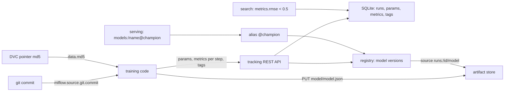

# An Experiment Is Parameters, Metrics and Artifacts With Lineage

*A run is immutable params, stepped metrics, files and tags naming its code and data: a better number without lineage proves nothing.*

## Metadata

| Field | Value |
|---|---|
| Type | Build |
| Languages | Python |
| Prerequisites | [A Dataset Version Is a Content-Addressed Snapshot](https://cloudcaptain.io/learn/mlops/data-versioning) |
| Time | 90 minutes |
| Tools | mlflow, sqlite, git, docker |

<Quiz stage="pre" />

## The Problem

The pricing team's house-price model has served from a bucket path, `models/price/model_final_v3.json`, since spring. A data scientist retrains it on Monday with this week's listings and gets an RMSE of 0.124; the notebook that produced the current model said 0.110. Is the new model worse? Nobody can tell. The 0.110 came from a learning rate someone typed into a cell and later changed, on the listings export from some week in April that has since been overwritten, with code from a branch that was squashed. The number survives in a slide; the conditions that produced it do not.

The comparison itself is broken too. The team keeps a spreadsheet of results: one row per training run, a column per hyperparameter, the final RMSE. A row was edited when someone "fixed" a learning rate after the fact. The spreadsheet holds only final values, so the run that diverged at epoch 12 and recovered by luck looks as good as the one that converged smoothly. And two rows with RMSE 0.12 and 0.11 were evaluated on different validation splits, because the export grew from 400 to 800 listings between them.

Then the new model goes out by overwriting the bucket path, the error rate on expensive houses doubles, and rolling back means finding the old file in someone's downloads folder. Every one of these failures has the same fix: record each training run as data the moment it happens (its parameters, its metric curve, its output files, the commit and the data version it used) in a store that refuses to rewrite history, and deploy by a named pointer into that store instead of by file path. That store is an experiment tracker. In this lesson you build one, `minitrack`, that speaks the REST API of MLflow so closely that the official `mlflow` client cannot tell it apart from a real MLflow server.

## The Concept

An **experiment** is a namespace for runs that answer one question, such as "predict house prices". A **run** is one execution of training code, and it has exactly four kinds of data, each with different rules:

- **Parameters** are the inputs you chose: learning rate, epochs, feature list. They are strings, written once. Logging the same key with a different value is an error, because a run whose inputs changed after the fact is two runs pretending to be one.
- **Metrics** are measurements over time: a key, a float, a timestamp and a step (an epoch, a batch). They append; the whole curve is kept. Searches and summaries use the **latest** value, which is the one with the highest step (then the latest timestamp).
- **Tags** are mutable metadata: the run's name, its parent run, the git commit, the data version, a review status. Lineage lives here, under well-known keys such as `mlflow.source.git.commit` and `mlflow.parentRunId`.
- **Artifacts** are files: the trained model, plots, a confusion matrix. They live in a blob store under the run's `artifact_uri`, not in the database.

**Lineage** turns a run from a number into evidence. The commit says which code ran; the data version (the md5 that DVC already recorded in a pointer file) says which data it saw; the parent run says which sweep it belongs to. Two runs are comparable only when their data versions match. A tracker that records lineage can answer "why did RMSE change?" with "the data changed", instead of starting an argument.

**Search** is a small query language over runs: `metrics.rmse < 0.5 and params.lr = '0.1'`, ordered by `metrics.rmse ASC`. Each side has a type. Metrics compare as numbers against the latest value; params and tags are strings, so `params.lr > '0.05'` is refused rather than silently comparing text. Runs that lack the key never match, and in ordering they always sort last.

The **model registry** sits on top: a registered model has numbered **versions**, each created from a run's artifact (`runs:/<run-id>/model`), and **aliases** such as `@champion`, which are named pointers to one version each. Serving loads `models:/house-prices@champion`; promotion and rollback move the pointer, and the version keeps its run, so production can always be traced back to parameters, curve, commit and data.

None of this needs a special server. The tracking server is a REST API over a database (runs, params, metrics, tags, registry) and a blob store (artifacts). The client does the work: it creates runs, batches metrics, uploads files over HTTP and resolves model URIs.



The rules are what make the record trustworthy: params cannot be rewritten, metrics keep their history, artifacts are addressed by run, and deployments name an alias that points at a version that points at a run.

## Build It

`code/main.py` is `minitrack`: a tracking server (`server`), a seeded dataset generator (`make-data`), a training sweep that logs with lineage (`train`), a run comparison (`compare`) and a model URI resolver (`resolve`). It uses only the standard library: `sqlite3` for the backend store, `http.server` for the API, `urllib` for its own client. The tests start the server on a real local socket and drive it over HTTP.

### Step 1: the backend store is a handful of tables

One table per entity, keyed much as MLflow's SQL store keys them. Params have a primary key on `(run_id, key)`, so a second value cannot sneak in; metrics keep every point; `latest_metrics` caches the value searches use:

```sql
CREATE TABLE IF NOT EXISTS params (run_id TEXT, key TEXT, value TEXT, PRIMARY KEY (run_id, key));
CREATE TABLE IF NOT EXISTS tags (run_id TEXT, key TEXT, value TEXT, PRIMARY KEY (run_id, key));
CREATE TABLE IF NOT EXISTS metrics (run_id TEXT, key TEXT, value REAL, timestamp INTEGER, step INTEGER, is_nan INTEGER, PRIMARY KEY (run_id, key, timestamp, step, value, is_nan));
CREATE TABLE IF NOT EXISTS latest_metrics (run_id TEXT, key TEXT, value REAL, timestamp INTEGER, step INTEGER, is_nan INTEGER, PRIMARY KEY (run_id, key));
```

The store creates experiment `0`, `Default`, on first start, as MLflow does, so the first experiment you create gets id `1`. A run's artifact location is derived from its experiment's:

```python
artifact_uri = f"{experiment['artifact_location'].rstrip('/')}/{run_id}/artifacts"
```

### Step 2: params are written once, metrics append, tags overwrite

Every write path, the single `log-parameter`, `log-metric` and `set-tag` endpoints included, goes through `log_batch()` inside one SQLite transaction. Re-logging the same param value is allowed (clients retry); a different value is the error MLflow returns, word for word:

```python
existing = self.db.execute("SELECT value FROM params WHERE run_id = ? AND key = ?", (run_id, key)).fetchone()
if existing is not None and existing["value"] != value:
    raise invalid(f"Changing param values is not allowed. Param with key='{key}' was already logged with value='{existing['value']}' for run ID='{run_id}'. Attempted logging new value '{value}'.")
```

Keys are validated before anything is written: names that could become paths (`../x`, `/abs`) are refused, because a tracker may store them as files.

### Step 3: the latest value is the highest step, not the last write

A metric point is inserted with `INSERT OR IGNORE` (an identical retry is a no-op), then compared with the cached latest value as a tuple, so step wins, then timestamp, then value:

```python
self.db.execute("INSERT OR IGNORE INTO metrics VALUES (?, ?, ?, ?, ?, ?)", (run_id, key, stored, timestamp, step, int(is_nan)))
latest = self.db.execute("SELECT step, timestamp, value FROM latest_metrics WHERE run_id = ? AND key = ?", (run_id, key)).fetchone()
if latest is None:
    self.db.execute("INSERT INTO latest_metrics VALUES (?, ?, ?, ?, ?, ?)", (run_id, key, stored, timestamp, step, int(is_nan)))
elif (step, timestamp, stored) > (latest["step"], latest["timestamp"], latest["value"]):
```

A worker that flushes epoch 2 after epoch 3 therefore does not move the run's RMSE backwards. The history endpoint returns every point ordered by timestamp, then step, the same order MLflow's SQL store uses.

### Step 4: a filter language with types

`parse_filter()` tokenizes `identifier comparator value`, joined only by `AND` (MLflow refuses `OR`). Identifiers take a prefix (`metrics.`, `params.`, `tags.`, `attributes.` and their singular forms) or none, which means an attribute such as `run_name`; backticks quote keys with dots, as in `` tags.`data.md5` ``. The type decides what is legal:

```python
numeric = kind == "metric" or (kind == "attribute" and key in numeric_attributes)
if kind == "attribute" and key not in numeric_attributes and key not in string_attributes:
    raise invalid(f"Invalid attribute key '{key}' specified. Valid keys are {sorted(list(numeric_attributes) + list(string_attributes))}")
if numeric:
    if op not in NUMERIC_OPS:
        raise invalid(f"Invalid comparator '{op}' not one of {list(NUMERIC_OPS)}")
    if number is None:
        raise invalid(f"Expected numeric value type for {kind}. Found {string!r}")
    return Clause(kind, key, op, float(number))
if op not in STRING_OPS:
    raise invalid(f"Invalid comparator '{op}' not one of {list(STRING_OPS)}")
```

`LIKE` and `ILIKE` become anchored regular expressions (`%` is `.*`, `_` is `.`); `LIKE` is case-sensitive, `ILIKE` is not. A run without the key never matches, not even `!=`.

### Step 5: order with nulls last, then page with offset tokens

`search_runs()` appends MLflow's tie-breakers to whatever the caller asked for: newest `start_time` first, then `run_id`. The comparator puts a missing value after every present one in both directions, so a parent run that has no `rmse` sorts last for `metrics.rmse ASC` and for `DESC`:

```python
def ordering(keys: List[OrderKey], value_of: Callable[[Any, OrderKey], Any]) -> Callable[[Any, Any], int]:
    def compare_rows(left: Any, right: Any) -> int:
        for key in keys:
            a, b = value_of(left, key), value_of(right, key)
            if a is None or b is None:
                if a is None and b is None:
                    continue
                return 1 if a is None else -1
            if a == b:
                continue
            result = -1 if a < b else 1
            return result if key.ascending else -result
        return 0
    return compare_rows
```

Params sort as strings (`'2.5'` after `'0.3'`), metrics as floats. Results come back in pages of `max_results` with a `next_page_token` that is base64 of `{"offset": n}`, which is exactly what MLflow sends; clients must treat it as opaque.

### Step 6: artifacts go through the server

MLflow's server can proxy artifacts: a run's `artifact_uri` is `mlflow-artifacts:/1/<run-id>/artifacts`, and the client turns it into `PUT` and `GET` on `/api/2.0/mlflow-artifacts/artifacts/<path>`, plus `GET ...?path=<dir>` to list a directory. minitrack stores the bytes under its artifact root and refuses any path that would leave it, encoded dot segments included:

```python
def artifact_path(self, relative: str) -> Path:
    clean = urllib.parse.unquote(relative).strip("/")
    parts = [p for p in clean.split("/") if p not in ("", ".")]
    if any(p == ".." for p in parts) or "\\" in clean or "\0" in clean:
        raise invalid(f"Invalid artifact path: '{relative}'")
```

Uploads land in a `.part` file and are renamed into place, so a listing never shows a half-written model.

### Step 7: the registry is versions plus pointers

A model version is created from a source; the source must belong to the run it claims, so nobody registers `/etc/passwd` or another run's files under your run's name:

```python
if parsed.scheme == "runs":
    source_run = parsed.path.lstrip("/").split("/", 1)[0]
    if parsed.netloc or not source_run or (run_id and source_run != run_id):
        raise invalid(f"Invalid model version source: '{source}'. The run ID in the source must match the run_id request parameter.")
```

An alias is a row `(name, alias, version)`. Setting it again moves it, which is promotion and rollback in one statement. Two names are reserved because model URIs already give them a meaning:

```python
if not alias or alias.lower() == "latest" or re.fullmatch(r"[vV]\d+", alias):
    raise invalid(f"Invalid alias name: '{alias}'. Aliases cannot be 'latest' or look like a version ('v1'), because models:/{name}/latest and models:/{name}/1 already mean something.")
```

A lookup of a missing alias returns `INVALID_PARAMETER_VALUE`, and a missing version `RESOURCE_DOES_NOT_EXIST` with HTTP 404: the same codes as MLflow, which the client turns into the same exceptions.

### Step 8: the HTTP surface is a routing table

Each endpoint is one line that maps a method and path under `/api/2.0/mlflow/` to a store call. GET requests carry their arguments in the query string (repeated keys become lists), POST and DELETE in a JSON body:

```python
("POST", "runs/log-batch"): lambda s, r: s.log_batch(run_id_of(r), r.get("metrics") or [], r.get("params") or [], r.get("tags") or []) or {},
("POST", "logged-models/search"): lambda s, r: {},
("GET", "registered-models/alias"): lambda s, r: {"model_version": s.get_model_version_by_alias(*need(r, "name", "alias"))},
```

The `logged-models/search` route is there because MLflow 3's client asks whether `model` in `runs:/<id>/model` names a logged model before it registers a version; minitrack has none and says so. Every request that matches no route is answered with `ENDPOINT_NOT_FOUND` and logged:

```python
sys.stderr.write(f"minitrack: no route for {method} {parsed.path}\n")
```

That log line is how this subset was found: point the official client at minitrack, run a session, and implement whatever it asks for. Errors are JSON `{"error_code": ..., "message": ...}` with MLflow's HTTP statuses.

### Step 9: lineage is recorded, not remembered

Before training, `train` collects tags that name the code and the data. The commit and whether the tree had uncommitted changes come from git through an injectable runner, so the tests need no repository:

```python
def git_lineage(directory: Path, runner: Runner = run_command) -> Dict[str, str]:
    code, commit = runner(["git", "-C", str(directory), "rev-parse", "HEAD"])
    if code != 0 or not re.fullmatch(r"[0-9a-f]{40}|[0-9a-f]{64}", commit):
        return {}
    code, status = runner(["git", "-C", str(directory), "status", "--porcelain", "--untracked-files=no"])
    return {TAG_GIT_COMMIT: commit, TAG_GIT_DIRTY: "true" if code != 0 or status else "false"}
```

The data version is the md5 of the file, the same number DVC writes into `houses.csv.dvc`. When a pointer exists and the file no longer matches it, training stops: logging a run against data nobody can check out again would record a lie.

```python
recorded = read_dvc_pointer(pointer)["md5"]
if recorded != actual:
    raise ValueError(f"{data} (md5 {actual}) does not match its pointer {pointer.name} (md5 {recorded}); run `dvc add {data.name}` and commit the pointer before training")
```

### Step 10: a real, reproducible training loop

The model is a linear regression on three standardized features, trained by batch gradient descent in pure Python on a seeded dataset, so every metric is real and every rerun gives the same floats. Each epoch logs the validation RMSE at its step:

```python
errors = [result.bias + sum(w * x for w, x in zip(result.weights, row)) - y for row, y in zip(xs, ys)]
gradients = [sum(e * row[j] for e, row in zip(errors, xs)) / len(xs) for j in range(len(FEATURES))]
result.weights = [w - lr * g for w, g in zip(result.weights, gradients)]
result.bias -= lr * sum(errors) / len(errors)
rmse = regression_metrics(result.model(), valid)["rmse"]
if not math.isfinite(rmse) or rmse > 1e6:
```

A sweep creates a parent run and one nested run per learning rate (tagged `mlflow.parentRunId`), sends each run's curve in one `log-batch`, uploads `model/model.json`, and marks a diverged run `FAILED` instead of hiding it. `compare` groups runs by `(data.md5, commit)` and picks a best run per group only, with a warning when groups differ.

### Step 11: run it

```bash
python3 code/main.py server --port 5005 &
python3 code/main.py make-data --rows 400 --seed 7 --out houses.csv
python3 code/main.py make-data --rows 800 --seed 11 --out houses-v2.csv
python3 code/main.py train --data houses.csv --lr 0.01 --lr 0.1 --lr 0.3 --lr 2.5 --register house-prices --alias champion
# lr-0.01          FINISHED  rmse 2.3036  run 97e8c31b...
# lr-0.1           FINISHED  rmse 0.1451  run 00f02494...
# lr-0.3           FINISHED  rmse 0.1233  run dcd5253d...
# lr-2.5           FAILED    rmse -  run c2ebc14d...
# best: lr-0.3 (rmse 0.1233)
# registered house-prices version 1 as @champion
python3 code/main.py train --data houses-v2.csv --lr 0.3 --sweep-name v2
python3 code/main.py compare
```

```text
run        lr    rows  rmse         mae     r2       train_rmse  data      commit    parent
v2-lr-0.3  0.3   800   0.1165       0.0904  0.9831   0.1136      197c1d13  e5dc8ebd  v2
lr-0.3     0.3   400   0.1233       0.1001  0.9801   0.1132      925e0572  e5dc8ebd  sweep
lr-0.1     0.1   400   0.1451       0.1124  0.9724   0.1667      925e0572  e5dc8ebd  sweep
lr-0.01    0.01  400   2.3036       2.2175  -5.9497  2.1666      925e0572  e5dc8ebd  sweep
lr-2.5     2.5   400   562103.2021  -       -        -           925e0572  e5dc8ebd  sweep
best by rmse for data 197c1d13 @ e5dc8ebd: v2-lr-0.3 (0.1165)
best by rmse for data 925e0572 @ e5dc8ebd: lr-0.3 (0.1233)
warning: runs were trained on different data versions (data.md5); compare metrics only inside one group
```

The v2 run looks best, but it was scored on a different validation set; `compare` refuses to rank it against the others. Then resolve the alias the way a model server would:

```bash
python3 code/main.py resolve models:/house-prices@champion --predict area_m2=95 rooms=3 age_years=20
# models:/house-prices@champion -> house-prices version 1 (aliases champion)
# source runs:/dcd5253d.../model from run dcd5253d...
#   model/model.json  sha256:2d24113d6cc18f17...
# prediction 2.7044 (price_100k)
```

Exit codes: 0 for success, 1 when the server refuses a request or the data does not match its pointer, 2 for bad input (a missing file, a malformed model URI).

<RunTests />

## Use It

**Run MLflow.** The server is a Python process over a backend store (SQLite here; PostgreSQL or MySQL in production) and an artifact destination it proxies (a directory here; S3, GCS or Azure Blob in production). The project publishes images on GHCR:

```bash
docker run -d --name mlflow -p 127.0.0.1:5000:5000 ghcr.io/mlflow/mlflow:v3.17.2 \
  mlflow server --host 0.0.0.0 --port 5000 --workers 1 \
  --backend-store-uri sqlite:////tmp/mlflow.db --artifacts-destination /tmp/mlflow-artifacts
curl -s 127.0.0.1:5000/version     # 3.17.2
python3 -m venv venv && venv/bin/pip install 'mlflow-skinny==3.17.2'
```

`mlflow-skinny` is the client without the server, the UI or the ML flavors; `code/requirements-mlflow.txt` pins it and its whole dependency tree with hashes, which is how the smoke installs it.

**Log a run.** The fluent API keeps an active run per thread; `MlflowClient` is the explicit API underneath it. Every call below is one of the REST requests minitrack implements:

```python
import mlflow
from mlflow import MlflowClient

mlflow.set_tracking_uri("http://127.0.0.1:5000")
mlflow.set_experiment("house-prices")
with mlflow.start_run(run_name="sweep"):
    mlflow.set_tags({"mlflow.source.git.commit": commit, "data.md5": data_md5})
    with mlflow.start_run(run_name="lr-0.3", nested=True) as run:
        mlflow.log_param("lr", "0.3")
        for epoch, rmse in enumerate(history):
            mlflow.log_metric("rmse", rmse, step=epoch)
        mlflow.log_artifact("model.json", artifact_path="model")

client = MlflowClient()
best = client.search_runs([run.info.experiment_id], "metrics.rmse < 0.5 and params.lr = '0.3'", order_by=["metrics.rmse ASC"])
history = client.get_metric_history(best[0].info.run_id, "rmse")
```

`mlflow.log_metric` in a loop sends one HTTP request per point; `client.log_batch` or `mlflow.log_metrics` sends up to 1,000 at once, and `MLFLOW_ENABLE_ASYNC_LOGGING=true` queues them in a background thread. In a real training script `mlflow.autolog()` logs parameters, per-epoch metrics and the model for scikit-learn, PyTorch Lightning, XGBoost and others, and MLflow fills `mlflow.source.git.commit` itself when the script runs from a git checkout.

**Register, alias, load.** Aliases arrived in MLflow 2.3, and the fixed stages (`Staging`, `Production`, `Archived`) were deprecated in 2.9. Stages were a closed list with transition rules baked into the registry; aliases are any names you choose, each points to exactly one version, several can point to the same one, and moving one is a single call:

```python
mv = client.create_model_version("house-prices", f"runs:/{run_id}/model", run_id=run_id)
client.set_registered_model_alias("house-prices", "champion", mv.version)
client.get_model_version_by_alias("house-prices", "champion").version
path = mlflow.artifacts.download_artifacts("models:/house-prices@champion")
client.set_registered_model_alias("house-prices", "champion", "1")
```

With the full `mlflow` package and a model logged through a flavor (`mlflow.sklearn.log_model(model, name="model")`), `mlflow.pyfunc.load_model("models:/house-prices@champion")` returns a callable model, and `mlflow models serve -m models:/house-prices@champion` serves it over HTTP. In MLflow 3 those flavor calls create a **LoggedModel** (`models:/m-<id>`), a first-class entity with its own params and metrics that can outlive a run; that is why the client probes `logged-models/search` before registering a `runs:/` source. The smoke for this lesson replays one scripted session (experiments, 6 runs, 141 metric points, 11 searches, paging, 15 error codes, artifact listings and downloads, two versions, two aliases, a rollback) through the official client against minitrack and against the pinned MLflow server, and requires identical results after replacing IDs with run names. It then runs minitrack's own `train`, `compare` and `resolve` against both servers.

**Hosted trackers.** Weights & Biases and Neptune keep the same entities with different mechanics. Their clients buffer metrics locally and stream them to a hosted backend from a background process, so a crashed or offline job uploads later (`wandb sync`); runs carry config (params), a history of logged rows keyed by step (metrics), files and artifacts, and both record the git commit by default (W&B also saves a patch of uncommitted changes). W&B Artifacts version datasets and models by content digest with lineage edges between runs that produce and consume them, and its registry links artifact versions to collections with aliases, the same pointer idea as MLflow's. Databricks, SageMaker and Azure ML host MLflow-compatible tracking servers, so code written against the MLflow client moves between them by changing the tracking URI.

| What you built | Real tool | Note |
|---|---|---|
| `Store` on `sqlite3` | MLflow `SqlAlchemyStore` (SQLite, PostgreSQL, MySQL) | same tables in spirit; MLflow migrates its schema with Alembic |
| `log_batch()`, param immutability | `runs/log-batch`, `MlflowClient.log_batch` | identical error text and codes |
| `latest_metrics` tuple rule | MLflow's latest metric (max step, then timestamp) | searches compare the latest value |
| `parse_filter()`, `ordering()` | `search_runs` filter and `order_by` | MLflow also supports `IN`, `IS NULL` and dataset filters |
| offset `next_page_token` | the same base64 `{"offset": n}` | opaque to clients |
| `mlflow-artifacts` proxy | `mlflow server --artifacts-destination` | MLflow also offers multipart uploads to S3 |
| model versions, aliases | MLflow Model Registry | stages are deprecated; aliases replace them |
| `git_lineage()`, `data_lineage()` | MLflow source tags, `mlflow.log_input` datasets, DVC | `mlflow.data` records dataset digests too |
| `compare` lineage groups | the MLflow UI's compare view, W&B reports | neither refuses to rank across data versions for you |
| `resolve models:/name@alias` | `mlflow.artifacts.download_artifacts`, `mlflow.pyfunc.load_model` | pyfunc adds environment and signature handling |

<Quiz stage="check" />

## Ship It

Two artifacts in `outputs/`:

- **`skill-experiment-hygiene.md`**: a runbook for making a team's training runs trustworthy: the tags every run must carry (commit, dirty flag, data version, parent), param and metric naming, logging curves with steps, refusing stale data, registering from a run, promoting and rolling back with aliases, and an audit that searches a tracking server for runs that break the rules. It ends with a decision table and a fixed report.
- **`prompt-compare-runs.md`**: paste `minitrack compare --json` output or an MLflow `search_runs` export and get a comparison that groups runs by data version and commit, separates real improvements from noise and divergence, and names the run to promote and the evidence still missing.

<ShipIt />

## Exercises

### Easy

Add the two comparators MLflow has and minitrack lacks: `attributes.run_id IN ('a1...', 'b2...')`, with a parenthesized list of quoted strings, and `tags.failure IS NULL` / `IS NOT NULL` for params and tags, which take no value and match on the key's absence or presence. Write the tests first, including `metrics.rmse IN (1, 2)` and `params.lr IN ('0.1')`, which must be refused, and a run without the tag matching `IS NULL` even though it never matches `!=`.

### Medium

Add run deletion with a retention window. `runs/delete` sets `lifecycle_stage` to `deleted` (so `search_runs` hides it unless `run_view_type` is `DELETED_ONLY` or `ALL`), `runs/restore` undoes it, and a `gc --older-than DAYS` subcommand removes deleted runs, their metrics and their artifacts for good, refusing to touch any run that a model version still references. Tests first: a deleted run disappears from default searches, reappears with `ALL`, and a run behind `@champion` survives `gc`.

### Hard

Make minitrack serve two clients that log to the same run concurrently, as distributed training workers do. Replace the single connection and lock with a connection per request, use `BEGIN IMMEDIATE` with retries on `SQLITE_BUSY`, and keep `latest_metrics` correct under interleaving. Prove it with a test that starts the server, runs eight threads that each log 500 points with interleaved steps and timestamps, and asserts that the history has all 4,000 points and the latest value is the one with the highest step.

<Quiz stage="post" />

## Key Terms

| Term | Common misconception | Precise definition |
|---|---|---|
| Run | "A row in a results spreadsheet." | One execution of training code with immutable params, a time series per metric, mutable tags and an artifact location, plus status and start and end times. |
| Parameter | "Any value you want to remember." | A string input written once per run; logging a different value for the same key is refused, because it would change what the run claims it did. |
| Metric step | "Just the order in which values were logged." | An integer position (epoch, batch) that orders a metric's history; the run's reported value is the point with the highest step, then the latest timestamp. |
| Lineage | "The run's name and a description." | Tags that identify inputs exactly: the git commit and dirty flag for code, the data version (md5 from a DVC pointer) for data, and the parent run for sweeps. |
| Artifact URI | "A path on the training machine." | The run's location in the artifact store, such as `mlflow-artifacts:/1/<run-id>/artifacts`, which clients upload to and download from through the server. |
| Registered model version | "A copy of the model file." | A numbered registry entry that points at a run's artifact (`runs:/<id>/model`) and keeps that run as its provenance. |
| Alias | "Another word for a stage like Production." | A mutable named pointer from a registered model to exactly one version; `models:/name@alias` resolves through it, and moving it is promotion or rollback. |
| Search filter | "SQL on the tracking database." | A typed `AND`-only expression over metrics (numbers, latest value), params and tags (strings) and run attributes; runs missing a key never match it and sort last. |

## Further Reading

- [AI/ML Ops learning path](https://cloudcaptain.io/docs/learning-paths/ai-ml): where experiment tracking sits between data versioning, pipelines and serving.
- [Python for DevOps scripting](https://cloudcaptain.io/docs/tools/python/devops-scripting): the standard-library HTTP, subprocess and JSON patterns minitrack is built from.
- [Git fundamentals](https://cloudcaptain.io/docs/tools/git/fundamentals): commits and working-tree state, the code half of a run's lineage.
- [MLflow Tracking](https://mlflow.org/docs/latest/ml/tracking/): experiments, runs, params, metrics, artifacts and the server architectures (local, proxied artifacts, remote).
- [MLflow REST API](https://mlflow.org/docs/latest/api_reference/rest-api.html): every endpoint minitrack implements, with request and response fields.
- [MLflow search syntax](https://mlflow.org/docs/latest/ml/search/search-runs/): the filter grammar, identifier prefixes, quoting and ordering rules.
- [MLflow Model Registry](https://mlflow.org/docs/latest/ml/model-registry/): versions, aliases, tags and why stages were deprecated.
- [DVC .dvc files](https://doc.dvc.org/user-guide/project-structure/dvc-files): the pointer format whose md5 minitrack records as the data version.
- [Weights & Biases experiment tracking](https://docs.coreweave.com/products/wandb/track): the hosted model of the same entities, with offline sync and artifact lineage.
