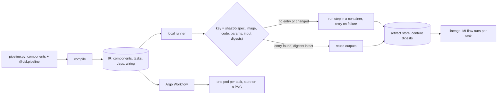

# An ML Pipeline Is a Cached DAG of Containers

*A pipeline is a DAG of containerised steps; a step reruns only when its code, image, parameters or input data hashes change.*

## Metadata

| Field | Value |
|---|---|
| Type | Build |
| Languages | Python |
| Prerequisites | [An Experiment Is Parameters, Metrics and Artifacts With Lineage](https://cloudcaptain.io/learn/mlops/experiment-tracking), [A Pipeline Is a Graph of Jobs in Clean Rooms](https://cloudcaptain.io/learn/cicd/pipeline-runner) |
| Time | 90 minutes |
| Tools | kfp, Argo Workflows, kubectl, kind, docker |

<Quiz stage="pre" />

## The Problem

The pricing team's model is retrained by `retrain.sh`, a cron job on a GPU box: pull six months of transactions (two hours), build features (one hour), train (forty minutes), evaluate, and copy `model.pkl` to the serving bucket if the error is low enough. In March a data scientist raises the evaluation threshold from 0.50 to 0.55. The change is one line in the last step, and the next night the whole script runs again: three hours of extraction and feature building for data that has not changed. In April the training step dies at minute 35 on a preempted node, and the retry is the whole script, so the model is a day late.

In May it goes the other way. To save time, someone adds `if [ -f features.parquet ]; then skip; fi`. A month later the feature code changes (a new holiday calendar), but `features.parquet` from the old code is still on the box, so the script skips the step, trains on old features and ships a model that underprices the Easter weekend. The postmortem asks two questions nobody can answer from the box: which code produced the features the model was trained on, and which dataset produced the model that is serving now.

Both failures come from the same gap: the script knows the order of its steps but not what each step depends on. A pipeline engine fixes that by making the dependencies explicit. Each step is a component with typed inputs and outputs that runs in its own container; the pipeline is a DAG built from which output feeds which input; and every step is fingerprinted from its code, image, parameters and the content digests of its input data. Same fingerprint, reuse the outputs; different fingerprint, run it; and record every run so lineage is a query, not an archaeology project. You are going to build `minipipe`, which compiles a Python pipeline to the same intermediate representation as the Kubeflow Pipelines SDK, runs it locally with a content-addressed step cache, retries, a condition and a fan-out, records lineage to an MLflow-compatible tracking server such as minitrack, and emits an Argo Workflows manifest. Then you compile the same file with `kfp` and run minipipe's Workflow on kind.

## The Concept

A build system already solves this for code. `make` rebuilds a target when an input is newer than the output; Bazel and Nix rebuild it when a hash of the inputs and the build command changes, which survives copied files, clock skew and checked-out branches. An ML pipeline is a build system whose targets are datasets, models and metrics, and whose build steps run for hours, so the hash version is the one worth having.

Four ideas carry the whole lesson:

- **A component is a function with a typed interface and an image.** Parameters are small values (`int`, `float`, `str`, `bool`); artifacts are files or directories (`Dataset`, `Model`, `Metrics`) passed by reference. The function's source travels with the component, so the step can run in any container that has a Python interpreter.
- **The DAG comes from data flow.** Calling a component inside a `@dsl.pipeline` function does not run it; it records a task. Passing one task's output to another creates an edge. The compiler turns the call graph into an **intermediate representation (IR)**: component specs, tasks, dependencies and the wiring of every input. A condition (`dsl.If`) and a fan-out (`dsl.ParallelFor`) become sub-DAGs with a trigger condition or an item list. The IR is the contract with the backend: Kubeflow Pipelines, a local runner, or a translation to Argo Workflows.
- **A step's fingerprint is its cache key.** Hash the component's interface, the container (image, command with the function source, arguments), the input parameter values and the content digests of the input artifacts. If an earlier execution has the same key and its outputs are still intact, reuse them. A changed parameter changes one key; the new output digest then changes the keys of everything downstream, and nothing else.
- **Lineage is a by-product.** Every execution records which artifact digests went in and came out. Sent to an experiment tracker, that answers "which data produced this model" for every run, including the ones that were cache hits.



Three details decide whether the cache can be trusted. The step must be deterministic: seeded randomness, no clock, no network reads that are not inputs, or two runs with the same key produce different outputs and the cache silently returns the first one. The image must be pinned, because a tag that moves does not change the key. And a hit must check that the stored outputs are still the bytes the step produced, because object stores have lifecycle rules and people have shells.

## Build It

`code/main.py` is `minipipe`, one standard-library file with five subcommands: `compile`, `dag`, `run`, `argo` and `explain`. `code/pipeline.py` is the lesson's pipeline (`house-prices`: make a dataset, train a linear model with gradient descent, evaluate it, register it if the test RMSE is below a threshold, and score three slices of the test set in parallel). It imports `from minipipe import dsl`; `code/kfp_compile.py` compiles the same file with the real SDK by aliasing that import to `kfp.dsl`.

### Step 1: a component is a function, its interface and its source

`Component` reads the function's signature. Annotations decide what each argument is: `dsl.Input[dsl.Dataset]` and `dsl.Output[dsl.Model]` are artifacts, `int`, `float`, `str` and `bool` are parameters, and the return annotation becomes an output parameter named `Output`, as in KFP:

```python
        for pname, parameter in signature.parameters.items():
            annotation = resolved_annotation(func, parameter.annotation)
            if isinstance(annotation, ArtifactAnnotation):
                target = self.input_artifacts if annotation.direction == "input" else self.output_artifacts
                target[pname] = annotation.cls.schema_title
                continue
            default = MISSING if parameter.default is inspect.Parameter.empty else parameter.default
            self.parameters[pname] = ParamSpec(pname, parameter_type(annotation, f"{func.__name__}({pname})"), default)
```

The executor of a component is a container spec: the base image, a command that starts a small standard-library bootstrap with the function's source as its argument, and KFP's argument shape, where `{{$}}` stands for the executor input the runner fills in:

```python
    def container(self) -> Dict[str, Any]:
        return {
            "image": self.base_image,
            "command": ["python3", "-c", BOOTSTRAP, self.source],
            "args": ["--executor_input", "{{$}}", "--function_to_execute", self.python_func.__name__],
        }
```

Because the source is part of the container spec, editing the function body changes the cache key. KFP does the same: a lightweight component's command embeds its source.

### Step 2: calling a component inside a pipeline records a task

`compile_pipeline()` calls the pipeline function with one `Channel` per pipeline parameter. A component call returns a `PipelineTask` whose `.outputs` are channels too, so `train_model(train_data=data.outputs["train_data"], ...)` stores a reference to `make-dataset`'s output, not a value. The checks a compiler can do happen here: a missing argument, an unknown one, an `int` parameter given a string, a parameter given an artifact, `.output` on a task with two outputs, and `if evaluation.output < 0.5:` in Python, which raises because the value does not exist until run time:

```python
    def __bool__(self) -> bool:
        raise PipelineError(f"{self.channel_name} has no value while the pipeline is compiled; branch with dsl.If(...), not with Python's if")
```

`wire()` turns each channel into the IR's input forms. A producer in the same DAG becomes `taskOutputArtifact` or `taskOutputParameter` plus a dependency; a value from outside a sub-DAG becomes a `pipelinechannel--...` input of that sub-DAG:

```python
    if producer.group is scope:
        deps.add(producer.name)
        if channel.is_artifact:
            return {"taskOutputArtifact": {"outputArtifactKey": channel.name, "producerTask": producer.name}}
        return {"taskOutputParameter": {"outputParameterKey": channel.name, "producerTask": producer.name}}
    if producer.group.kind == "root":
        needs[channel.channel_name] = channel
        return {("componentInputArtifact" if channel.is_artifact else "componentInputParameter"): channel.channel_name}
```

That is why `evaluate-model` depends on `make-dataset` and `train-model` without any `.after()`: it consumes their outputs. Task names follow KFP's rule: the function name with dashes, and `-2`, `-3` for the second and third call of the same component.

### Step 3: conditions and loops are sub-DAGs

`with dsl.If(evaluation.output < max_rmse, name="good-enough"):` and `with dsl.ParallelFor(items=["low", "mid", "high"], parallelism=2) as segment:` open groups. Each group compiles to a component with its own `dag` and `inputDefinitions`, and to a task in the parent that feeds those inputs. The condition becomes a CEL expression over the group's inputs, with KFP's casts: `int(...)` around integer channels, and `double(...)` when an integer is compared with a float:

```python
def condition_text(predicate: Predicate, group: Group, needs: Dict[str, Channel]) -> str:
    left, left_type = condition_operand(predicate.left, group, needs)
    right, right_type = condition_operand(predicate.right, group, needs)
    if left_type != right_type:
        if {left_type, right_type} != {"NUMBER_INTEGER", "NUMBER_DOUBLE"}:
            raise PipelineError(f"dsl.If compares {left_type} with {right_type}; compare values of the same type")
        left = f"double({left})" if left_type == "NUMBER_INTEGER" else left
        right = f"double({right})" if right_type == "NUMBER_INTEGER" else right
    return f"{left} {predicate.op} {right}"
```

Group ids come from one counter, so the condition is `condition-1`, the loop's item is `loop-item-param-2` and the loop is `for-loop-3`, exactly the numbers the KFP compiler produces. minipipe supports one level of groups and refuses to let a loop body's output leave the loop (KFP needs `dsl.Collected` for that fan-in).

### Step 4: the IR, and how it compares with KFP's

`minipipe compile code/pipeline.py -o ir.json` writes `components`, `deploymentSpec`, `pipelineInfo`, `root`, `schemaVersion` `2.1.0` and `sdkVersion`. The condition task in the root DAG, as minipipe writes it:

```json
"condition-1": {
  "componentRef": {"name": "comp-condition-1"},
  "dependentTasks": ["evaluate-model", "train-model"],
  "inputs": {
    "artifacts": {"pipelinechannel--train-model-model": {"taskOutputArtifact": {"outputArtifactKey": "model", "producerTask": "train-model"}}},
    "parameters": {
      "pipelinechannel--evaluate-model-Output": {"taskOutputParameter": {"outputParameterKey": "Output", "producerTask": "evaluate-model"}},
      "pipelinechannel--max_rmse": {"componentInputParameter": "max_rmse"}
    }
  },
  "taskInfo": {"name": "good-enough"},
  "triggerPolicy": {"condition": "inputs.parameter_values['pipelinechannel--evaluate-model-Output'] < inputs.parameter_values['pipelinechannel--max_rmse']"}
}
```

`code/fixtures/kfp-2.18.0/` holds what `kfp` 2.18.0 compiles for `code/pipeline.py` and for `code/fixtures/features_pipeline.py` (reused components, `.after()`, caching off, string and integer conditions, float and integer loops, a parallelism limit). The tests require minipipe's `components`, `root`, `pipelineInfo`, executor images and arguments to be equal to them; only the commands differ, because KFP's starts with `pip install kfp` and runs `kfp.dsl.executor_main`. `minipipe dag` prints the leaf tasks of either IR:

```text
condition-1/register-model  after [evaluate-model, train-model]  if inputs.parameter_values['pipelinechannel--evaluate-model-Output'] < inputs.parameter_values['pipelinechannel--max_rmse']
    model <- train-model.model
    name <- constant "house-prices"
    rmse <- evaluate-model.Output
    -> card
for-loop-3/score-slice  after [make-dataset, train-model]  for each of ["low", "mid", "high"]
```

### Step 5: the executor contract

The runner never imports your pipeline to run it; it reads the IR, exactly as a backend does. For each task it builds an **executor input** in KFP's shape and starts the container command with it:

```json
{
  "inputs": {
    "parameterValues": {"epochs": 300, "lr": 0.5},
    "artifacts": {"train_data": {"artifacts": [{"uri": "minipipe://artifacts/make-dataset/27aa345f14322d5e/train_data", "metadata": {"sha256": "a4572b..."}}]}}
  },
  "outputs": {
    "parameters": {"Output": {"outputFile": ".../parameters/Output"}},
    "artifacts": {"model": {"artifacts": [{"uri": "minipipe://artifacts/train-model/c41a5492ab4090cc/model"}]}},
    "outputFile": ".../executor_output.json"
  }
}
```

`BOOTSTRAP` is the program inside the container. It `exec`s the function source with a small `dsl` namespace (so the annotations evaluate without minipipe or kfp installed), maps `minipipe://` URIs to paths under `$MINIPIPE_STORE`, coerces parameters to the annotated types, calls the function, and writes the return value and a sha256 of every output artifact (directories are hashed over their sorted relative paths and file digests):

```python
    for key, artifact in produced.items():
        if not os.path.exists(artifact.path):
            raise SystemExit(name + ": output artifact " + key + " was not written to " + artifact.path)
        sha = digest(artifact.path)
        report["artifacts"][key] = {"artifacts": [{"uri": artifact.uri, "metadata": dict(artifact.metadata, sha256=sha)}]}
```

`--runner subprocess` (the default) runs that command with the local interpreter; `--runner docker` runs it in the component's image with `docker run --rm --network=none --user UID:GID`, the store mounted at the same path and each container named after `--container-prefix`, the run id, the task and the attempt. The runner recomputes every digest on the host and refuses an output whose bytes do not match what the container reported.

### Step 6: the cache key and the cache check

`run_leaf()` collects the ingredients, hashes their canonical JSON (sorted keys, no whitespace), and looks up the key. A found entry is only a hit if `Store.verify()` finds every output artifact with its recorded digest:

```python
        ingredients = {
            "component": {k: comp.get(k) for k in ("inputDefinitions", "outputDefinitions")},
            "container": executor,
            "parameters": params,
            "artifacts": {k: v["sha256"] for k, v in refs.items()},
        }
        key = sha256_text(canonical(ingredients))
```

```python
            entry = self.store.lookup(key)
            problem = "no cache entry for this key" if entry is None else self.store.verify(entry)
            if problem is None and entry is not None:
                run.status, run.reason = "cached", f"cache hit from run {entry['run_id']}"
```

Parameters are coerced to their declared types before hashing, so `200` from minipipe's IR and `200.0` from KFP's (protobuf stores numbers as doubles) produce the same key. Output URIs contain the first 16 hex digits of the key (`minipipe://artifacts/train-model/c41a5492ab4090cc/model`), so two executions with different inputs never overwrite each other. Input artifacts enter the key by content digest, not by URI: a dataset rebuilt byte for byte by a different run is still a hit downstream. KFP's automatic key covers the same ingredients (inputs, base image, command, arguments) and lets you replace them with `set_caching_options(True, cache_key=...)`; `set_caching_options(False)` turns caching off for a task, and minipipe honours both that and `--no-cache` for a whole run.

### Step 7: scheduling, groups, retries

`run_dag()` is the scheduler: start every task whose `dependentTasks` are done, wait for the first to finish, repeat. A task whose dependency failed is marked `upstream-failed` and never starts, and independent branches keep going:

```python
                for name in sorted(pending):
                    deps = pending[name].get("dependentTasks", [])
                    if not all(d in done for d in deps):
                        continue
                    spec = pending.pop(name)
                    blocked = [d for d in deps if done[d].status in ("failed", "upstream-failed")]
```

A group task evaluates its `triggerPolicy.condition` with `evaluate_condition()` (comparisons, `int()`, `double()`, quoted strings, `&&` and `||`) and either marks its tasks `skipped` or runs its sub-DAG; a loop runs one sub-DAG per item with at most `parallelismLimit` iterations at a time. Process slots are a semaphore of size `--parallelism`, so a wide fan-out cannot start more processes than you allow. `retryPolicy` is honoured as KFP defines it: `maxRetryCount` extra attempts, `backoffDuration` growing by `backoffFactor`, and `backoffMaxDuration` as the total window after which no further attempt starts.

### Step 8: lineage to an MLflow-compatible tracker

With `--tracking-uri URL` (or `MLFLOW_TRACKING_URI`), `Tracker` speaks MLflow's REST API, which is also what minitrack from the experiment-tracking lesson serves: `experiments/get-by-name` or `experiments/create`, a parent run per pipeline run, and a child run per task (cache hits included, so lineage costs no compute) with `mlflow.parentRunId`, the cache key, and every input and output digest as tags; numeric outputs become metrics:

```python
            for name, sha in run.ingredients.get("artifacts", {}).items():
                tags[f"minipipe.input.{name}"] = f"sha256:{sha}"
            for name, artifact in run.artifacts.items():
                tags[f"minipipe.output.{name}"] = f"{artifact['uri']} sha256:{artifact['sha256']}"
```

The integration is optional. When the server cannot be reached, the first failure prints `lineage: tracking server ... is not usable (...); continuing without lineage` and the pipeline runs on.

### Step 9: the same IR as an Argo Workflow

`minipipe argo ir.json --service-account minipipe` translates the IR into one `Workflow`. Each leaf task becomes a container template that runs the same bootstrap with the executor input written as Argo template expressions; each group becomes a DAG template; dependencies, `when`, `withItems` and `retryStrategy` are Argo's own fields:

| IR | Argo Workflows |
|---|---|
| `root.dag.tasks`, `dependentTasks` | the `root` DAG template, `dependencies` |
| `componentInputParameter` at the root | `{{workflow.parameters.NAME}}` |
| `taskOutputParameter` | `{{tasks.TASK.outputs.parameters.Output}}` |
| `taskOutputArtifact` | `{{tasks.TASK.outputs.parameters.NAME-uri}}`: a reference into the store |
| `triggerPolicy.condition` | `when: "{{tasks.evaluate-model.outputs.parameters.Output}} < {{workflow.parameters.max_rmse}}"` |
| `parameterIterator` with `parallelismLimit: 2` | a `for-loop-3-fanout` DAG template with `parallelism: 2` and one task with `withItems` |
| `retryPolicy` | `retryStrategy` with `limit`, `retryPolicy: OnFailure` and `backoff` |
| the artifact store | a `volumeClaimTemplates` PVC mounted at `/minipipe/store` in every step |

Artifacts are not copied through Argo: each step writes its outputs to the PVC and reports `NAME-uri` and `NAME-sha256` as Argo output parameters read from files (`valueFrom.path`), so the next step receives a reference and a digest, the same way KFP passes artifact URIs. Argo's own artifact passing would need an artifact repository; the Use It section shows that alternative.

### Step 10: run it

```bash
python3 code/main.py compile code/pipeline.py -o /tmp/ir.json
python3 code/main.py dag /tmp/ir.json
python3 code/main.py run /tmp/ir.json --store /tmp/mp
# run 20261111T120058-4b4e3c  pipeline house-prices  runner subprocess  status succeeded
# task                               status          tries  key           outputs
# make-dataset                       executed            1  27aa345f1432  test_data=sha256:daa02406f021 train_data=sha256:a4572b2afd3a
# train-model                        executed            1  c41a5492ab40  Output=0.285966 model=sha256:599a0ff7a52e
# evaluate-model                     executed            1  22311477e720  Output=0.317348
# ...
# summary: 7 executed
python3 code/main.py run /tmp/ir.json --store /tmp/mp                     # summary: 7 cached
python3 code/main.py run /tmp/ir.json --store /tmp/mp --param lr=0.4      # make-dataset cached, the rest executed
python3 code/main.py explain train-model --store /tmp/mp
# train-model in run ...: executed (no cache entry for this key)
# key differs from run ... (c41a5492ab4090cc) because:
#   parameters.lr: 0.5 -> 0.4
python3 code/main.py run /tmp/ir.json --store /tmp/mp --param max_rmse=0.1     # condition-1/register-model skipped
python3 code/main.py run /tmp/ir.json --store /tmp/mp-docker --runner docker   # the same digests from python:3.12-alpine
python3 code/main.py argo /tmp/ir.json --service-account minipipe -o /tmp/workflow.json
```

`run` exits 0 when every task succeeded or was skipped, 1 when a task failed, and 2 for input it cannot use.

<RunTests />

## Use It

**The Kubeflow Pipelines SDK.** `kfp` is the SDK minipipe imitates. The same `code/pipeline.py` compiles with it, because `code/kfp_compile.py` puts `kfp.dsl` where the file imports `minipipe.dsl`. The smoke test installs the whole resolved tree pinned by hash; `kfp-server-api` publishes only a source distribution, so it is built from its hash-checked sdist with a pinned setuptools and no build isolation:

```bash
python3.12 -m venv /tmp/kfp
/tmp/kfp/bin/pip install --require-hashes --only-binary=:all: -r code/requirements-build.txt
/tmp/kfp/bin/pip install --require-hashes --only-binary=:all: --no-binary=kfp-server-api --no-build-isolation -r code/requirements-kfp.txt
/tmp/kfp/bin/python code/kfp_compile.py code/pipeline.py /tmp/kfp-ir.json     # or ir.yaml: the YAML form starts with "# PIPELINE DEFINITION"
python3 code/main.py dag /tmp/kfp-ir.json                                      # the same rows as minipipe's IR
```

In the SDK the same ideas have the names you already used: `@dsl.component(base_image=..., packages_to_install=[...])`, `dsl.Input[dsl.Dataset]`, `dsl.Output[dsl.Model]`, `dsl.If` (the older `dsl.Condition` is deprecated), `dsl.Elif` and `dsl.Else`, `dsl.ParallelFor(items, parallelism=N)`, `dsl.Collected` for fan-in, `task.set_retry(...)`, `task.set_caching_options(...)`, `task.after(...)`. A Kubeflow Pipelines installation runs the IR: its API server stores the pipeline, a driver resolves each task's inputs and checks the cache, and a launcher runs the step and uploads artifacts to object storage (MinIO or S3), all as pods of an Argo Workflow that the backend generates. That stack is heavy, so this lesson does not install it; the client side is:

```python
from kfp import Client
client = Client(host="http://localhost:8080")
client.create_run_from_pipeline_package("ir.yaml", arguments={"lr": 0.4}, enable_caching=True)
```

**Argo Workflows on kind.** Argo Workflows is the engine underneath, and minipipe's Workflow runs on it directly. The smoke test pins `v4.1.6`, checks `namespace-install.yaml` against a sha256 computed for this lesson (the release's checksum file covers only the CLI binaries), and installs the controller in `--namespaced` mode into one namespace, without the UI server. The release's CRDs carry full OpenAPI schemas, about 14 MB in all, which makes every apply and delete slow on a small cluster; the smoke test uses the repository's minimal CRDs from the same tag (`manifests/base/crds/minimal`, no schemas, each pinned by sha256) instead. The plain install is:

```bash
V=v4.1.6
NS=cc-ml-pipelines
curl -fsSLO https://github.com/argoproj/argo-workflows/releases/download/$V/namespace-install.yaml
kubectl create namespace $NS
kubectl apply -n $NS --server-side -f namespace-install.yaml       # CRDs (large: server-side apply), PriorityClass, RBAC, controller, argo-server
kubectl -n $NS rollout status deployment/workflow-controller --timeout=180s
kubectl -n $NS create serviceaccount minipipe
kubectl -n $NS create role minipipe-executor --verb=create,patch --resource=workflowtaskresults.argoproj.io
kubectl -n $NS create rolebinding minipipe-executor --role=minipipe-executor --serviceaccount=$NS:minipipe
python3 code/main.py argo code/pipeline.py --service-account minipipe -o workflow.json
kubectl -n $NS create -f workflow.json
kubectl -n $NS get workflows -w
kubectl -n $NS get workflow WORKFLOW -o jsonpath='{range .status.nodes.*}{.displayName}{"\t"}{.type}{"\t"}{.phase}{"\n"}{end}'
```

The service account matters: Argo's executor reports each step's outputs by creating a `WorkflowTaskResult`, and without that permission the step fails although the container succeeded. With the `argo` CLI from the same release, `argo submit --watch workflow.json`, `argo get WORKFLOW`, `argo logs WORKFLOW` and `argo retry WORKFLOW` do the same jobs. The smoke test submits minipipe's Workflow and checks that the seven pods produced the same output values and artifact digests as the local run, and that each started after its dependencies finished.

Two Argo features replace parts of minipipe when you run on Argo alone. **Artifact repositories** (`artifactRepositoryRef`, or S3 and MinIO settings in the controller's ConfigMap) let templates declare `outputs.artifacts` and `inputs.artifacts` that Argo uploads and downloads for you:

```yaml
outputs:
  artifacts:
    - name: model
      path: /tmp/outputs/model
      s3: {key: "house-prices/{{workflow.uid}}/model"}
```

**Memoization** is Argo's step cache: a template with `memoize: {key: "...", cache: {configMap: {name: house-prices-cache}}, maxAge: "24h"}` stores its outputs in a ConfigMap and skips the step when the key was seen. The key is whatever string you build from template expressions, so it is only as good as the inputs you put in it; build it from the same ingredients as minipipe's key, including upstream digests, and give the service account access to that ConfigMap.

**Other orchestrators, by mechanism.** The difference that matters is whether the engine schedules work or tracks data.

- **Airflow** schedules DAGs of operators on a timetable, one run per data interval; tasks exchange small values through XCom, and a task reruns when you clear it or backfill an interval. Recent releases add assets that trigger DAGs when upstream data is updated, but a task's result is not reused by fingerprinting its inputs.
- **Prefect** runs Python flows of tasks with retries, and a task can be cached by a key computed from its inputs and its source (`cache_policy=INPUTS + TASK_SOURCE`), which is the minipipe idea inside one Python process.
- **Flyte** is closest to KFP: typed tasks in containers, data passed by reference through a blob store, and `@task(cache=True, cache_version="1")` reusing outputs for the same typed inputs.
- **Dagster** models pipelines as software-defined assets and records materialisations; you rerun the assets that are stale.

| What you built | Real tool | Note |
|---|---|---|
| `dsl.component`, `Component` | `kfp.dsl.component` | same interface types and source-in-command executor; no `packages_to_install` |
| `PipelineTask`, `Channel`, `wire()` | KFP `PipelineTask`, `PipelineChannel` | identical IR for the lesson's pipeline and the features fixture |
| `dsl.If`, `dsl.ParallelFor`, `condition_text()` | `dsl.If`, `dsl.ParallelFor` | one level of groups; no `Elif`, `Else`, `Collected`, or loops over a parameter |
| `compile_pipeline()`, IR JSON | `kfp.compiler.Compiler`, PipelineSpec | `schemaVersion` 2.1.0; KFP also writes YAML |
| `BOOTSTRAP`, executor input | `kfp.dsl.executor_main`, the KFP launcher | KFP installs `kfp` in the step at run time; minipipe needs only Python |
| `run_leaf()` key, `Store.verify()` | KFP driver cache, Flyte cache, Argo `memoize` | minipipe hashes input artifact contents and checks outputs on every hit |
| `run_dag()`, retries | the Argo controller, KFP backend | `retryPolicy` maps to `retryStrategy` |
| `Tracker` | KFP metadata, MLflow runs | child run per task with input and output digests |
| `to_argo()` | the Workflow the KFP backend generates | minipipe passes artifact references on a PVC; KFP uses object storage |
| `explain` | reading two executions in the KFP UI | the ingredient diff is the answer to "why did this rerun" |

<Quiz stage="check" />

## Ship It

Two artifacts in `outputs/`:

- **`skill-pipeline-review.md`**: a runbook with two halves. Before merge, it compiles the pipeline, reads the DAG, and checks every task against a table (data dependencies, self-contained and deterministic components, pinned images, caching per step, secrets out of parameters, retries that fit the failure, condition types, bounded fan-out, small parameters), then proves the cache with two runs and checks the Argo translation. During an incident, it triages unexpected misses, stale hits, skipped branches, retry storms and missing lineage from `explain`, the run records and the Workflow's nodes, and ends with a fixed report.
- **`prompt-explain-pipeline-cache-miss.md`**: give a model two run records, the `explain` output or the IR diff, and get back the ingredient that changed, the root cause, which downstream steps missed because of it, and the fix.

<ShipIt />

## Exercises

### Easy

Add `minipipe gc --store DIR --keep-runs N`: delete cache entries and artifact directories not referenced by the last N runs, and print what was removed and how many bytes it freed. Write the tests first: after three runs with different `lr` values, `--keep-runs 1` keeps exactly the artifacts of the last run and a following run is all cache hits; `--keep-runs 3` deletes nothing; a cache entry whose artifact was removed by `gc` becomes a miss with the reason "is gone", never an error.

### Medium

Implement fan-in with `dsl.Collected`: inside `ParallelFor`, `train_model(lr=lr)` per learning rate, and outside the loop `pick_best(rmses=dsl.Collected(train.outputs["Output"]))` receives the list. Compile it with `kfp` first and make minipipe's IR equal (the collected output appears as an output of the loop's sub-DAG component); run it locally, collecting results in item order; and emit it to Argo, where the outputs of a looped task are aggregated into a JSON list. Test the IR against a new kfp fixture, the local result order, and the Argo expression.

### Hard

Make the Argo backend cache like the local runner. Emit `memoize` on every container template whose task has caching on, with a key built from the component's container hash, the parameter values and the upstream `NAME-sha256` outputs, a ConfigMap cache per pipeline, and RBAC for it. Test the key construction with fixtures (a changed upstream digest changes the key; a changed `lr` changes only `train-model`'s and its descendants'), then on kind submit the Workflow twice and assert from the node statuses (`memoizationStatus.hit`) that the second run reused every step.

<Quiz stage="post" />

## Key Terms

| Term | Common misconception | Precise definition |
|---|---|---|
| Component | "A Python function." | A function plus a typed interface (parameters, input and output artifacts) and an executor: a container image and command that can run it anywhere, with its source embedded. |
| Pipeline IR | "The YAML is just a serialised Python file." | The compiled, backend-independent spec: component definitions, tasks, dependencies, input wiring, conditions, loops and executors. Backends run the IR without importing your code. |
| Artifact | "Any output of a step." | A file or directory output passed by reference (a URI in a store) with a type and metadata such as its digest; small values are parameters instead. |
| Cache key | "The step's name and the run's date." | A hash of everything that can change a step's result: the component interface, image, command and arguments (with the source), parameter values, and the content digests of input artifacts. |
| Cache hit | "The output file exists." | An earlier execution with the same key whose stored outputs still have their recorded digests; anything else is a miss and the step runs. |
| Data dependency | "Steps run in the order I wrote them." | An edge created by passing one task's output to another; the scheduler starts a task only when all its producers are done, and unrelated tasks run in parallel. |
| Fan-out | "A for loop in the pipeline function." | A `ParallelFor` group: a sub-DAG run once per item, at most `parallelism` at a time, compiled to a parameter iterator in the IR and `withItems` in Argo. |
| Lineage | "The model registry entry." | The recorded chain of executions with the digests each consumed and produced, from raw data to a model, queryable per run, including steps that were cache hits. |

## Further Reading

- [CI/CD Fundamentals](https://cloudcaptain.io/docs/tools/cicd/fundamentals): pipelines, stages and caching in CI, the delivery side of the same DAG idea.
- [Kubernetes Storage](https://cloudcaptain.io/docs/tools/kubernetes/storage): PersistentVolumeClaims, access modes and storage classes, which decide where a pipeline's artifact store can live on a cluster.
- [Kubernetes Workloads](https://cloudcaptain.io/docs/tools/kubernetes/workloads): pods and jobs, the unit every pipeline step becomes on Kubernetes.
- [Python for DevOps scripting](https://cloudcaptain.io/docs/tools/python/devops-scripting): subprocesses, JSON and packaging habits that `minipipe` relies on.
- [Kubeflow Pipelines: components and pipelines](https://www.kubeflow.org/docs/components/pipelines/user-guides/components/): lightweight Python components, containerised components and the interface types.
- [Kubeflow Pipelines: caching](https://www.kubeflow.org/docs/components/pipelines/user-guides/core-functions/caching/): what the cache key contains and how to turn caching off per task or per run.
- [Kubeflow Pipelines: control flow](https://www.kubeflow.org/docs/components/pipelines/user-guides/core-functions/control-flow/): `dsl.If`, `dsl.Elif`, `dsl.Else`, `dsl.ParallelFor` and `dsl.Collected`.
- [PipelineSpec protocol buffer](https://github.com/kubeflow/pipelines/blob/master/api/v2alpha1/pipeline_spec.proto): the authoritative definition of the IR that minipipe writes.
- [Argo Workflows: DAG](https://argo-workflows.readthedocs.io/en/latest/walk-through/dag/): `dependencies`, `when` and how DAG templates nest.
- [Argo Workflows: loops](https://argo-workflows.readthedocs.io/en/latest/walk-through/loops/): `withItems`, `withParam` and `parallelism`.
- [Argo Workflows: memoization](https://argo-workflows.readthedocs.io/en/latest/memoization/): Argo's step cache, the Hard exercise's starting point.
- [Argo Workflows: workflow RBAC](https://argo-workflows.readthedocs.io/en/latest/workflow-rbac/): why the executor's service account needs `workflowtaskresults`.
- [MLflow REST API](https://mlflow.org/docs/latest/api_reference/rest-api.html): the endpoints `Tracker` calls, which minitrack also serves.
