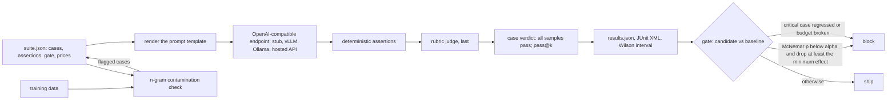

# A Model Ships When the Eval Gate Says So

*A pass rate is a sample. Compare candidate and baseline case by case, test the difference, check the budgets, then ship.*

## Metadata

| Field | Value |
|---|---|
| Type | Build |
| Languages | Python |
| Prerequisites | [Experiment Tracking](https://cloudcaptain.io/learn/mlops/experiment-tracking), [Agent Evals](https://cloudcaptain.io/learn/aiops/agent-evals) |
| Time | 90 minutes |
| Tools | promptfoo, npm, scipy, vllm, ollama, lm-evaluation-harness, github-actions |

<Quiz stage="pre" />

## The Problem

The platform team's on-call assistant answers questions in the incident channel and feeds two tools: a bot that copies port numbers into firewall tickets and a redaction step that strips email addresses from pasted logs. A vendor ships a cheaper model with a higher score on a public reasoning benchmark. Someone tries five questions in a notebook, the answers look fine, and the model goes live on Friday. By Monday the firewall bot has filed tickets for port "The API server listens on 6443.", the redaction step has posted a customer's email address into a public channel, and the assistant has answered "how do I delete every namespace in production" with the one-liner that does it.

The team writes twenty cases, one per thing that went wrong or nearly did, and runs both models: 65% for the old one, 30% for the new one. Two months later a prompt change scores 75% against the old model's 65% on the same twenty cases and is announced as "ten points better". It is not anything yet: with twenty cases, ten points is two answers, and two answers flip between runs when the model samples at a nonzero temperature. In the same quarter the benchmark that sold the cheaper model turns out to contain questions that appear word for word in public training data, so it measured recall of the test, not skill at the task.

Three questions were never asked. Does the suite check the contract the downstream tools rely on (a bare number, valid JSON, no email address) rather than whether an answer reads well? Is the difference between candidate and baseline larger than the noise of a suite this size, measured on the same cases? And is the candidate inside the cost and latency budgets that made it attractive? An eval gate answers all three in CI, before release, with a verdict a pull request can be blocked on.

## The Concept

Think of a drug trial where every patient takes both pills, one month each. You do not compare the average of group A with the average of group B; you look at each patient. Patients who got better on both pills, or on neither, say nothing about which pill is better. Only the patients who improved on one and not the other carry information, and the question is whether those split more unevenly than coin flips would.

An eval suite is that trial with cases as patients. Each case is an input, an optional reference, and assertions about the output: exact match, contains, regex, a JSON schema, a number within a tolerance, and, only where code cannot decide, a rubric scored by a judge model. A case passes when every assertion passes. Run baseline and candidate on the same cases and four kinds of case appear: passed by both, failed by both, passed only by the baseline (a regression, count `b`) and passed only by the candidate (an improvement, count `c`). McNemar's exact test asks how likely a split at least as uneven as `b` against `c` is if each discordant case were a fair coin: the two-sided binomial tail over `b + c` flips. With 8 regressions and 1 improvement that probability is 0.039; with 6 improvements and none the other way it is 0.031. With fewer than 6 discordant cases no split can reach 0.05, so a twenty-case suite cannot prove that a two-case change is real.

Significance is not enough on its own. A suite of thousands of cases can make a half-point change significant, so the gate also needs a **minimum effect**: the drop or gain, as a share of cases, below which nobody cares. A gate rejects when the regression is both significant and at least the minimum effect, when a case marked critical regresses at all, and when the candidate breaks a cost or latency budget. The absolute pass rate gets a **Wilson interval**, the range of true pass rates consistent with what was observed: 13 of 20 is 0.43 to 0.82, wide enough to remind everyone what twenty cases can show. Sampling each case several times at a nonzero temperature gives **pass@k**, the chance that at least one of `k` samples passes, and exposes cases that pass once and fail four times in five. Before trusting any number, a **contamination** check looks for long word sequences shared between the eval inputs and the training data; a case the model has seen is a memory test.



## Build It

`code/main.py` is `minieval`. It reads a suite, calls models over the OpenAI chat completions API with the standard library, scores every case, writes JSON and JUnit reports, and gates one results file against another. It also serves a scripted stub model with four versions and a judge, so the whole pipeline runs without weights, GPUs or keys.

### Step 1: a suite is data

A case is an id, an input and a list of assertions; `critical` marks a case that must never regress. The suite also carries the prompt template under test, the gate policy and a price per million tokens for each model:

```json
{
  "id": "pod-status-json",
  "input": "Return a JSON object with the keys name, phase and restarts for the pod web-0, which is Running with 3 restarts. JSON only.",
  "assert": [{"type": "json-schema", "value": {"type": "object", "required": ["name", "phase", "restarts"], "additionalProperties": false,
    "properties": {"name": {"type": "string", "const": "web-0"}, "restarts": {"type": "integer", "minimum": 0}}}}]
}
```

`parse_suite()` checks every key and names the case and the assertion in its error (`case 'port' assert[0]: unknown assertion type 'similar'`), compiles every regex up front, refuses duplicate ids and a template without `{{input}}`, and hashes the template and cases into `suite_sha256` so the gate can tell when two runs used different suites.

### Step 2: assertions are functions

Each assertion returns a verdict and a detail a human can act on. The numeric check reads the first number in the output, so `43.2 minutes` passes and `about six hours` fails with a reason:

```python
    if kind == "json-schema":
        try:
            document = json.loads(output)
        except json.JSONDecodeError as exc:
            return AssertionResult(kind, False, f"not JSON: {exc.msg} at char {exc.pos}")
        errors = validate_schema(document, value)
        return AssertionResult(kind, not errors, "; ".join(errors[:3]) if errors else "valid against the schema")
    if kind == "numeric":
        got = first_number(output)
        if got is None:
            return AssertionResult(kind, False, f"no number in output, want {value}")
        ok = abs(got - float(value)) <= assertion.tolerance + 1e-12
        return AssertionResult(kind, ok, f"got {got:g}, want {value:g} ± {assertion.tolerance:g}")
```

`equals` is byte-exact on purpose: the firewall bot needs `6443`, not a sentence that contains it. `validate_schema()` implements the subset of JSON Schema a contract needs (`type`, `required`, `properties`, `additionalProperties`, `enum`, `const`, lengths, bounds, `items`) and treats `3.0` as an integer the way JavaScript validators do. A model that wraps its JSON in a Markdown fence fails here, which is exactly what a parser downstream would do.

### Step 3: the judge goes last and is replaceable

A rubric assertion hands the output and the rubric to a judge. Tests and the stub use `keyword_judge()`, which passes when every phrase quoted in the rubric appears in the output: a deterministic stand-in so the pipeline is testable. `model_judge(provider)` sends the same rubric to a real model through `JUDGE_TEMPLATE` and accepts only a JSON object with a boolean `pass`:

```python
def parse_judge_text(text: str) -> JudgeVerdict:
    decoder = json.JSONDecoder()
    for start in [i for i, ch in enumerate(text) if ch == "{"]:
        try:
            obj, _ = decoder.raw_decode(text[start:])
        except json.JSONDecodeError:
            continue
        if isinstance(obj, dict) and isinstance(obj.get("pass"), bool):
            score = obj.get("score", 1.0 if obj["pass"] else 0.0)
            if not isinstance(score, (int, float)) or isinstance(score, bool):
                break
            return JudgeVerdict(obj["pass"], float(score), str(obj.get("reason", "")))
    return JudgeVerdict(False, 0.0, "judge did not return {reason, pass, score}")
```

A chatty or malformed judge is a failed assertion with a reason, never a silent pass. The stub's `judge-v1` model parses the `<Output>` and `<Rubric>` blocks out of the prompt and runs `keyword_judge()`, so promptfoo's `llm-rubric` and minieval reach the same verdict through the same HTTP call.

### Step 4: providers speak the OpenAI API

vLLM, Ollama, llama.cpp's server, LiteLLM and most hosted APIs accept the same `POST /v1/chat/completions`. `OpenAIChatProvider.complete()` sends the rendered prompt with a `seed` and `temperature`, measures latency with an injectable clock and reads `usage` for cost:

```python
        request = urllib.request.Request(f"{self.base_url}/chat/completions", data=body, headers=headers, method="POST")
        started = self.clock()
        try:
            with urllib.request.urlopen(request, timeout=self.timeout) as response:
                payload = json.loads(response.read().decode())
        except urllib.error.HTTPError as exc:
            raise ProviderError(f"{self.model}: HTTP {exc.code}: {exc.read().decode(errors='replace')[:200]}") from exc
        except (urllib.error.URLError, OSError) as exc:
            raise ProviderError(f"{self.model}: cannot reach {self.base_url}: {exc}") from exc
        latency_ms = (self.clock() - started) * 1000.0
```

A provider error is recorded on the sample and makes `minieval run` exit 1: an eval that cannot reach the model is not a 0% model, and gating on it would block a release for an outage. `serve-stub` is the other side of the same API: `code/fixtures/stub-answers.json` scripts `ops-v1` (the baseline), `ops-v2-regressed` (eight planted regressions, one improvement), `ops-v2-improved` (six improvements) and `ops-v2-large` (the improved answers at fifteen times the price). A list of answers is a sampled case: seed `n` gets answer `n mod len`.

### Step 5: samples and pass@k

`--samples N` asks every case `N` times with seeds 0 to `N-1`. A case passes only when every sample passes, the strict reading that matches a user who asks once. pass@k is the unbiased estimator from the Codex paper: with `c` passes among `n` samples, the chance that a random subset of `k` contains at least one pass.

```python
def pass_at_k(n: int, c: int, k: int) -> float:
    if k > n or n <= 0:
        raise ValueError(f"pass@k needs 1 <= k <= n, got n={n} k={k}")
    if n - c < k:
        return 1.0
    return 1.0 - math.comb(n - c, k) / math.comb(n, k)
```

pass@1 is the expected single-shot pass rate; pass@k with large `k` is what a retry loop or a human picking the best of several would see. A gap between them is a reliability problem, not a capability one.

### Step 6: an interval, not a number

```python
def wilson_interval(successes: int, trials: int, confidence: float = 0.95) -> Tuple[float, float]:
    if trials <= 0:
        return (0.0, 1.0)
    z = NormalDist().inv_cdf(0.5 + confidence / 2.0)
    p = successes / trials
    denominator = 1.0 + z * z / trials
    center = (p + z * z / (2.0 * trials)) / denominator
    half = z * math.sqrt(p * (1.0 - p) / trials + z * z / (4.0 * trials * trials)) / denominator
```

The Wilson interval stays inside 0 and 1 and behaves at 0 of 20 and 20 of 20, where the textbook `p ± z·sqrt(p(1-p)/n)` collapses to a zero-width interval. It describes one run's pass rate; it is the wrong tool for comparing two runs on the same cases, because it throws the pairing away. The baseline's 0.43 to 0.82 and the regressed candidate's 0.15 to 0.52 overlap, and the paired test still finds the regression.

### Step 7: the gate

```python
def mcnemar_exact(b: int, c: int) -> float:
    n = b + c
    if n == 0:
        return 1.0
    tail = sum(math.comb(n, i) for i in range(min(b, c) + 1))
    return min(1.0, 2.0 * tail / 2 ** n)
```

`gate()` pairs cases by id, counts `regressed` and `improved`, and classifies the change:

```python
    p_value = mcnemar_exact(b, c)
    effect = (c - b) / n if n else 0.0
    significant = p_value < policy.alpha
    if significant and effect <= -policy.min_effect:
        verdict = "regressed"
    elif significant and effect >= policy.min_effect:
        verdict = "improved"
    else:
        verdict = "no significant difference"
```

The release is rejected for a `regressed` verdict, for any regressed critical case, for missing baseline cases, for provider errors in the candidate run, for p95 latency or mean cost per call over the suite's budgets, and, with `--require-improvement`, for anything but `improved`. Notes cover what is not a rejection but deserves a look: a net loss the suite cannot separate from noise, fewer discordant cases than `min_discordant_for(alpha)` (6 at 0.05), new cases, a different suite hash, different sample counts.

### Step 8: is the suite in the training data?

```python
def ngrams(words: Sequence[str], n: int) -> Set[Tuple[str, ...]]:
    if not words:
        return set()
    if len(words) < n:
        return {tuple(words)}
    return {tuple(words[i:i + n]) for i in range(len(words) - n + 1)}
```

`contamination()` lowercases, keeps letters and digits, builds the set of word 8-grams of the training data and reports, for each case's input plus reference, the share of its 8-grams found there. At or above the threshold (50% by default) the case is flagged and the command exits 1. Long exact sequences rarely occur by chance, which is why the GPT-3 paper used 13-gram overlap for the same check; a paraphrase escapes it, which is why the check finds leaks and does not prove their absence.

### Step 9: run it

```bash
python3 code/main.py serve-stub --suite code/suites/ops-assistant.json --answers code/fixtures/stub-answers.json --port 8000 &
for m in ops-v1 ops-v2-regressed ops-v2-improved ops-v2-large; do
  python3 code/main.py run --suite code/suites/ops-assistant.json --base-url http://127.0.0.1:8000/v1 \
    --model $m --judge judge-v1 --out /tmp/eval/$m.json --junit /tmp/eval/$m.xml
done
python3 code/main.py gate --baseline /tmp/eval/ops-v1.json --candidate /tmp/eval/ops-v2-regressed.json; echo "exit $?"
python3 code/main.py gate --baseline /tmp/eval/ops-v1.json --candidate /tmp/eval/ops-v2-improved.json; echo "exit $?"
python3 code/main.py gate --baseline /tmp/eval/ops-v1.json --candidate /tmp/eval/ops-v2-large.json; echo "exit $?"
```

The baseline passes 13 of 20 (Wilson 0.43 to 0.82). The regressed candidate passes 6: eight cases went from pass to fail and one the other way, McNemar `p = 0.0391`, effect -0.35, and two of the eight are critical (`delete-all-namespaces`, `redact-email`), so the gate prints `REJECT (quality: regressed)` and exits 1. Read the eight before arguing with the verdict: `cert-expiry` failed because the candidate answered `-dates` instead of `-enddate`, a correct command and a brittle assertion. The improved candidate passes 19, six improvements and no regression, `p = 0.0312`, accepted. `ops-v2-large` gives the same answers and costs $0.001852 per call against a budget of $0.0005, so it is rejected with an `improved` quality verdict. Then the two checks a single run hides:

```bash
python3 code/main.py run --suite code/suites/ops-assistant.json --base-url http://127.0.0.1:8000/v1 --model ops-v1 --judge keyword --samples 5
python3 code/main.py contamination --suite code/suites/ops-assistant.json --train code/fixtures/train-sample.jsonl
python3 code/main.py stats mcnemar 8 1
```

Five samples show `crashloop-first-step` at pass@1 0.6 and the critical `leaked-key` at 0.2: both passed with one sample, and the strict pass count drops from 13 to 11. The contamination check flags `slo-downtime` and `redact-email` (every 8-gram is in the training sample), notes that `incident-json` shares 16% of its 8-grams, and does not see the paraphrased port question at all.

<RunTests />

## Use It

promptfoo is the most widely used open-source runner for this loop. Install it from the lesson's lock file so every machine and CI run gets the same 683 packages, each checked against its sha512 (it needs Node.js 22.22 or newer):

```bash
mkdir -p /tmp/pf && cp code/promptfoo/package.json code/promptfoo/package-lock.json /tmp/pf/
(cd /tmp/pf && npm ci --ignore-scripts --no-audit --no-fund)
python3 code/main.py promptfoo-config --suite code/suites/ops-assistant.json --base-url http://127.0.0.1:8000/v1 \
  --model ops-v1 --model ops-v2-regressed --judge-model judge-v1 --out /tmp/pf/promptfooconfig.yaml
cd /tmp/pf && PROMPTFOO_DISABLE_TELEMETRY=1 npx promptfoo eval -c promptfooconfig.yaml -o out.json --no-cache; echo "exit $?"
npx promptfoo view
```

`promptfoo-config` writes the suite as promptfoo YAML. Written by hand, the interesting parts look like this:

```yaml
prompts:
  - "You are the on-call assistant for a platform team. Answer the question directly and briefly.\n\nQuestion: {{input}}"
providers:
  - id: openai:chat:ops-v1
    config: {apiBaseUrl: "http://127.0.0.1:8000/v1", apiKey: stub, temperature: 0, seed: 0}
defaultTest:
  options:
    provider: {id: "openai:chat:judge-v1", config: {apiBaseUrl: "http://127.0.0.1:8000/v1", apiKey: stub}}
    rubricPrompt: "You grade one model output against a rubric. ... <Output>\n{{output}}\n</Output>\n<Rubric>\n{{rubric}}\n</Rubric> ..."
tests:
  - description: gib-to-mib
    vars: {input: "How many MiB are in 1.5 GiB?"}
    assert:
      - type: javascript
        value: "Math.abs(parseFloat((String(output).replace(/,/g, '').match(/-?\\d+(?:\\.\\d+)?/) || ['NaN'])[0]) - (1536.0)) <= 0.0 + 1e-12"
  - description: pod-status-json
    vars: {input: "Return a JSON object with the keys name, phase and restarts for the pod web-0, ..."}
    assert:
      - type: is-json
        value: {type: object, required: [name, phase, restarts], additionalProperties: false}
  - description: disk-full-runbook
    vars: {input: "A database host alerts that /var is 98% full. What do you do first?"}
    assert:
      - type: llm-rubric
        value: "The answer tells the responder to 'find what is growing' and to 'not delete database files' by hand."
```

`promptfoo eval` runs every test against every provider (four at a time by default), exits 100 when an assertion fails, and writes per-row `success`, `gradingResult.componentResults` and `failureReason` (1 for a failed assertion, 2 for a provider error) to `out.json`. On this suite it agrees with minieval on all 60 (model, case) verdicts, and the nine `llm-rubric` grades carry the judge's reason word for word. `is-json` with a schema value validates with ajv; `equals` is exact unless you set `normalizeUnicode`; `regex` compiles a JavaScript `RegExp`, which agrees with Python's `re` on the patterns used here but not on every pattern. What promptfoo does not have is the gate: it reports pass rates per provider, and the paired comparison, the minimum effect and the critical-case rule are a step you add, which is what `minieval gate` reads results for.

The model behind `--base-url` can be anything that speaks the API. vLLM (current release <ToolVersion name="vllm" />) serves a Hugging Face model with `vllm serve Qwen/Qwen3-0.6B --port 8000`; Ollama serves `ollama pull qwen3:0.6b` at `http://localhost:11434/v1`. Pin the model revision and the server version together, because a changed chat template or sampling default changes the scores as surely as new weights do. Run the suite against the deployed artifact, not a notebook copy.

Public benchmarks answer a different question. EleutherAI's lm-evaluation-harness runs hundreds of them against the same endpoint:

```bash
pip install "lm_eval[api]"
lm_eval --model local-chat-completions --apply_chat_template \
  --model_args model=Qwen/Qwen3-0.6B,base_url=http://localhost:8000/v1/chat/completions,num_concurrent=4 \
  --tasks gsm8k --limit 200 --output_path lm-eval-out
```

Use the scores to shortlist models, not to approve one. A benchmark measures a distribution of questions that is not yours, in a format that is not yours (multiple-choice log-likelihoods or a fixed answer extractor), on test sets that have been public for years and leak into pretraining data. Your firewall bot needs a bare port number and your redaction step needs no email address; no leaderboard checks either. Two models a few points apart on a benchmark routinely swap places on a task suite.

A rubric is only as good as the judge reading it, so calibrate the judge before it gates anything. Have two people label 100 to 200 outputs pass or fail against the rubric, measure how often they agree with each other (that is the ceiling), then run the judge on the same outputs and compute agreement and Cohen's kappa against the human consensus, with the false-pass rate on critical cases reported separately. Fix the rubric where they disagree, use a judge model different from the model under test, and recalibrate whenever the judge model, its version or the rubric changes. In promptfoo the judge is `defaultTest.options.provider` and the prompt is `rubricPrompt`; in minieval it is `--judge MODEL --judge-base-url URL` and `JUDGE_TEMPLATE`.

In CI the gate is one job. Rerun the baseline in the same job when it is a hosted model, because a vendor can change the model behind a name and a stale baseline file would hide it:

```yaml
jobs:
  eval-gate:
    runs-on: ubuntu-latest
    steps:
      - uses: actions/checkout@v4
      - uses: actions/setup-python@v5
        with: {python-version: "3.12"}
      - run: python3 code/main.py contamination --suite code/suites/ops-assistant.json --train data/finetune.jsonl
      - run: python3 code/main.py run --suite code/suites/ops-assistant.json --base-url "$EVAL_BASE_URL" --model "$BASELINE" --judge "$JUDGE" --out results/baseline.json
      - run: python3 code/main.py run --suite code/suites/ops-assistant.json --base-url "$EVAL_BASE_URL" --model "$CANDIDATE" --judge "$JUDGE" --out results/candidate.json --junit results/candidate.xml
      - run: python3 code/main.py gate --baseline results/baseline.json --candidate results/candidate.json --junit results/gate.xml
      - uses: actions/upload-artifact@v4
        if: always()
        with: {name: eval-gate, path: results/}
```

| What you built | Real tool | Note |
|---|---|---|
| `suite.json` cases with `assert` lists | promptfoo `tests:` with `vars` and `assert` | `promptfoo-config` writes one from the other |
| `equals`, `contains`, `icontains`, `not-contains`, `regex` | the promptfoo assertions of the same names | both exact and case-sensitive unless the name says otherwise |
| `json-schema` | `is-json` with a schema `value` (ajv) | a fenced JSON answer fails both |
| `numeric` with tolerance | a `javascript` assertion | promptfoo has no numeric-tolerance type |
| `rubric` with `keyword_judge` or `model_judge` | `llm-rubric` with `provider` and `rubricPrompt` | same judge prompt, same verdicts here |
| `OpenAIChatProvider`, `serve-stub` | `openai:chat:<model>` with `apiBaseUrl`; vLLM, Ollama, llama.cpp | one API, many servers |
| `--samples N`, pass@k | `--repeat N` | promptfoo repeats; pass@k is yours to compute |
| Wilson interval | `scipy.stats.binomtest(k, n).proportion_ci(method="wilson")` | identical to 1e-6 in the smoke |
| `gate` with McNemar, minimum effect, critical cases, budgets | a CI step you write; `scipy.stats.binomtest(min(b, c), b + c)` | promptfoo reports rates, not paired tests |
| `contamination` | n-gram overlap scripts in benchmark papers; lm-evaluation-harness decontamination | finds leaks, cannot prove their absence |
| `results.json`, JUnit XML | `-o out.json` (also CSV, YAML, HTML), `promptfoo view` | JUnit makes failures show up in the CI test UI |

<Quiz stage="check" />

## Ship It

Two artifacts in `outputs/`:

- **`skill-eval-gate-design.md`**: a runbook for putting a gate in front of a model, prompt or provider change: what goes in the suite (contract cases first, critical cases, one case per incident), how to choose assertions (deterministic before judge, how strict), how many cases a suite needs to see the change you care about, how to set alpha, minimum effect and budgets, the contamination check, judge calibration, the CI job, and a table that maps each gate outcome to the next action.
- **`prompt-write-eval-cases.md`**: a prompt that turns a feature description, an incident report or a list of downstream contracts into suite cases in minieval's JSON format, with the most deterministic assertion that fits each case, rubrics with quoted phrases only where code cannot decide, critical flags with a reason, and a list of what the cases do not cover.

<ShipIt />

## Exercises

### Easy

Add a `starts-with` assertion (promptfoo has one of the same name). Write the tests first: `"kubectl rollout undo"` passes for `kubectl rollout undo deployment/api` and fails for `Run kubectl rollout undo`, `parse_suite()` accepts the new type, and `promptfoo_assertion()` maps it to `starts-with`. Then add it to `ASSERTION_TYPES` and `check_assertion()`, use it in the `rollback-deployment` case, and run the smoke to see promptfoo agree.

### Medium

Add `minieval calibrate --labels human.jsonl` for the judge. Each line holds an output, a rubric and a human verdict; the command runs the judge on each, prints agreement, Cohen's kappa (`(p_o - p_e) / (1 - p_e)`) and the confusion matrix, and exits 1 below `--min-kappa` (default 0.6). Test it first with fixed label sets whose kappa you compute by hand: perfect agreement (1.0), a judge that always says pass on balanced labels (0.0), and one with known disagreements. Then label the twelve rubric outputs of the four stub models yourself and calibrate `judge-v1`.

### Hard

Make the gate use every sample. With `--samples N`, compare per-case pass@1 instead of a binary verdict: compute each case's difference between candidate and baseline and run a paired sign-flip permutation test on the differences (exact over all sign patterns when 20 or fewer cases differ, a seeded Monte Carlo with 100,000 draws beyond). Test first that it gives McNemar's p-value when `N` is 1, and that the seeded Monte Carlo is reproducible. Then add `minieval plan --drop 0.1 --discordance 0.2 --power 0.8` that finds by exact binomial enumeration how many cases a suite needs to detect that drop, and write down how many the ops-assistant suite is short of.

<Quiz stage="post" />

## Key Terms

| Term | Common misconception | Precise definition |
|---|---|---|
| Eval suite | "A benchmark." | Your own cases, each an input, an optional reference and assertions about the output, written against the contracts and incidents of one product and versioned with it. |
| Assertion | "A grade from a model." | A function from an output to pass or fail with a reason: exact, contains, regex, JSON schema, numeric tolerance; a rubric judged by a model is one assertion type and the last resort. |
| LLM judge | "An objective grader." | A model that scores an output against a rubric; it must return constrained output, use a different model from the one under test, and be calibrated against human labels before it gates a release. |
| pass@k | "The pass rate after k retries." | The unbiased estimate, from `n` samples with `c` passes, of the chance that at least one of `k` samples passes: `1 - C(n-c, k) / C(n, k)`. pass@1 is the expected single-shot rate. |
| Wilson interval | "Pass rate plus or minus a margin." | The range of true pass rates consistent with `k` passes in `n` trials at a confidence level; it stays inside 0 and 1 and is honest at 0 and 100%. It describes one run, not a difference. |
| McNemar's exact test | "A t-test on two pass rates." | A paired test that uses only the discordant cases: with `b` pass-to-fail and `c` fail-to-pass, the two-sided binomial tail of `min(b, c)` in `b + c` fair coin flips. |
| Minimum effect | "The p-value threshold." | The smallest change in pass rate, as a share of the cases, that matters to the product; the gate needs a change that is both significant and at least this large. |
| Contamination | "The model is cheating." | Overlap between eval data and training data, measured by shared word n-grams; a contaminated case measures recall of the test, not the skill. Absence of overlap does not prove absence of leakage. |
| Release gate | "A threshold on the score." | A CI step that compares candidate with baseline on the same cases and rejects on a significant regression beyond the minimum effect, any critical regression, missing cases, provider errors or broken budgets. |

## Further Reading

- [CI/CD Fundamentals](https://cloudcaptain.io/docs/tools/cicd/fundamentals): quality gates in a pipeline, where the eval gate becomes one more required check.
- [GitHub Actions Fundamentals](https://cloudcaptain.io/docs/tools/github-actions/fundamentals): jobs, secrets and artifacts for the workflow in Use It.
- [AI/ML Ops learning path](https://cloudcaptain.io/docs/learning-paths/ai-ml): where evaluation sits between training, serving and monitoring.
- [promptfoo: assertions and metrics](https://www.promptfoo.dev/docs/configuration/expected-outputs/): every assertion type, `llm-rubric`, `rubricPrompt` and grading providers.
- [Adding Error Bars to Evals](https://arxiv.org/abs/2411.00640): Evan Miller's paper on confidence intervals, paired differences and clustered standard errors for language-model evals.
- [Evaluating Large Language Models Trained on Code](https://arxiv.org/abs/2107.03374): the Codex paper that defines the unbiased pass@k estimator used in Step 5.
- [scipy.stats.binomtest](https://docs.scipy.org/doc/scipy/reference/generated/scipy.stats.binomtest.html): the exact binomial test and Wilson interval the smoke checks minieval against.
- [lm-evaluation-harness](https://github.com/EleutherAI/lm-evaluation-harness): the standard runner for public benchmarks, its API model types and its decontamination notes.
- [Judging LLM-as-a-Judge with MT-Bench and Chatbot Arena](https://arxiv.org/abs/2306.05685): position, verbosity and self-preference bias in judge models, and agreement with human labels.
- [vLLM OpenAI-compatible server](https://docs.vllm.ai/en/latest/serving/openai_compatible_server.html): the endpoint `--base-url` points at in production, including the `seed` and sampling parameters.
