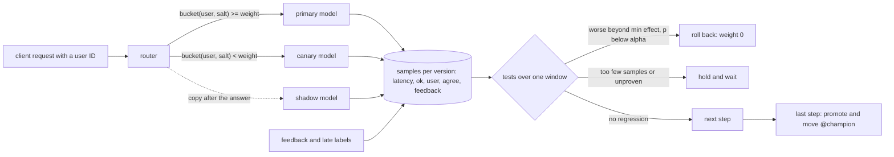

# Roll Out a Model Like Code: Shadow, Canary, Compare

*A model can answer 200 in 10 ms and still be wrong: shadow it, canary it to sticky users, and let a test on quality decide.*

## Metadata

| Field | Value |
|---|---|
| Type | Build |
| Languages | Python |
| Prerequisites | [A Rollout Is a Loop That Watches a Metric](https://cloudcaptain.io/learn/cicd/progressive-delivery), [A Model Ships When the Eval Gate Says So](https://cloudcaptain.io/learn/mlops/llm-eval-gates) |
| Time | 90 minutes |
| Tools | kubectl, kind, Argo Rollouts, Gateway API, KServe, MLflow, scipy, curl |

<Quiz stage="pre" />

## The Problem

Monday, 09:30. The fraud team retrains `fraud-score` on the last quarter of transactions. Version 7 beats version 6 on the offline holdout by two points of AUC and passes the eval gate. The platform team ships it the way they ship every service: an Argo Rollouts canary, 10% for ten minutes, analysis on HTTP error rate and p95 latency. Both stay flat, the rollout promotes, and the registry's `@champion` alias still points at version 6 because nobody wired the release to it. What nobody tested is that the online feature service computes `amount_vs_30d_mean` with the opposite sign from the batch pipeline the model was trained on. Every response is a valid JSON score, in 12 ms, with status 200. About a third of the decisions are now wrong.

On Wednesday, chargebacks double. The incident review finds three more problems. The canary split was per request, so the same customer was approved by v6 and declined by v7 on two refreshes of the checkout page, and support tickets about "random declines" were the first signal anyone had. Nobody could say which model version made a given decision, because the router logged the Service name, not the version, and the registry disagreed with the cluster. And when the team looked at the canary's labelled outcomes afterwards, ten minutes at 10% had produced 140 labelled transactions: too few to tell a 5-point quality drop from noise, so even a quality metric would have waved it through.

A model release needs everything a service release needs plus a signal for "the answers are worse", which errors and latency never carry. You get that signal in two places. Before any user sees the new version, a **shadow** receives a copy of real traffic, and its answers are compared with the current model's and thrown away. Then a **canary** serves a sticky cohort of users, so each user sees one model and their feedback (a click, a chargeback, a thumbs down) can be attributed to it. A comparison with enough samples, a minimum effect worth acting on and a test that separates a real drop from chance decides: promote, hold or roll back. Promotion moves the registry alias, so the registry, the router and the audit log agree. You are going to build `minirollout`, a router and controller that does all of that over HTTP, then run the same rollout with Argo Rollouts on kind, fed by the same samples, and check that both reach the same verdict at the same step.

## The Concept

A hospital replacing a blood analyser does not switch on the new machine and hope. For a week it runs every sample through both machines and reports only the old machine's numbers: if the new one disagrees too often, nobody was harmed by the test. Then it lets the new machine report for two wards, and every patient on those wards stays with that machine, so a doctor comparing a patient's results over three days never mixes two calibrations. It decides from outcomes it can count, and it decides in advance how many samples it needs and how big a difference matters.

A model rollout is that procedure in a router and a controller:

- **Shadow (mirror).** The router answers from the primary, and after the answer copies the request to the candidate. The copy is fire-and-forget: a slow, failing or hanging shadow cannot change or delay a response. What you learn: the candidate's latency, errors, and **agreement** with the primary on live inputs. What you do not learn: how users react, because nobody saw the shadow's answer.
- **Canary with sticky assignment.** The router hashes a user ID with a salt into a bucket from 0 to 100 and sends users whose bucket is below the weight to the candidate. A user keeps their version for the whole rollout, raising the weight only adds users, and each candidate gets a different salt, so the same unlucky users are not the first cohort of every release. Now feedback, labels that arrive later, and conversions belong to one version.
- **Per-version online metrics.** Every request is recorded with its version, latency, success and user; feedback is attached later by request ID. Latency and errors are cheap and fast; the quality proxy (agreement during shadow, feedback rate or delayed labels during canary) is slower and noisier, and it is the only one that sees a wrong model.
- **Comparison, not thresholds.** The candidate is compared with the primary over the same window, so a busy hour or a slow dependency moves both. Each metric gets a test that answers "is the candidate worse, beyond chance?": Mann-Whitney U for latency (no assumption about the latency distribution), a two-proportion z-test for error rate and feedback rate, a one-proportion test of shadow disagreement against a limit. A **minimum effect** says how much worse matters; a **minimum sample size**, computed from that effect, says when the test can be trusted.
- **Decision.** Any metric worse beyond the minimum effect with a p-value under alpha: roll back. Too few samples, or a large but unproven difference: hold and collect more. Otherwise move to the next step; after the last one, promote and move the registry alias.



Three facts about the numbers shape every plan. A quality drop is a difference between two proportions, and detecting a drop d from a baseline p at significance alpha with 80% power needs about `(z_alpha * sqrt(2 * pbar * (1 - pbar)) + z_beta * sqrt(p1 * (1 - p1) + p2 * (1 - p2)))^2 / d^2` samples per side: 147 for a 10-point drop from 0.97, 556 for a 5-point drop from 0.95. Time to that many samples is `n / (rps * weight)`, so a small canary on a quiet service can take hours, and a shadow at 100% gets there fastest with no user exposed. And with enough samples every difference is significant, which is why the minimum effect exists: a candidate 0.4 points worse with a p-value of 1e-9 is still a promotion if you decided that only 5 points matter.

## Build It

`code/main.py` is `minirollout`, one standard-library file with eight subcommands: `model` (a stub model server), `router`, `load` (a load generator that posts feedback or records samples itself), `run` (the controller), `analyze`, `replay`, `plan` and `assign`. The router and the load generator share one sample recorder and serve the same `/compare`, `/stats`, `/samples` and `/queries` endpoints, which is what lets Argo Rollouts and minirollout read the same data. Everything is injectable (the HTTP client, the clocks), so the tests run a whole rollout in a simulated second.

### Step 1: stub models and a labelled stream

The models are logistic regressions with fixed weights over two features, so every answer is deterministic and quality is measurable. The data stream is seeded; the true label comes from the weights `1.5, -2.0, 0.25` with 3% label noise:

```python
def make_dataset(seed: int = 7, size: int = 1000) -> List[Example]:
    rng = random.Random(seed)
    examples = []
    for index in range(size):
        features = (round(rng.uniform(-2.0, 2.0), 4), round(rng.uniform(-2.0, 2.0), 4))
        label = 1 if score(TRUE_WEIGHTS, features) > 0 else 0
        if rng.random() < LABEL_NOISE:
            label = 1 - label
        examples.append(Example(f"x{index}", features, label))
    return examples
```

| Version | Weights | Accuracy on the stream | Agrees with v1 | What it stands for |
|---|---|---|---|---|
| v1 | `1.5,-2.0,0.25` | 97.0% | 100% | the champion |
| v2 | `1.4,-2.1,0.2` | 95.2% | 98% | a retrain on newer data |
| v3 | `-1.5,-2.0,0.25` | 63.3% | 64.5% | a feature whose sign flipped between training and serving |
| v4 | v2's weights, +120 ms | 95.2% | 98% | a heavier model or a cold cache |

`ModelBehaviour.answer()` adds latency and injected errors decided by a hash of the version and the request ID, so the same request always gets the same delay and the same failure, in a test and in the smoke run.

### Step 2: the router has one primary, one canary and one shadow

`RouteConfig` is the whole routing state: a primary backend, an optional canary with a weight, an optional shadow with a percentage, and a salt. `POST /admin/config` replaces it atomically. `Router.route()` picks the arm, calls it, records the result, and only then considers the mirror:

```python
    def route(self, body: Any, headers: Dict[str, str]) -> AppResult:
        config = self.snapshot()
        request_id = headers.get("x-request-id") or f"req-{next(self.counter)}"
        user = headers.get("x-user-id") or (str(body.get("user") or "") if isinstance(body, dict) else "") or request_id
        arm, backend = PRIMARY, config.primary
        if config.canary is not None and assign(user, config.cohort_salt(), config.weight) == CANARY:
            arm, backend = CANARY, config.canary
        status, payload, latency = self.call(backend, body, {"X-Request-Id": request_id})
        ok = status < 500
        label = payload.get("label") if ok and isinstance(payload, dict) else None
        self.recorder.add(Sample(self.recorder.clock(), backend.name, SERVED, round(latency, 3), ok, request_id, user, label))
        if config.shadow is not None and fraction("mirror", request_id) * 100.0 < config.shadow_percent:
            self.mirror((config.shadow, request_id, user, body, label))
        return status, payload, {"X-Model-Version": backend.name, "X-Request-Id": request_id, "X-Route": arm}
```

Every response carries `X-Model-Version` and `X-Request-Id`. The first is what an audit log needs ("which model declined this payment?"); the second is the key a client uses later to send feedback, `POST /feedback {"request_id": ..., "good": true}`, which the recorder attaches to the served sample.

### Step 3: the shadow is a queue, never a wait

The mirror job goes onto a bounded queue with `put_nowait`. Two worker threads call the shadow with an `X-Shadow: true` header, record its latency and status, and compare its label with the label the user actually received:

```python
        try:
            self.jobs.put_nowait(job)
        except queue.Full:
            with self.lock:
                self.dropped += 1
```

```python
        agree = (label == served_label) if label is not None and served_label is not None else None
        self.recorder.add(Sample(self.recorder.clock(), backend.name, SHADOW, round(latency, 3), ok, request_id, user, label, agree))
```

If the shadow hangs, the queue fills and mirror jobs are dropped and counted (`mirror_dropped` in `/admin/config`), but the caller's latency does not change. The test `test_a_hanging_shadow_does_not_delay_the_answer_and_a_full_queue_drops` blocks the shadow on an event and checks that five requests still return. Shadowing a model that writes (a recommender that logs impressions, an agent that calls tools) needs one more rule this stub does not show: the shadow must not perform side effects, which is what the `X-Shadow` header is for.

### Step 4: sticky assignment is a hash, not a coin

```python
def fraction(*parts: str) -> float:
    digest = hashlib.sha256(":".join(parts).encode("utf-8")).digest()
    return int.from_bytes(digest[:8], "big") / 2.0 ** 64


def bucket(user: str, salt: str) -> float:
    return fraction("cohort", salt, user) * 100.0


def assign(user: str, salt: str, weight: float) -> str:
    return CANARY if weight > 0 and bucket(user, salt) < weight else PRIMARY
```

Three properties fall out of it and are tested: the same user always lands in the same bucket; a user in the canary at 10% is still in it at 50%, because `bucket < 10` implies `bucket < 50`; and the default salt is the candidate's name, so v3's first 10% is a different set of users from v2's. `minirollout assign --weight 30 --salt v2 --users 1000` prints the cohort (277 of 1000 users: a hash split is close to the weight, not exact, and the error shrinks with the number of users).

### Step 5: record per version, and serve the same view to everyone

`Recorder` keeps a bounded deque of `Sample`s (time, version, role `served` or `shadow`, latency, ok, request ID, user, label, agree, feedback). `summarize()` turns a window of samples into the numbers an analysis or a dashboard reads: requests, errors, error rate, nearest-rank p50 and p95, feedback count and rate, agreement count and rate, distinct users. `GET /compare?primary=v1&candidate=v2&window=20&step=1` returns both summaries for the last 20 seconds and logs the window it used; `GET /queries` returns that log and `GET /samples?since=...&until=...` the raw samples. Argo Rollouts reads `/compare`; `minirollout replay` reads `/queries` and `/samples` and re-analyses exactly the windows Argo looked at.

### Step 6: Mann-Whitney U for latency

Latency is skewed and heavy-tailed, so a t-test on means is the wrong tool. Mann-Whitney U ranks all the latencies of both versions together and asks whether the candidate's ranks are higher than chance would give. Ties get the average of their ranks and shrink the variance; the continuity correction subtracts half a unit from U. This is scipy's `mannwhitneyu(candidate, primary, alternative="greater", method="asymptotic")`, and the unit tests compare it with values scipy computed, to nine decimal places:

```python
def mann_whitney_greater(candidate: Sequence[float], primary: Sequence[float]) -> TestResult:
    n1, n2 = len(candidate), len(primary)
    if n1 == 0 or n2 == 0:
        raise ValueError("the Mann-Whitney U test needs at least one value on each side")
    ranks, ties = midranks(list(candidate) + list(primary))
    u = sum(ranks[:n1]) - n1 * (n1 + 1) / 2.0
    n = n1 + n2
    tie_term = sum(t ** 3 - t for t in ties)
    variance = n1 * n2 / 12.0 * ((n + 1) - tie_term / (n * (n - 1))) if n > 1 else 0.0
    if variance <= 0:
        return TestResult(u, 0.0, 1.0)
    z = (u - n1 * n2 / 2.0 - 0.5) / math.sqrt(variance)
    return TestResult(u, z, norm_sf(z))
```

The effect reported next to it is the difference of the medians in milliseconds, because "the candidate's ranks are higher" says nothing about how much slower it is.

### Step 7: proportions for errors, feedback and disagreement

Error rate and positive-feedback rate are proportions. The pooled two-proportion z-test asks whether the candidate's bad rate (errors, or negative feedback) is higher than the primary's; its z squared is the chi-square statistic of the 2x2 table without Yates' correction, which is how the smoke test checks it against `scipy.stats.chi2_contingency`:

```python
def two_proportion_greater(bad_candidate: int, n_candidate: int, bad_primary: int, n_primary: int) -> TestResult:
    if n_candidate <= 0 or n_primary <= 0:
        raise ValueError("the two-proportion z-test needs at least one observation on each side")
    difference = bad_candidate / n_candidate - bad_primary / n_primary
    pooled = (bad_candidate + bad_primary) / (n_candidate + n_primary)
    variance = pooled * (1 - pooled) * (1.0 / n_candidate + 1.0 / n_primary)
    if variance <= 0:
        return TestResult(difference, 0.0, 1.0)
    z = difference / math.sqrt(variance)
    return TestResult(difference, z, norm_sf(z))
```

A shadow has no feedback, and the primary agrees with itself by definition, so shadow quality is a one-proportion test: is the disagreement rate above the limit you set (10% by default)? Zero errors on both sides gives a variance of zero; the functions return "no evidence" (p = 1) instead of dividing by zero.

### Step 8: minimum effect, minimum samples, and the decision

```python
def judge(n_primary: int, n_candidate: int, effect: float, limit: float, p_value: float, th: Thresholds) -> str:
    if min(n_primary, n_candidate) < th.min_samples:
        return INSUFFICIENT
    if effect > limit and p_value < th.alpha:
        return FAIL
    if effect > limit:
        return SUSPECT
    return PASS


def decide(checks: Sequence[Check]) -> str:
    verdicts = {c.verdict for c in checks}
    if FAIL in verdicts:
        return ROLLBACK
    if verdicts & {INSUFFICIENT, SUSPECT}:
        return HOLD
    return PROMOTE
```

A check fails only when the candidate is worse by more than the limit (50 ms on the median, 2 points of error rate, 10 points of positive feedback, 10% disagreement) and the test says that is not chance at `alpha` 0.01. Worse beyond the limit but not significant is `suspect`: hold and collect more. Fewer than `min_samples` (150) on either side is `insufficient`, whatever the numbers look like. `samples_needed()` computes where 150 comes from, and `minirollout plan` warns when your `--min-samples` is below it:

```text
$ python3 code/main.py plan code/fixtures/plan-shadow.json --rps 60
#   step                                live %  mirror %    mode  cand. req/s  s to n
1   setMirrorRoute shadow: 100%              0       100
2   analysis (model-quality)                 0       100  shadow         60.0     2.5
3   setMirrorRoute shadow: removed           0         0
4   setWeight 25                            25         0
5   analysis (model-quality)                25         0  served         15.0    10.0
6   setWeight 50                            50         0
7   analysis (model-quality)                50         0  served         30.0     5.0
samples per side to detect the quality drop: 180
warning: min-samples 150 is below the 180 per side needed to detect a quality drop of 0.1 from 0.95 at alpha 0.01 with 80% power
```

With `--baseline-quality 0.97` the warning goes away (147 are enough). The controller looks at every window again and again until it decides, which is a form of peeking: each extra look is another chance for noise to cross alpha. The minimum effect, a small alpha and a decent minimum sample keep that risk small here; the medium exercise makes it explicit.

### Step 9: the controller speaks Argo Rollouts' step vocabulary

`parse_plan()` reads a list of steps, `{"steps": [...]}`, or a whole Argo Rollouts `Rollout`, and understands `setMirrorRoute` (a percentage turns the shadow on, a name alone removes it, as in Argo Rollouts), `setWeight`, `pause` with a duration, and `analysis`. Anything else (`setCanaryScale`, `setHeaderRoute`, `experiment`) is refused with its step number. So `code/fixtures/rollout.json`, the Rollout the smoke test applies to kind, is also a plan minirollout can run against its own router. `Controller.analyse()` picks the mode from the router's state (a shadow of the candidate with no live weight means shadow mode), and polls one window until the decision is not `hold` or the analysis times out:

```python
        while True:
            now = self.clock()
            since = now - self.window
            result = analyze(self.client.samples(self.primary.name, SERVED, since, now), self.client.samples(self.candidate.name, mode, since, now), self.thresholds, mode)
            finished = result.decision != HOLD or now - started >= self.analysis_timeout
```

Rollback sets the router back to the primary alone and tags the candidate's registry version `rollout=rolled-back`. Promotion makes the candidate the primary, then moves the alias:

```python
        if self.registry is not None:
            self.registry.set_alias(self.model, CHAMPION, self.registry_version)
            self.tag("promoted")
```

`--registry` is a JSON file or the URL of an MLflow tracking server; `MlflowRegistry` calls the same REST endpoints the MLflow client does, `POST /api/2.0/mlflow/registered-models/alias` and `POST /api/2.0/mlflow/model-versions/set-tag`, so the previous lesson's `@champion` alias moves when, and only when, the rollout promotes. The run's state file records every analysis (checks, p-values, verdicts), the step index that failed (counted from 0, like Argo Rollouts' `step-index` label) and the exposure: how many requests and users the candidate served.

### Step 10: run it

```bash
python3 code/main.py model --version v1 --weights=1.5,-2.0,0.25 --port 8001 &
python3 code/main.py model --version v2 --weights=1.4,-2.1,0.2 --port 8002 &
python3 code/main.py model --version v3 --weights=-1.5,-2.0,0.25 --port 8003 &
python3 code/main.py router --primary v1=http://127.0.0.1:8001 --listen 127.0.0.1:8000 &
python3 code/main.py load --url http://127.0.0.1:8000 --rps 60 --users 400 --feedback &
echo '{"models": {"churn": {"aliases": {"champion": "1"}, "versions": {}}}}' > /tmp/registry.json
RUN="python3 code/main.py run --router http://127.0.0.1:8000 --registry /tmp/registry.json --model churn --tick 0.5"
$RUN code/fixtures/plan-shadow.json --candidate v2=http://127.0.0.1:8002; echo "exit $?"   # shadow, 25%, 50%: promoted, exit 0
$RUN code/fixtures/plan-shadow.json --candidate v3=http://127.0.0.1:8003; echo "exit $?"   # rolled back at the shadow step, 0 users served, exit 1
#   analysis step 2 (shadow): rollback: disagreement fail: candidate 0.3623 vs primary 0, effect +0.3623 (limit 0.1), one-proportion z z=17.79 p=4.1e-71
$RUN code/fixtures/rollout.json --candidate v3=http://127.0.0.1:8003; echo "exit $?"       # no shadow: caught by feedback at step 2, after ~150 requests
#   analysis step 2 (served): rollback: quality fail: candidate 0.7161 vs primary 0.947, effect +0.2309 (limit 0.1), two-proportion z z=7.97 p=7.9e-16
cat /tmp/registry.json                                                                     # champion is 2; version 3 is tagged rolled-back
curl -s 'http://127.0.0.1:8000/compare?primary=v2&candidate=v3&window=60'
python3 code/main.py analyze --source http://127.0.0.1:8000 --primary v2 --candidate v3 --window 120
```

Look at what v3 is in each run: 200 OK, the same latency, no errors. A canary that measured only latency and errors would have promoted it. The shadow plan stopped it before any user saw it; the plan without a shadow stopped it after about 150 requests to 85 users, which is the price of learning from feedback. `run` exits 0 when promoted, 1 when rolled back, 2 for input it cannot use and 3 when an analysis held until `--analysis-timeout`; traffic stays as it was for a human to decide, as Argo Rollouts does with an Inconclusive analysis.

<RunTests />

## Use It

On Kubernetes the controller is Argo Rollouts, the split is a Service or a traffic router, and the metrics come from a provider. The smoke test installs Argo Rollouts v1.10.2 without any cluster-wide controller: the five CRDs from `install.yaml`, and the controller from `namespace-install.yaml`, which runs it with `--namespaced`, a Role instead of a ClusterRole, and watches only its own namespace. Neither manifest is in the release's `argo-rollouts-checksums.txt` (it covers only the kubectl plugin), so the smoke test pins sha256 values computed from the release assets.

```bash
V=v1.10.2
NS=cc-model-rollout
curl -fsSLO https://github.com/argoproj/argo-rollouts/releases/download/$V/install.yaml
curl -fsSLO https://github.com/argoproj/argo-rollouts/releases/download/$V/namespace-install.yaml
sha256sum install.yaml namespace-install.yaml       # compare with the values pinned in code/smoke.sh
kubectl create namespace $NS
kubectl apply --server-side -f crds.yaml            # the CustomResourceDefinition documents of install.yaml
kubectl -n $NS apply -f controller.yaml             # namespace-install.yaml without its aggregate ClusterRoles
kubectl -n $NS rollout status deployment/argo-rollouts --timeout=180s
kubectl -n $NS create configmap minirollout-code --from-file=main.py=code/main.py
```

The model pods run `main.py model` from that ConfigMap with the version and weights in environment variables. Inside the cluster, `minirollout load --record --listen 0.0.0.0:9090` sends 50 requests per second to the `model` Service, records the version each answer came from with its latency, status and correctness (the label stands in for feedback), and serves `/compare`. The AnalysisTemplate uses Argo Rollouts' **web** provider, which calls a URL, parses JSON, extracts a value with a JSONPath and evaluates the conditions on it. With `jsonPath: "{$}"` the whole response is `result`, so a condition can compare the candidate with the primary:

```yaml
apiVersion: argoproj.io/v1alpha1
kind: AnalysisTemplate
metadata:
  name: model-quality
spec:
  args:
    - name: stable
    - name: canary
    - name: step
  metrics:
    - name: quality
      initialDelay: 20s
      interval: 5s
      count: 2
      failureLimit: 0
      successCondition: result.candidate.feedback >= 150 && result.candidate.feedback_rate >= result.primary.feedback_rate - 0.10
      failureCondition: result.candidate.feedback >= 150 && result.candidate.feedback_rate < result.primary.feedback_rate - 0.10
      provider:
        web:
          url: "http://loadgen.cc-model-rollout.svc.cluster.local:9090/compare?primary={{args.stable}}&candidate={{args.canary}}&window=20&step={{args.step}}"
          jsonPath: "{$}"
          timeoutSeconds: 5
    # errors and latency follow the same pattern: error_rate <= primary + 0.02, p50_ms <= primary + 50
```

Both conditions start with the sample count, so a window with too few answers satisfies neither: the measurement is Inconclusive and the Rollout pauses for a human, which is minirollout's `hold`. What Argo Rollouts cannot express here is the test: its conditions are thresholds on numbers, so the significance part of the decision has to come from the provider (a Prometheus query, a Job, or a web endpoint that runs the test). Two behaviours of the web provider to know: a non-2xx answer is an Error measurement, and a body that is not JSON is recorded as **Successful** without evaluating any condition, so a misconfigured URL that returns an HTML error page with status 200 passes your analysis.

The Rollout is `code/fixtures/rollout.json`, the same file minirollout ran as a plan: four replicas, no traffic router, so 25% is one pod of four behind the `model` Service:

```yaml
  strategy:
    canary:
      steps:
        - setWeight: 25
        - analysis:
            templates: [{templateName: model-quality}]
            args: [{name: stable, value: v1}, {name: canary, value: v2}, {name: step, value: "1"}]
        - setWeight: 50
        - analysis:
            templates: [{templateName: model-quality}]
            args: [{name: stable, value: v1}, {name: canary, value: v2}, {name: step, value: "3"}]
```

```bash
kubectl -n $NS apply -f rollout-v2.json && kubectl -n $NS get rollout model -w
kubectl -n $NS get analysisruns -L step-index                      # model-849854fcff-2-1 Successful, model-849854fcff-2-3 Successful
kubectl -n $NS apply -f rollout-v3.json                            # the sign-flipped model
kubectl -n $NS get rollout model -o jsonpath='{.status.phase}{"\n"}{.status.message}{"\n"}'
# Degraded
# RolloutAborted: Rollout aborted update to revision 3: Step-based analysis phase error/failed: Metric "quality" assessed Failed due to failed (1) > failureLimit (0)
kubectl -n $NS port-forward svc/loadgen 9090:9090 &
python3 code/main.py replay --source http://127.0.0.1:9090        # minirollout's verdict on every window Argo measured
# step 1   v3 vs v2 (N vs M samples): rollback: quality fail: candidate 0.66 vs primary 0.94, ...
```

In the smoke test Argo Rollouts promoted v2 with both AnalysisRuns Successful and aborted v3 in the AnalysisRun of `step-index` 1 with only the quality metric failing; `minirollout replay` over the same windows said `promote` for every v2 window and `rollback` for every v3 window, and minirollout's own run of the same Rollout steps against its router stopped v3 at step index 1 too.

**Exact weights and mirroring.** Basic canary moves whole pods behind one Service, per connection, and cannot shadow. With `canaryService`, `stableService` and `trafficRouting`, Argo Rollouts sets weights on a mesh, an ingress or a Gateway API `HTTPRoute` (through the Gateway API plugin), and with Istio it supports `setMirrorRoute` steps: `percentage` mirrors that share of matching requests to the canary Service, a step with only the name removes the route, and `setCanaryScale` gives the canary pods to receive the copies while its weight is still 0. In plain Gateway API, a weighted split and a mirror are two parts of one rule; the gateway sends the copy and must ignore the mirror's response, which is the shadow guarantee you tested in Step 3:

```yaml
apiVersion: gateway.networking.k8s.io/v1
kind: HTTPRoute
metadata:
  name: fraud-score
spec:
  parentRefs: [{name: inference}]
  rules:
    - backendRefs:
        - {name: fraud-score-v6, port: 8080, weight: 90}
        - {name: fraud-score-v7, port: 8080, weight: 10}
      filters:
        - type: RequestMirror
          requestMirror:
            backendRef: {name: fraud-score-v8, port: 8080}
```

Weights in an `HTTPRoute` are per request, not per user. Stickiness needs a cohort decision before the gateway: an edge that sets a header such as `X-Cohort: canary` from a hash of the user, and a rule with a header `matches` that sends that cohort to the canary. `RequestMirror` is an extended-support feature, so check your implementation's conformance report before you rely on it; recent Gateway API releases also define a mirror `percent`.

**KServe.** An `InferenceService` (current release <ToolVersion name="kserve" />) rolls out a new model by changing `storageUri` with `canaryTrafficPercent` set; KServe keeps the previous revision and splits traffic between the two revisions per request. Canary rollout is supported only in KServe's Serverless (Knative) mode, not in RawDeployment mode. Not installed in the smoke test; the manifest:

```yaml
apiVersion: serving.kserve.io/v1beta1
kind: InferenceService
metadata:
  name: fraud-score
  annotations:
    serving.kserve.io/enable-tag-routing: "true"
spec:
  predictor:
    canaryTrafficPercent: 10
    model:
      modelFormat: {name: sklearn}
      storageUri: s3://models/fraud-score/7
```

`kubectl get isvc fraud-score` shows `PREV 90` and `LATEST 10`. Remove `canaryTrafficPercent` to promote, or set it to 0 to send everything back to the previous revision. Tag routing gives each revision its own URL (`latest-...` and `prev-...`), which is how you send test or shadow traffic to one revision directly. KServe does not run an analysis: something (Argo Rollouts, Flagger, a pipeline step, minirollout) still has to compare the revisions and edit the field.

**The registry.** With MLflow, the alias move minirollout makes is one client call, and serving code that loads by alias picks up the new version on its next load:

```python
from mlflow import MlflowClient
import mlflow.pyfunc

client = MlflowClient("http://mlflow:5000")
client.set_registered_model_alias("fraud-score", "champion", 7)
client.set_model_version_tag("fraud-score", "7", "rollout", "promoted")
model = mlflow.pyfunc.load_model("models:/fraud-score@champion")
```

Aliases replaced registry stages (`Staging`, `Production`) because a stage is a fixed set of names on the version, while an alias is a pointer you can create per purpose (`@champion`, `@challenger`, `@shadow`) and move atomically. Moving it at promotion, and only then, keeps three records in agreement: what the registry says is live, what the router serves, and what the audit log attributes decisions to.

**Why quality, not only latency and errors.** A model degrades by being wrong, and a wrong answer is a fast 200. The proxies differ in delay and in bias: shadow agreement is immediate but only says "different", not "worse" (a better model also disagrees); feedback rates arrive in seconds but are noisy and depend on what the UI asks; ground-truth labels (chargebacks, churn) arrive days later and need a canary that stays up long enough, or a holdout that keeps serving the old model to a small cohort after promotion. A plan usually combines them: shadow with an agreement limit to catch the gross failures, a canary gated on latency, errors and the fastest quality signal, and a delayed check on labels after promotion.

| What you built | Real tool | Note |
|---|---|---|
| `Router.route()`, `RouteConfig` | a Service, an `HTTPRoute` with weighted `backendRefs`, KServe revisions, Argo Rollouts `trafficRouting` | minirollout routes per user; Kubernetes Services, `HTTPRoute` weights and KServe split per connection or per request |
| `mirror()`, `shadow_call()` | Gateway API `RequestMirror`, Argo Rollouts `setMirrorRoute` (Istio), Istio `mirror` | the copy's response is discarded in all of them; side effects are your problem |
| `bucket()`, `assign()` with a salt | a header set by an edge from a user hash, plus header `matches` | sticky cohorts are not built into Service or `HTTPRoute` weights |
| `Recorder`, `/compare`, `/samples` | Prometheus metrics labelled by model version, a feature/feedback store | Argo Rollouts' web provider read minirollout's `/compare` in the smoke test |
| `mann_whitney_greater()`, `two_proportion_greater()` | `scipy.stats.mannwhitneyu`, `chi2_contingency`; Kayenta's Mann-Whitney judge | matched to scipy in the unit tests and the smoke test |
| `judge()`: min samples, min effect, alpha | `successCondition` / `failureCondition` with a count guard; Inconclusive | Argo Rollouts evaluates thresholds; tests must come from the provider |
| `Controller` over `setMirrorRoute`, `setWeight`, `pause`, `analysis` | Argo Rollouts `Rollout` steps and `AnalysisRun` | the same fixture drove both; both stopped v3 at step index 1 |
| `rollback()`, `hold()` | `abort` (Degraded), a paused Rollout after an Inconclusive run | exit 1 and exit 3 |
| `FileRegistry`, `MlflowRegistry.set_alias()` | MLflow `set_registered_model_alias`, `models:/name@champion` | moved on promotion only; rolled-back versions are tagged |
| `plan`, `samples_needed()` | a power calculation before the rollout | tells you how long each step must last at your traffic |

<Quiz stage="check" />

## Ship It

Two artifacts in `outputs/`:

- **`skill-model-rollout-plan.md`**: a runbook an agent follows to plan and review a model rollout. It collects the traffic, the quality signals and their delays, computes the samples needed per step with `minirollout plan`, chooses shadow or not, writes the steps, the AnalysisTemplate (or router config), the stickiness key and the registry action, checks the plan against a decision table (missing quality metric, per-request split, underpowered steps, web provider pitfalls, shadow side effects), and ends with a fixed report.
- **`prompt-explain-rollout-decision.md`**: give a model the evidence from one rollout (minirollout's state file or analysis JSON, or an Argo Rollouts AnalysisRun and the Rollout status) and get back a plain-language explanation of why it promoted, held or rolled back, which numbers decided it, how many users met the candidate, whether the decision could be a false alarm or a miss, and what to do next, in a fixed structure.

<ShipIt />

## Exercises

### Easy

Add an absolute p95 guard to the latency check: with `--max-p95-ms 300`, a candidate whose nearest-rank p95 is above 300 ms fails the latency check as soon as it has `min_samples` successful requests, whatever the primary does, because a service-level objective is absolute. Write the tests first: a candidate equal to the primary but with a p95 of 400 ms rolls back, a candidate at 250 ms with a slower primary passes, and fewer than `min_samples` requests still hold. Show the guard in the reason string next to the Mann-Whitney result.

### Medium

The controller looks at the same growing window every tick, and each look is another chance for noise to cross alpha. Simulate it: run `analyze()` on two copies of the same model every second for ten minutes and count how often a run would have rolled back with and without the minimum effect. Then add `--looks N` and split alpha over the planned looks (Bonferroni, alpha divided by N), or implement an O'Brien-Fleming style boundary that is strict early and close to alpha at the last look. Test that the false rollback rate of identical models over 1,000 seeded simulations stays under alpha, and that v3 is still caught at the first look.

### Hard

Add `--target gateway` to `run`: instead of posting to the router's `/admin/config`, write an `HTTPRoute` through an injectable `kubectl` runner, with weighted `backendRefs` for `setWeight`, a `RequestMirror` filter for `setMirrorRoute`, and sticky cohorts as a rule that matches a header `X-Cohort: canary` set by an edge. Read the samples from Prometheus-style per-version counters or from the load generator's `/samples`. Test the generated `HTTPRoute` for every step against a fake runner (the order of patches, the mirror removed before the first weight, everything back to the primary on rollback), and explain in a test name why a weighted rule without the cohort header cannot be sticky.

<Quiz stage="post" />

## Key Terms

| Term | Common misconception | Precise definition |
|---|---|---|
| Shadow deployment | "A canary at 0% that users never notice, so it is free." | The candidate receives a copy of live requests after the primary has answered; its answers are recorded and discarded. It measures latency, errors and agreement without user exposure, costs the candidate's compute, and must not perform side effects. |
| Sticky assignment | "A 10% canary means every request has a 10% chance." | Each user is mapped to a version by a hash of their ID and a salt, so they see one version for the whole rollout and raising the weight only adds users; per-request splits mix versions for one user and make feedback unattributable. |
| Quality proxy | "Error rate covers quality: a broken model throws errors." | A signal that tracks whether answers are right: agreement with the primary, a feedback or conversion rate, or delayed labels. A wrong model usually answers 200 quickly; only a quality proxy sees it. |
| Mann-Whitney U test | "It compares the averages of two latency samples." | A rank test of whether values from one sample tend to be larger than from the other, with no distribution assumption; it says nothing about how much larger, so pair it with an effect size such as the difference of medians. |
| Two-proportion z-test | "If the canary's error rate is higher, the canary is worse." | A test of whether two observed rates differ more than chance allows at the given sample sizes; with a pooled variance, z squared equals the 2x2 chi-square statistic. |
| Minimum effect | "Statistical significance is enough to roll back." | The smallest difference worth acting on, decided before the rollout; with enough samples every tiny difference is significant, so a rollback needs both significance and an effect above this limit. |
| Minimum sample size | "Ten minutes of canary is a fixed, safe duration." | The number of observations per side needed to detect the minimum effect at alpha with the chosen power; divided by the candidate's request rate it gives the time each step must last. |
| Registry alias | "The registry is documentation; the cluster is the truth." | A movable, named pointer to a model version (such as `@champion`) that serving loads by name; moved at promotion only, it keeps the registry, the router and the audit log in agreement. |

## Further Reading

- [CI/CD Fundamentals](https://cloudcaptain.io/docs/tools/cicd/fundamentals): canary, blue/green and rolling deployments and where they sit in a delivery pipeline.
- [Kubernetes in Production](https://cloudcaptain.io/docs/tools/kubernetes/production-operations): canary and blue/green on a cluster, probes and rollback procedures that a model rollout builds on.
- [AI and ML learning path](https://cloudcaptain.io/docs/learning-paths/ai-ml): where serving, evaluation and rollout fit in an ML platform.
- [Argo Rollouts: Web metric provider](https://argo-rollouts.readthedocs.io/en/stable/analysis/web/): `url`, `jsonPath`, headers and authentication of the provider the smoke test points at `/compare`.
- [Argo Rollouts: Analysis and Progressive Delivery](https://argo-rollouts.readthedocs.io/en/stable/features/analysis/): measurements, `count`, `failureLimit`, Inconclusive results and args.
- [Argo Rollouts: Traffic management](https://argo-rollouts.readthedocs.io/en/stable/features/traffic-management/): `setMirrorRoute`, `setHeaderRoute`, `setCanaryScale` and which traffic routers support them.
- [Gateway API: HTTP request mirroring](https://gateway-api.sigs.k8s.io/guides/http-request-mirroring/): the `RequestMirror` filter and the rule that mirror responses are ignored.
- [Gateway API: HTTP traffic splitting](https://gateway-api.sigs.k8s.io/guides/traffic-splitting/): weighted `backendRefs` for canaries.
- [KServe: Canary rollout](https://kserve.github.io/website/docs/model-serving/predictive-inference/rollout-strategies/canary-example): `canaryTrafficPercent`, promotion, pinning the previous revision and tag routing.
- [MLflow Model Registry](https://mlflow.org/docs/latest/ml/model-registry/): registered models, versions, aliases and tags, and loading `models:/name@alias`.
- [scipy.stats.mannwhitneyu](https://docs.scipy.org/doc/scipy/reference/generated/scipy.stats.mannwhitneyu.html): the reference implementation minirollout matches, with the tie and continuity corrections.
- [NIST Engineering Statistics Handbook: comparing two proportions](https://www.itl.nist.gov/div898/handbook/prc/section3/prc33.htm): the test behind the error and feedback checks and its sample-size reasoning.
- [Google SRE Workbook: Canarying Releases](https://sre.google/workbook/canarying-releases/): canary size, duration and why the comparison must be against a control population.
