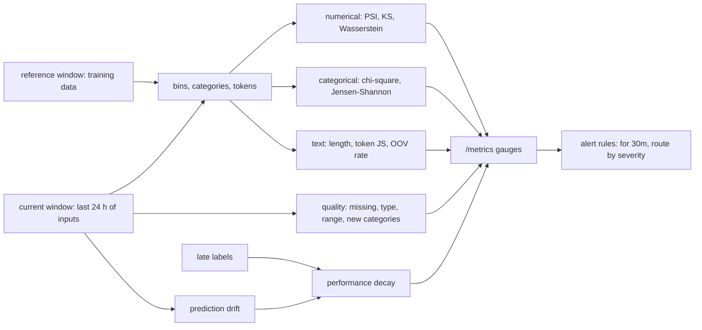

# A Model Degrades Without a Deploy: Drift and Data Quality

*Compare this week's inputs with the data the model learned from, column by column, and alert on the gap before the late labels prove it.*

## Metadata

| Field | Value |
|---|---|
| Type | Build |
| Languages | Python |
| Prerequisites | [An Alert Is a Query With a Clock and a Router](https://cloudcaptain.io/learn/observability/alerting), [An Experiment Is Parameters, Metrics and Artifacts With Lineage](https://cloudcaptain.io/learn/mlops/experiment-tracking) |
| Time | 75 minutes |
| Tools | Evidently, scipy, whylogs, Prometheus, promtool |

<Quiz stage="pre" />

## The Problem

The churn model has served the same version for four months. Its pods are healthy, p99 latency is 40 ms, the error rate is zero, and every dashboard the platform team owns is green. In week 17 the retention team asks why the "high churn risk" list doubled while actual cancellations did not move. Nobody deployed anything. Marketing launched a premium plan in week 12, so the `plan` column now has two and a half times as many `pro` customers as the training data had, incomes in the signup flow are 28% higher because of a new partner channel, and the model, trained when `pro` customers rarely left, now scores everyone who looks like a premium customer as low risk and everyone else as high risk.

The labels that would show it arrive late. A customer counts as churned 30 days after they stop paying, so in week 17 the team has ground truth for 40% of the week-15 traffic. Accuracy on that slice fell from 0.81 to 0.60, but the first person to compute it was an analyst, by hand, two weeks after the inputs started moving. The inputs themselves were available on the day of the launch.

The same month, a schema change in the CRM export turned `age` into an empty string for 6% of rows and wrote `unknown` into `tenure_days` for a few others. The feature pipeline filled the gaps with defaults, the model kept answering, and no alert fired, because nothing about a service's health says the numbers it receives are wrong. This lesson builds `minidrift`, which compares a current window of production inputs with a reference window column by column, checks data quality, tracks prediction drift and late-label performance, and exposes the results as Prometheus gauges with alerting rules, so the next shift pages someone on day one instead of week five.

## The Concept

A model is a function fitted to one sample of the world. **Drift** is any difference between that sample and what the model sees now. Three kinds matter in practice: the inputs change (data drift or covariate shift: more `pro` customers), the relation between inputs and the outcome changes (concept drift: `pro` customers start to churn), or the inputs break (a data-quality failure: a column goes empty). Only the first and the last are visible without labels, which is why monitoring compares inputs first and model quality when the labels arrive.

The comparison always has two windows. The **reference window** is the data the model learned from or a recent period you trust; the **current window** is the last day or week of production inputs. Each column gets a test that fits its type. **Numerical** columns get distances between distributions: the population stability index (PSI) bins both windows and sums `(ref − cur) × ln(ref / cur)` over the bins; the Kolmogorov-Smirnov (KS) statistic is the largest vertical gap between the two empirical CDFs and comes with a p-value; the Wasserstein distance is the area between the CDFs, how far the mass moved, in the column's own unit, so it is divided by the reference standard deviation. **Categorical** columns get a chi-square test of current counts against the counts the reference shares predict, and the Jensen-Shannon distance between the share vectors. **Text** inputs to an LLM can be compared without embeddings: message length, the divergence of token frequencies, and the share of tokens never seen in the reference (out of vocabulary).

The hard part is choosing what "different" means. p-values answer "could these be the same distribution?", and with 100,000 rows the answer is "no" for differences nobody cares about. Distances answer "how far apart?" and need a threshold you pick from history. The common default (Evidently's) is a test for small windows and a distance for large ones. **Data-quality checks** run beside drift: missing rate, values of the wrong type, numbers outside the reference range, categories never seen before. A spike in missing values is not drift to retrain on; it is a bug to fix.



Prediction drift is the cheapest early warning: the model's own output distribution moves whenever the inputs that matter to it move, and it needs no labels. Performance decay is the ground truth, but only on the labelled slice and only after the label delay, so it is reported with its coverage. The gauges go to Prometheus because the alerting machinery (a `for` clause, routing, silences, an on-call rotation) already exists there.

## Build It

`code/main.py` is `minidrift`: `generate` writes seeded CSVs with planted shifts, `report` compares two windows, `metrics` prints the Prometheus exposition, `serve` exposes `/metrics` and `/report`, and `rules` prints the alerting rules. It uses only the standard library, and every statistic is checked against Evidently and scipy in the smoke test.

### Step 1: windows, a schema and missing values

Both windows are CSV files. A schema names the id, target and prediction columns and the type of each feature; anything it omits is inferred from the reference (numbers, short strings, or text when values average four or more tokens). Reading a column separates usable values from missing ones and from values of the wrong type, because those are three different findings:

```python
for row in rows:
    raw = row.get(name)
    if is_missing(raw):
        data.missing += 1
        continue
    if kind == "numerical":
        value = parse_float(raw)
        if value is None:
            data.type_errors += 1
            continue
        data.values.append(value)
```

A feature that exists in the reference and not in the current window is reported as a schema change, exit code 2, never as drift.

### Step 2: PSI needs a binning rule

PSI is only defined over bins, so the binning is part of the metric: a different rule gives a different number for the same data. `minidrift` documents and uses one rule, the same one Evidently uses: equal-width bins over the pooled range of both windows, as many as Sturges' rule gives for the pooled size (13 bins for 4,000 values), computed the way `numpy.histogram_bin_edges(..., bins="sturges")` does:

```python
def sturges_edges(pooled: Sequence[float]) -> List[float]:
    lo, hi = min(pooled), max(pooled)
    width = (hi - lo) / (math.log2(len(pooled)) + 1.0)
    if lo == hi:
        lo, hi = lo - 0.5, hi + 0.5
    count = math.ceil((hi - lo) / width) if width else 1
    step = (hi - lo) / count
    return [i * step + lo for i in range(count)] + [hi]
```

Bins are half-open except the last, which includes its right edge. A numerical column with 20 or fewer distinct reference values is binned per value instead. An empty bin would make `ln(ref / cur)` infinite, so zero shares are replaced by 0.0001, or by a millionth of the smallest non-zero share when that is smaller:

```python
def fill_zeroes(shares: Sequence[float]) -> List[float]:
    smallest = min((s for s in shares if s > 0), default=1.0)
    filler = smallest / 10 ** 6 if smallest <= 0.0001 else 0.0001
    return [s if s > 0 else filler for s in shares]
```

```python
return math.fsum((r - c) * math.log(r / c) for r, c in zip(ref, cur))
```

The credit-scoring rule of thumb reads PSI below 0.1 as stable, 0.1 to 0.25 as a moderate shift and above 0.25 as a major one. Those numbers assume ten reference deciles; with another binning, calibrate the threshold on your own history.

### Step 3: the KS statistic and an exact p-value

KS sorts both samples and walks them together, tracking the gap between the two empirical CDFs after consuming every copy of each value (ties matter for integer columns). The gap is kept as an integer numerator over the least common multiple of the two sizes, so the statistic is exact:

```python
while i < n1 and j < n2:
    v = min(a[i], b[j])
    while i < n1 and a[i] == v:
        i += 1
    while j < n2 and b[j] == v:
        j += 1
    best = max(best, abs(i * s1 - j * s2))
```

The p-value is the share of all monotone lattice paths from `(0, 0)` to `(n1, n2)` that leave the band of width `best`. For equal sizes it has a closed form, evaluated without cancellation the way scipy does it:

```python
def ks_outside_square(n: int, h: int) -> float:
    p = 0.0
    k = n // h
    while k >= 0:
        p1 = 1.0
        for j in range(h):
            p1 = (n - k * h - j) * p1 / (n + k * h + j + 1)
        p = p1 * (1.0 - p)
        k -= 1
    return 2 * p
```

For unequal sizes (a column with missing values in one window) `ks_outside_lattice()` walks the lattice column by column, keeping only the band's sliding window, Hodges' "inside method" with Viehmann's recursion for `1 − p`. Above 10,000 rows per window it switches, like scipy, to the asymptotic Kolmogorov distribution (with Stephens' small-sample correction), which is within about 0.001 of scipy's value there.

### Step 4: Wasserstein in the column's unit, then normalised

The 1-D Wasserstein distance is the area between the two CDFs: walk the pooled sorted values and add `|F_ref − F_cur| × gap` for each step:

```python
for left, right in zip(pooled, pooled[1:]):
    u_cdf = bisect_right(u_sorted, left) / len(u_sorted)
    v_cdf = bisect_right(v_sorted, left) / len(v_sorted)
    total.append(abs(u_cdf - v_cdf) * (right - left))
```

On the generated data, income moved by 15,398 (currency units), age by 0.44 (years). Dividing by the reference's population standard deviation makes the scores comparable and gives one threshold, 0.1, for every column: income scores 0.62, age 0.04.

### Step 5: categorical columns

Chi-square compares the current counts with the counts the reference shares predict for a window of the current size, over the union of categories:

```python
scale = len(current) / len(reference)
statistic = 0.0
for key in keys:
    expected = ref_counter[key] * scale
    observed = cur_counter[key]
    if expected == 0:
        statistic = math.inf
        break
    statistic += (observed - expected) ** 2 / expected
```

A category the reference never had makes the expectation zero and the statistic infinite: `region` with 1.2% new `apac` rows gets p = 0. The p-value is the chi-square survival function, the regularised upper incomplete gamma function `Q(df/2, x/2)`, computed with a series below `x = a + 1` and a Lentz continued fraction above it (`gamma_q()`). The Jensen-Shannon distance is symmetric, bounded and finite with empty categories, which is why it is the large-sample default:

```python
m = [(a + b) / 2.0 for a, b in zip(p, q)]
js = math.fsum(rel_entr(a, c) for a, c in zip(p, m)) + math.fsum(rel_entr(b, c) for b, c in zip(q, m))
if base is not None:
    js /= math.log(base)
return math.sqrt(max(js, 0.0) / 2.0)
```

With the natural logarithm it lies between 0 and `sqrt(ln 2)` ≈ 0.83; with base 2 between 0 and 1. On the same `region` data JS is 0.068, below the 0.1 threshold: the two methods disagree about a 1.2% new category, and the data-quality check is what catches it either way.

### Step 6: pick the method by window size

```python
def choose_method(kind: str, reference_rows: int, override: Optional[str]) -> str:
    if override:
        return override
    if kind == "categorical":
        return "chisquare" if reference_rows <= SMALL_SAMPLE else "jensenshannon"
    return "ks" if reference_rows <= SMALL_SAMPLE else "wasserstein"
```

```python
def is_drift(method: str, score: float, threshold: float) -> bool:
    return score < threshold if method in P_VALUE_METHODS else score >= threshold
```

Every report carries all statistics for every column; the method only decides which one sets the drift flag. `--num-method` and `--cat-method` override it, `--threshold psi=0.2` changes a threshold. The dataset drifts when at least half of the feature columns do (`--drift-share`).

### Step 7: data quality next to drift

```python
if cur_missing - ref_missing > options.max_missing_increase:
    report["issues"].append(f"missing rate rose from {ref_missing:.1%} to {cur_missing:.1%}")
if cur.type_errors:
    report["issues"].append(f"{cur.type_errors} value(s) are not {kind}")
```

The same function flags numerical values outside the reference minimum and maximum (above 1% of rows) and lists categories the reference never had. Drift is computed on the usable values only, so a column can lose 6% of its values and show no drift at all: `age` does exactly that in the generated data.

### Step 8: prediction drift and late labels

The prediction column goes through the same numerical tests with role `prediction`, so it is reported and alerted separately from the features. Performance needs labels; current rows usually have none yet, so `--labels` joins a file of labels that have arrived, by id:

```python
raw = row.get(target)
raw = late.get(row.get(id_column, ""), raw) if is_missing(raw) else raw
```

Accuracy (or MAE for a numeric target) is computed on the labelled rows of each window and reported with the coverage. Below 20% coverage the status is `insufficient_labels` whatever the number says; above it, a drop of more than 0.05 is `decayed`.

### Step 9: text drift without embeddings

LLM traffic has no columns, but its prompts have measurable shape. `text_stats()` tokenises with a lowercase regex and compares three things: the token-count distribution (KS), token frequencies over the union vocabulary (Jensen-Shannon), and the share of current tokens that never appear in the reference:

```python
unseen = Counter({tok: n for tok, n in cur_counts.items() if tok not in ref_counts})
oov_rate = sum(unseen.values()) / cur_total
```

The column drifts when any of the three crosses its threshold, and the report lists the most frequent new tokens: `refund`, `charged`, `outage` in a support bot's traffic say more than any score.

### Step 10: gauges and alert rules

`render_metrics()` writes the Prometheus text format: one `# HELP` and `# TYPE ... gauge` per family, then samples with the model, feature, kind, role and method as labels:

```text
minidrift_feature_drift_detected{model="churn",method="wasserstein",feature="income",kind="numerical",role="feature"} 1.0
minidrift_feature_missing_ratio{model="churn",feature="age",window="current"} 0.0565
minidrift_dataset_drift_share{model="churn"} 0.5
```

`serve` computes the report once and again whenever an input file's modification time changes, so a batch job that rewrites `current.csv` every hour drives the gauges. `rules` writes five alerts: `FeatureDrift` and `PredictionDrift` (ticket), `DatasetDrift` (page), `FeatureMissingValues`, which compares the two windows with `ignoring(window)`, and `DriftCheckStale` for a job that stopped running. The drift and quality alerts wait 30 minutes (`--for`) so one odd batch does not page.

### Step 11: run it

```bash
python3 code/main.py generate --out data
python3 code/main.py report data/reference.csv data/current.csv --schema data/schema.json --labels data/labels.csv --model churn
```

```text
column         kind         role        method              score threshold  drift
age            numerical    feature     wasserstein       0.03996       0.1  -
income         numerical    feature     wasserstein        0.6168       0.1  DRIFT
tenure_days    numerical    feature     wasserstein       0.05889       0.1  -
plan           categorical  feature     jensenshannon      0.1725       0.1  DRIFT
region         categorical  feature     jensenshannon     0.06813       0.1  -
message        text         feature     text               0.1627       0.1  DRIFT
prediction     numerical    prediction  wasserstein        0.7121       0.1  DRIFT

dataset: 3 of 6 features drifted (50%), dataset drift (50%)
performance: accuracy 0.807 -> 0.604 on 849 labelled rows (42% coverage): decayed
quality:
  age: missing rate rose from 0.0% to 5.7%
  tenure_days: 6 value(s) are not numerical
  region: 1 new category: apac (1.2% of rows)
  prediction: 1.2% of values outside the reference range [0.0325, 0.937]
text message: tokens 8.0 -> 13.1, token JS 0.163, OOV 7.4%, new: card, login, crash, outage, refund
```

```bash
python3 code/main.py report data/reference.csv data/current.csv --schema data/schema.json --num-method ks --cat-method chisquare --json > report.json
python3 code/main.py serve data/reference.csv data/current.csv --schema data/schema.json --labels data/labels.csv --model churn --port 9108 &
curl -s localhost:9108/metrics | grep drift_detected
python3 code/main.py rules --for 30m > drift-rules.yml
```

`report --fail-on-drift` exits 1 when a column drifted, a quality check failed or performance decayed, so it can gate a batch scoring job; bad input exits 2.

<RunTests />

## Use It

**Evidently** is the open-source library most teams start with. Its current API builds a `Report` from metrics and presets and runs it on two `Dataset`s; the drift methods behind `ValueDrift` and `DataDriftPreset` are the ones you just built (`psi`, `ks`, `wasserstein`, `jensenshannon`, `chisquare` and more), with the same binning and the same small-versus-large window defaults. The lesson's requirements file pins Evidently 0.7.23 and its whole dependency tree by hash; that release still imports a pandas internal that pandas 3 removed, so the file pins pandas 2.3.3:

```bash
python3.12 -m venv ev
ev/bin/pip install --require-hashes --only-binary=:all: -r code/requirements-oracles.txt
```

```python
import pandas as pd
from evidently import DataDefinition, Dataset, Report
from evidently.metrics import DriftedColumnsCount, MissingValueCount, ValueDrift
from evidently.presets import DataDriftPreset, DataSummaryPreset
from evidently.tests import lt, lte

num, cat = ["age", "income", "tenure_days", "prediction"], ["plan", "region"]
def load(path):
    df = pd.read_csv(path, dtype={c: str for c in cat})
    df[num] = df[num].apply(pd.to_numeric, errors="coerce")
    return df[num + cat]
schema = DataDefinition(numerical_columns=num, categorical_columns=cat)
ref = Dataset.from_pandas(load("data/reference.csv"), data_definition=schema)
cur = Dataset.from_pandas(load("data/current.csv"), data_definition=schema)

Report([DataDriftPreset(method="psi"), DataSummaryPreset()]).run(cur, ref).save_html("drift.html")

gate = Report([
    DriftedColumnsCount(columns=["age", "income", "tenure_days", "plan", "region"], share_tests=[lt(0.5)]),
    ValueDrift(column="prediction", method="wasserstein", tests=[lte(0.1)]),
    MissingValueCount(column="age", tests=[lte(0)]),
], include_tests=True).run(cur, ref)
print([(t["name"], t["status"]) for t in gate.dict()["tests"]])
```

The first report is the HTML page an analyst reads; the second is a test suite whose statuses a CI job or an Airflow task turns into pass or fail. Note `run(current, reference)`: current first. Evidently can also store snapshots in a workspace and chart them over time in its UI. The smoke test runs 22 `ValueDrift` metrics and two `DriftedColumnsCount` metrics against `minidrift` on the same files: every value agrees to 1e-9 (chi-square p-values to 1e-6), and the drifted-column counts are equal. So do `scipy.stats.ks_2samp`, `wasserstein_distance`, `chisquare` and `scipy.spatial.distance.jensenshannon`, including the exact KS p-values for the columns with missing values (2,000 against 1,887 rows).

**whylogs** takes another approach: instead of keeping raw windows, it logs a **profile** per batch, a set of mergeable sketches (KLL quantiles for distributions, HyperLogLog for cardinality, frequent items for categories), so a day of profiles is kilobytes and profiles from many hosts merge. `why.log(df).view()` builds one, and `calculate_drift_scores(target_view=cur, reference_view=ref)` from `whylogs.viz.drift.column_drift_algorithms` runs KS and chi-square on the profiles. On this lesson's data it gives income a KS statistic of 0.239 where the exact one is 0.240, because the CDF comes from a quantile sketch: sketches trade exactness for constant memory. The project's last release (1.6.4) predates NumPy 2 (it uses `np.unicode_`) and its repository has had no activity since January 2025, after WhyLabs discontinued its hosted platform; treat it as unmaintained and use it for the idea, or pin NumPy below 2 in an isolated environment.

**Prometheus** turns the gauges into pages. Scrape `minidrift serve` (or a push from a batch job through the Pushgateway, since drift is computed per batch), load the generated rules, and test both offline:

```yaml
scrape_configs:
  - job_name: drift
    scrape_interval: 1m
    static_configs:
      - targets: ["drift-monitor.ml.svc:9108"]
rule_files:
  - drift-rules.yml
```

```bash
curl -s localhost:9108/metrics > metrics.txt
docker run --rm -i --entrypoint /bin/promtool prom/prometheus:v3.16.0 check metrics < metrics.txt
docker run --rm -i --entrypoint /bin/promtool prom/prometheus:v3.16.0 check rules /dev/stdin < drift-rules.yml
promtool test rules drift-rules-test.yml
```

The smoke test builds `drift-rules-test.yml` from the scraped metrics, holds every value for an hour of `input_series`, and asserts that at 10 minutes nothing fires and at 45 minutes exactly three `FeatureDrift`, one `PredictionDrift`, one `DatasetDrift` and one `FeatureMissingValues` alert fire with the expected labels and rendered annotations, then checks that an expectation with one alert missing fails. Route `severity: ticket` to the model owner's queue and `severity: page` to on-call; a drifted feature is rarely a 3 a.m. problem, a model whose inputs all moved at once usually is.

**Deciding what a drift alert means.** The statistics say the windows differ, not why. Work through the causes in this order, because the cheap ones are the common ones:

| Signal | Usually means | Action |
|---|---|---|
| missing ratio, type errors or out-of-range values up, often in several columns at once | an upstream schema or pipeline change | fix the pipeline or roll it back; never retrain on broken inputs |
| one categorical column with a new category, everything else stable | a new product, region or client version | add the category to the feature pipeline; retrain if it carries real volume |
| several features and the prediction distribution moved, labels not in yet | a real population change (campaign, season, new channel) | check the business calendar, segment the report, retrain from a window that contains the new population |
| features stable, labelled accuracy down | concept drift: the relation changed | retrain on recent labelled data; features may be missing |
| prediction drift only | a feature the model weighs heavily moved a little, or a serving bug (wrong model version, preprocessing skew) | compare the serving features with the training pipeline's for the same rows |
| drift every week on a column nobody cares about | the threshold is too tight for the window size | calibrate the threshold on past weeks without incidents, or drop the alert for that column |

The reference window has to be versioned like the model: the training data of the model version in production, pinned by the data version recorded in its run (the experiment-tracking lesson's lineage tags), not "last month", which silently moves.

| What you built | Real tool | Note |
|---|---|---|
| `sturges_edges()`, `fill_zeroes()`, `psi()` | Evidently `psi` stattest | same pooled Sturges bins and zero filling; credit-risk PSI uses reference deciles instead |
| `ks_2samp()` exact and asymptotic | `scipy.stats.ks_2samp`, Evidently `ks` | same lattice algorithms; scipy also offers one-sided tests |
| `wasserstein_norm()` | `scipy.stats.wasserstein_distance`, Evidently `wasserstein` | Evidently divides by the reference standard deviation too |
| `chi_square()`, `gamma_q()` | `scipy.stats.chisquare`, `scipy.stats.chi2.sf` | a new category gives an infinite statistic in all three |
| `jensen_shannon()` | `scipy.spatial.distance.jensenshannon` | natural log by default; pass `base=2` for a 0 to 1 scale |
| `choose_method()` | Evidently's automatic method selection | Evidently also uses a z-test for binary categories |
| `quality()` | Evidently `DataSummaryPreset`, `MissingValueCount`; Great Expectations | expectations as code are the next step for quality rules |
| `text_stats()` | Evidently text descriptors (`TextLength`, `OOV`), embedding drift | embeddings catch meaning changes that token counts miss |
| `performance()` with `--labels` | Evidently classification and regression presets, delayed-label joins in a feature store | always report coverage next to the metric |
| windows from CSV | whylogs profiles, Evidently snapshots | sketches merge across hosts and days; raw windows give exact statistics |
| `/metrics`, `rules` | Evidently UI, Prometheus and Alertmanager | `promtool check metrics` and `promtool test rules` prove both |

<Quiz stage="check" />

## Ship It

Two artifacts in `outputs/`:

- **`skill-drift-response.md`**: the runbook an on-call engineer or an agent follows when a drift or data-quality alert fires: confirm the job ran and which windows it compared, rule out pipeline bugs (missing values, types, ranges, schema), segment the shift, check the label coverage before trusting accuracy, and decide between fixing the pipeline, recalibrating a threshold, retraining or rolling back, with the commands for `minidrift`, Evidently and Prometheus, a decision table and a fixed report.
- **`prompt-explain-drift-report.md`**: paste a `minidrift report --json` or an Evidently snapshot and get a plain-language explanation for the model owner and the business: what moved and by how much in the column's units, which findings are data bugs, whether the label coverage supports a quality claim, the most likely causes ranked, and the one next action, without overstating p-values.

<ShipIt />

## Exercises

### Easy

Add decile binning for PSI: `--binning quantile` computes the 10 reference deciles as edges (with `-inf` and `+inf` at the ends), bins both windows on them, and reports PSI with the same zero filling. Write the tests first: a reference of 0 to 99 must give exactly 10% per bin, identical windows must give 0, and a current window shifted by 50 must put half its values in the last bin. Then compare both binnings on the generated income column and explain why the thresholds of 0.1 and 0.25 belong to the decile rule.

### Medium

Make drift monitoring segment-aware. Add `--segment plan`, which runs every drift and quality check per value of that column and adds a `segment` label to the gauges, and a `minidrift_segment_rows` gauge so small segments can be ignored in alert rules. Tests first: build windows where income shifts only for `pro` customers, and assert that the overall income score stays below the threshold while the `pro` segment drifts. Then write the alert rule that requires at least 200 rows in a segment before it fires, and a `promtool test rules` case for it.

### Hard

Close the loop with experiment tracking. Add `minidrift log --tracking-uri URL --run-id ID`, which posts every column's score, the dataset drift share and the performance numbers to `POST /api/2.0/mlflow/runs/log-batch` (MLflow's REST API, standard library `urllib` only), and add `--reference-run ID` that reads the run's `data.version` tag to name the reference dataset in the report. Test it against a fake tracking server on a real local socket that records the requests; assert the metric keys, steps and that a missing tag is a clear error. If the experiment-tracking lesson's `minitrack` or a real MLflow server is running, log a week of daily reports and compare them in its UI.

<Quiz stage="post" />

## Key Terms

| Term | Common misconception | Precise definition |
|---|---|---|
| Data drift | "The model got worse." | A change in the distribution of the model's inputs between a reference and a current window; it may or may not hurt quality. |
| Concept drift | "Another word for data drift." | A change in the relation between inputs and the outcome; inputs can look identical while the right answer changed, and only labels reveal it. |
| Reference window | "Last month's data." | The data you compare against, usually the training data of the model version in production, pinned by version so it does not move. |
| PSI | "A standard number with universal thresholds." | `Σ (ref − cur) × ln(ref / cur)` over bins; its value depends on the binning and the zero filling, so a threshold is only valid for one rule. |
| KS test | "A small p-value means a big shift." | The largest gap between two empirical CDFs with a p-value for "same distribution"; with large windows tiny, irrelevant shifts get tiny p-values. |
| Wasserstein distance | "A test with a p-value." | The area between two CDFs, how far probability mass moved, in the column's unit; divide by the reference standard deviation to compare columns. |
| Jensen-Shannon distance | "KL divergence." | The square root of the average KL divergence of each distribution from their mixture; symmetric, finite with empty bins, at most `sqrt(ln 2)` with natural logs. |
| Prediction drift | "Only useful with labels." | A change in the distribution of the model's outputs; it needs no labels and is often the first sign that inputs the model relies on moved. |
| Label delay | "Accuracy is a real-time metric." | The time until ground truth exists; quality metrics cover only the labelled slice, so they are reported with coverage and lag behind input drift. |
| Data-quality check | "Part of drift detection." | A rule about valid inputs (missing rate, type, range, allowed categories); a failure is a bug to fix, not a shift to retrain on. |

## Further Reading

- [Observability](https://cloudcaptain.io/docs/tools/observability): metrics, alerting and dashboards, the machinery drift gauges plug into.
- [AI/ML Ops learning path](https://cloudcaptain.io/docs/learning-paths/ai-ml): where monitoring sits after training, packaging and rollout.
- [SRE learning path](https://cloudcaptain.io/docs/learning-paths/sre): alert design and on-call practice that apply unchanged to model alerts.
- [Evidently: data drift methods](https://docs.evidentlyai.com/metrics/customize_data_drift): every drift method, its default threshold and how the automatic choice works.
- [scipy.stats.ks_2samp](https://docs.scipy.org/doc/scipy/reference/generated/scipy.stats.ks_2samp.html): exact and asymptotic modes and the references for the lattice-path algorithms.
- [scipy.stats.wasserstein_distance](https://docs.scipy.org/doc/scipy/reference/generated/scipy.stats.wasserstein_distance.html): the CDF-area definition used here.
- [Prometheus text exposition format](https://prometheus.io/docs/instrumenting/exposition_formats/): the format `/metrics` writes and `promtool check metrics` lints.
- [Prometheus unit testing for rules](https://prometheus.io/docs/prometheus/latest/configuration/unit_testing_rules/): `input_series`, expanding notation and `alert_rule_test`.
- [Prometheus metric and label naming](https://prometheus.io/docs/practices/naming/): why the gauges end in `_ratio` and `_seconds` and never in `_total`.
- [whylogs](https://github.com/whylabs/whylogs): data profiles built from mergeable sketches, the alternative to keeping raw windows.
