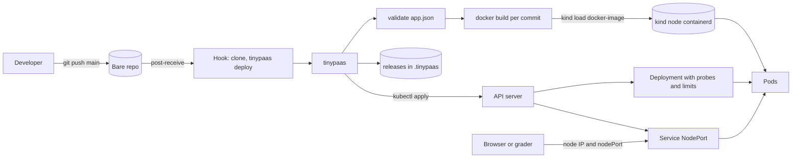

# Build a Tiny PaaS: From git push to a Running URL

*A PaaS is a build, a release record and a reconcile loop behind git push; build all three and the URL answers.*

## Metadata

| Field | Value |
|---|---|
| Type | Capstone |
| Languages | Python, Bash |
| Prerequisites | [Build an Image Without a Dockerfile](https://cloudcaptain.io/learn/containers/image-build), [A Controller Is a Loop That Compares](https://cloudcaptain.io/learn/orchestration/reconciler), [Hooks Are Programs Git Runs at the Right Moment](https://cloudcaptain.io/learn/git/git-hooks), [GitOps Is a Reconciler Whose Desired State Is a Commit](https://cloudcaptain.io/learn/cicd/gitops-reconciler), [A Golden Path Is a Template Plus Decisions Already Made](https://cloudcaptain.io/learn/platform/golden-path) |
| Time | 12 hours |
| Tools | docker, kind, kubectl, git |
| Pass score | 11 of 15 points |

## The Brief

Twelve product teams each run two or three small HTTP services on the shared cluster. Every team wrote its own Dockerfile, its own Deployment YAML and its own CI job, and every one of them is different: half have no readiness probe, a third have no memory limit, two tag every image `latest`, and nobody can say which commit is running in production without reading a pod spec. When a deploy goes wrong the fix is whatever the person on call remembers about `kubectl rollout undo`. The platform team wants the Heroku experience for these services: a developer writes an `app.json`, runs `git push` to a deploy remote, and gets a URL. You are building that platform, `tinypaas`, on a kind cluster.

Your users are application developers who know their app and do not want to learn Kubernetes, and the platform team who operates `tinypaas` and gets paged when a release breaks. At the end, a developer can validate a manifest, build an image per commit, deploy it behind probes and limits, deploy by pushing to `main`, set config and scale, list releases and roll back to any good one, and read the logs of every pod in one stream.

**The interface contract.** The grader never imports your code. It runs one executable and reads the cluster, so you can write `tinypaas` in any language as long as this holds:

- `bin/tinypaas` at the root of your project, executable. The starter gives you a Python one with every subcommand stubbed.
- Every read command takes `--json` and then prints exactly one JSON object on stdout; progress goes to stderr. Exit 0 on success, 1 on failure, 2 on a usage error.
- State lives under `$TINYPAAS_HOME/.tinypaas/` (or `--data-dir`, default your home directory) or in the cluster.

| Variable | Meaning | Default |
|---|---|---|
| `TINYPAAS_HOME` | data directory; state goes in `.tinypaas/` inside it | your home directory |
| `TINYPAAS_CONTEXT` | kubectl context to use | the current context |
| `TINYPAAS_KIND_CLUSTER` | kind cluster to load images into | the context name without `kind-` |
| `TINYPAAS_NAMESPACE_PREFIX` | apps live in namespace `<prefix>-<app>` | `tinypaas` |

| Command | With `--json` prints | Exit |
|---|---|---|
| `tinypaas validate <app-dir>` | `{"valid": bool, "errors": [{"path", "message"}]}` | 0 valid, 1 invalid |
| `tinypaas build <app-dir>` | `{"app", "image", "commit", "digest"}` | 0 |
| `tinypaas deploy <app-dir> [--timeout SECONDS] [--app NAME]` | `{"app", "release", "image", "status"}` | 0 live, 1 failed |
| `tinypaas url <app>` | `{"app", "url"}` | 0 |
| `tinypaas remote add <app> <bare-repo-path>` | `{"app", "remote"}` | 0 |
| `tinypaas config set <app> KEY=VALUE...` | `{"app", "release", "status"}` | 0 live, 1 failed |
| `tinypaas scale <app> web=N` | `{"app", "web"}` | 0 when N pods are ready |
| `tinypaas releases <app>` | `{"app", "current", "releases": [{"number", "image", "config_hash", "time", "status"}]}` | 0 |
| `tinypaas rollback <app> [--to N]` | `{"app", "release", "status"}` | 0 live, 1 failed |
| `tinypaas logs <app> [--since 5m]` | `{"app", "lines": [{"time", "pod", "line"}]}` | 0 |

In the cluster, app `web` with the default prefix runs as Deployment `web` in namespace `tinypaas-web`, behind a Service of type `NodePort`. Its URL is `http://<node InternalIP>:<nodePort>`. Images reach the node with `kind load docker-image`, so there is no registry. On Linux the node IP is reachable from the host; Docker Desktop on macOS and Windows does not route to it, so there the grader fetches the URL from inside the kind node with `docker exec <node> curl`, and you browse with `kubectl port-forward -n tinypaas-web svc/web 8080:80`.

**Out of scope:** an image registry, TLS and ingress or Gateway routing, buildpacks for languages other than Python and static sites, process types other than `web`, autoscaling, add-ons such as databases, persistent volumes, users and tenants.

**Install:** Docker, [kind](https://kind.sigs.k8s.io) (the curriculum tracks <ToolVersion name="kind" />), kubectl, git and Python 3.9 or newer. Create the cluster once with `kind create cluster --name tinypaas`; its context is `kind-tinypaas`.

## The Architecture



`tinypaas` follows the build, release, run split of the Twelve-Factor App. A **build** turns one commit into one image: `git archive` exports exactly the committed tree, so an uncommitted edit can never leak into an image, and the tag is the commit's short sha, so `kubectl get deploy -o yaml` tells you what is running. A **release** is that image plus a config (the manifest's `env` defaults overlaid by `config set` values) with a number, a time and a status. A **run** is Kubernetes making the cluster match the release: `tinypaas` renders a Deployment and a Service, applies them, and waits for the rollout. Kubernetes is the reconcile loop from the orchestration phase; `tinypaas` only writes the desired state and reads back whether it converged.

A manifest is small on purpose:

```json
{
  "name": "hello",
  "web": "python3 app.py",
  "port": 8080,
  "health": "/healthz",
  "env": {"GREETING": "hello"},
  "resources": {"cpu": "100m", "memory": "64Mi"},
  "replicas": 1
}
```

and a release record holds everything needed to recreate it exactly:

```json
{
  "number": 4,
  "image": "tinypaas/hello:3f9c2a1",
  "config_hash": "sha256:6b1f...",
  "time": "2026-11-13T10:42:07Z",
  "status": "succeeded",
  "description": "Rollback to v1",
  "rollback_of": 1
}
```

Three design decisions carry the milestones. First, the Deployment uses `maxUnavailable: 0` and `maxSurge: 1`, and a readiness probe on the manifest's health path: a new pod that never becomes ready never receives traffic and never replaces an old one, so a bad release cannot take the app down while you wait for it to time out. Second, a rollback is a new release that copies an old one's image and config, the way Heroku does it, so the release list is an append-only audit log and you can roll back a rollback. Third, `git push` deploys through a `post-receive` hook in a bare repository: it runs after the refs are updated, its output reaches the pusher as `remote:` lines, and it decides by ref name whether to deploy at all.

## Milestones

### Validate the app manifest

Build `tinypaas validate <app-dir> --json`. It reads `<app-dir>/app.json` and reports every error, not just the first, each with a JSON path built by joining keys with dots (`$.port`, `$.env.lower-case`, `$.resources.memory`; `$` for the file itself). Reread [the golden path lesson](https://cloudcaptain.io/learn/platform/golden-path): a validator that fails at the earliest moment is what keeps a template's services correct.

The rules the grader's fixtures follow:

| Field | Rule | Error path |
|---|---|---|
| file | `app.json` exists and is a JSON object | `$` |
| any key | one of `name`, `description`, `web`, `static`, `port`, `health`, `env`, `resources`, `replicas` | `$.<key>` |
| `name` | required; a DNS label (lowercase letters, digits, `-`, starts and ends alphanumeric) of at most 30 characters, so `<prefix>-<name>` fits the 63-character namespace limit | `$.name` |
| `web`, `static`, `Dockerfile` | `web` is a non-empty command; `static` is a relative directory that exists; not both; at least one of `web`, `static` or a `Dockerfile` in the app directory (missing all three is reported at `$.web`) | `$.web`, `$.static` |
| `port` | required integer from 1024 to 65535 | `$.port` |
| `health` | required string starting with `/` | `$.health` |
| `env` | optional object; keys match `[A-Z_][A-Z0-9_]*`, values are strings (one error per bad key) | `$.env.<key>` |
| `resources` | optional object with only `cpu` (`100m`, `0.5`) and `memory` (`64Mi`, `1Gi`) | `$.resources.<key>` |
| `replicas` | optional integer from 1 to 10 | `$.replicas` |

**Check:** 13 fixture manifests in `grader/fixtures/manifests/cases.json` (3 valid, 10 broken in one or several ways) must give the expected `valid`, the exit code 0 or 1, and exactly the expected set of paths. **Hint:** run every rule and collect errors into a list; return early only when the file cannot be parsed.

### Build an image per commit

Build `tinypaas build <app-dir> --json`. Export the committed tree (`git archive HEAD`, or `HEAD:<subdir>` when the app lives in a subfolder), use the app's `Dockerfile` if it has one, otherwise generate one: a Python app gets `FROM python:3.13-alpine`, `COPY . /app/` and `CMD ["sh", "-c", "exec <web>"]`; a static app copies its directory into an image that serves it with `python3 -m http.server`. Tag the image `tinypaas/<app>:<short sha>`, read its content digest with `docker image inspect --format '{{.Id}}'`, and load it into the cluster with `kind load docker-image <image> --name <cluster>`. Reread [the image build lesson](https://cloudcaptain.io/learn/containers/image-build) for what a tag and a digest are, and [PID 1](https://cloudcaptain.io/learn/linux/pid1-supervisor) for why the generated command starts with `exec`.

**Check:** the grader builds three fixture apps (a generated Python image, one with its own `Dockerfile`, and a static site). For each, the tag must be a prefix of at least 7 characters of the commit's sha, `digest` must equal Docker's image ID, and the image must be in the containerd store of every kind node (`crictl images`). The `Dockerfile` app's image must carry that Dockerfile's label, and a second commit must produce a new tag. **Hint:** `git rev-parse --show-prefix` gives the subfolder for `git archive`.

### Deploy and answer on a URL

Build `tinypaas deploy <app-dir> [--timeout SECONDS]` and `tinypaas url <app> --json`. Deploy validates, builds, records a release, applies a Namespace `<prefix>-<app>`, a Deployment and a NodePort Service, then waits with `kubectl rollout status --timeout`. Render the readiness and liveness probes from `health` (`httpGet` on the container port), set requests and limits from `resources`, pass `PORT` and the config as environment variables, and use `replicas` from the manifest. `url` reads the node's InternalIP and the Service's `nodePort`. Reread [the reconciler lesson](https://cloudcaptain.io/learn/orchestration/reconciler) for what `rollout status` is waiting for.

**Check:** after deploy, the URL answers HTTP 200 with the fixture's body within 90 seconds, and the live Deployment has `readinessProbe.httpGet.path` `/healthz`, a `livenessProbe`, and limits of 100m CPU and 64Mi memory. **Hint:** apply a `List` of objects with `kubectl apply -f -` and JSON on stdin; Kubernetes keeps the allocated `nodePort` across later applies.

### Deploy on git push

Build `tinypaas remote add <app> <bare-repo-path>`. It creates a bare repository with `git init --bare --initial-branch main` and installs an executable `hooks/post-receive` that reads `<old> <new> <ref>` lines on stdin, ignores every ref except `refs/heads/main`, clones the pushed commit into a temporary directory and runs `tinypaas deploy` on it. Bake the absolute path of `tinypaas` and the `TINYPAAS_*` values into the hook, because the hook runs with the pusher's environment, not yours. Reread [the git hooks lesson](https://cloudcaptain.io/learn/git/git-hooks) and [the GitOps reconciler lesson](https://cloudcaptain.io/learn/cicd/gitops-reconciler).

**Check:** the grader creates a fixture repository, runs `remote add`, pushes `main`, and expects the URL to serve the first body; pushes a second commit and expects the new body within 120 seconds; then pushes a `feature` branch and expects the Deployment's generation and the served body to stay the same for 8 seconds and no image tagged with the feature commit. **Hint:** a hook runs with `GIT_DIR` set; run `unset $(git rev-parse --local-env-vars)` before calling `git clone`, or the clone talks to the wrong repository.

### Config and scale

Build `tinypaas config set <app> KEY=VALUE...` and `tinypaas scale <app> web=N`. Setting config creates a new release with the current image and the merged config and rolls it out; the value must survive later deploys. Scaling is not a release: store the process count, run `kubectl scale`, wait until N pods are ready, and render that count on the next deploy instead of the manifest's `replicas`. Reread [the services and DNS lesson](https://cloudcaptain.io/learn/orchestration/services-dns) for why new pods join the Service on their own.

**Check:** after `config set ccg-config CC_GRADE_TOKEN=...`, the fixture's `/env` endpoint returns that value within 90 seconds; after `scale ccg-config web=3`, the Deployment asks for 3 replicas and 3 pods are ready within 120 seconds. This milestone deploys first, so it needs deploy to work. **Hint:** a changed environment variable changes the pod template, which is what makes Kubernetes roll new pods.

### Releases and rollback

Every deploy and config change is a numbered release (1, 2, 3, in order) with `number`, `image`, `config_hash`, `time` (RFC 3339) and `status` (`succeeded`, `failed`, or `pending` while it rolls out), and `current` is the number of the release that is serving. When a rollout does not finish within `--timeout`, mark the release `failed`, re-apply the current release so the half-started pod goes away, keep `current` unchanged and exit 1. `tinypaas rollback <app> --to N` creates a new release with release N's image and config; without `--to` it restores the most recent `succeeded` release before the current one, skipping failed ones. Compute `config_hash` from a canonical form of the config, for example `sha256` of `json.dumps(config, sort_keys=True, separators=(",", ":"))`. Reread [Helm from scratch](https://cloudcaptain.io/learn/orchestration/helm-from-scratch) for another release record.

**Check:** two good deploys give releases 1 and 2 with different images and config hashes; a commit whose `/healthz` returns 503 (the `unready` fixture), deployed with `--timeout 40`, must exit non-zero, show as release 3 `failed` with `current` still 2, while the URL keeps serving release 2's body. `rollback --to 1` must create release 4 with release 1's image and `config_hash`, serve release 1's body and `GREETING`, and run release 1's image on the live Deployment; a plain `rollback` must then restore release 2 as release 5. **Hint:** with `maxUnavailable: 0`, the old pods keep serving while the new one fails readiness; your only job is to notice and record it.

### Logs across pods

Build `tinypaas logs <app> --since 5m --json`: list the app's pods, run `kubectl logs <pod> --timestamps --since 5m` for each, split each line into its timestamp and text, and merge all pods into one list ordered by time, each entry `{"time", "pod", "line"}`. Reread [the incident response lesson](https://cloudcaptain.io/learn/observability/incident-response) for why merged, timestamped logs matter at 3 a.m.

**Check:** the grader deploys the fixture with `replicas: 2`, waits until both pods have answered its `/pod` endpoint through the Service, sends 40 requests carrying markers, and expects every marker back, each labelled with the pod that wrote it (the fixture prints its own pod name in the line), from both pods, with the times in order. **Hint:** RFC 3339 timestamps from the kubelet drop trailing zeros in the fraction, so `10:00:00.1Z` sorts after `10:00:00.12Z` as a string; parse them before sorting.

## Grading

Grade your project from a CloudCaptain checkout at any time; each milestone runs on its own:

```bash
kind create cluster --name tinypaas
bash curriculum/phases/16-capstones/01-build-a-paas/grader/grade.sh path/to/your-project
bash curriculum/phases/16-capstones/01-build-a-paas/grader/grade.sh path/to/your-project --milestone app-manifest
bash curriculum/phases/16-capstones/01-build-a-paas/grader/grade.sh path/to/your-project --milestone deploy --milestone logs
bash curriculum/phases/16-capstones/01-build-a-paas/grader/grade.sh path/to/your-project --json
```

The grader needs Python 3.9 or newer, Docker, kind, kubectl and git, and a kind cluster as the current kubectl context. It starts nothing long-lived itself: it writes fixture apps into temporary git repositories, drives your `bin/tinypaas` with `TINYPAAS_HOME` pointing at a temporary directory and `TINYPAAS_NAMESPACE_PREFIX=cc-grade-paas`, and reads the results with kubectl, docker and HTTP. The first milestone needs no cluster. A full run of the reference solution takes about three minutes; a deploy that never becomes ready costs its whole `--timeout`.

To grade every push, copy `grader/workflow.yml` to `.github/workflows/cloudcaptain-grade.yml` in your project repository. It checks out your repository as `project`, fetches the grader from CloudCaptain (so you get grader fixes and cannot edit your own grader), creates a kind cluster with `helm/kind-action`, and writes the score table to the run's summary page. If your `tinypaas` needs more than Python, add its setup step before `Grade`.

The grader's safety rules:

- It refuses to run cluster checks unless the current context starts with `kind-` or equals `$CC_GRADER_CONTEXT`; for a context not named `kind-<cluster>`, set `CC_GRADER_KIND_CLUSTER` too.
- It only creates, reads and deletes namespaces named `cc-grade-paas-*`, and only removes images named `tinypaas/ccg-*` (its own fixture apps) from Docker and from the kind nodes.
- Every check deletes what it created when it ends, passed or failed, and removes leftovers from an interrupted run before it starts.
- It never needs a registry, a cloud account or a network connection beyond pulling `python:3.13-alpine` for the builds.

## Ship It

You keep a working PaaS you can explain line by line, and two artifacts:

- `outputs/skill-build-a-paas-review.md`: a skill an agent follows to review any deploy platform or pipeline (yours, a Heroku-style buildpack setup, an internal developer platform) against the properties this capstone grades: immutable per-commit images, release records, safe rollouts, rollback, config handling and logs.
- `outputs/prompt-explain-failed-release.md`: a prompt that takes a release list, `kubectl describe` output and pod logs, and explains why a release failed and what to do next, in a fixed structure.

<ShipIt />

## Stretch Goals

- Add a `worker` process type that runs a second Deployment from the same image, and make `scale` accept `worker=N`.
- Replace NodePort with a Gateway API `HTTPRoute` per app and serve each app at `<app>.localtest.me`, as in the Gateway API lesson.
- Make `config set` accept secrets that are stored in a Kubernetes Secret and never printed by `config get` or written into the release file.
- Add a `release` phase command from `app.json` that runs once per release as a Job before the rollout, and fail the release when it fails.
- Sign each image with cosign and refuse to deploy an unsigned image.
- Ship `tinypaas` as an operator: an `App` custom resource whose controller does what `deploy` does today.

<Quiz stage="post" />

## Further Reading

- [The Twelve-Factor App: Build, release, run](https://12factor.net/build-release-run): the three-stage split this capstone implements, in two pages.
- [Heroku: Releases](https://devcenter.heroku.com/articles/releases): how a production PaaS numbers releases, why rollback creates a new release, and what triggers one.
- [githooks: post-receive](https://git-scm.com/docs/githooks#post-receive): the exact stdin format and environment of the hook your remote installs.
- [kind: Loading an image into your cluster](https://kind.sigs.k8s.io/docs/user/quick-start/#loading-an-image-into-your-cluster): how `kind load docker-image` works and why `latest` tags need `imagePullPolicy` care.
- [Kubernetes: Deployments, rolling update strategy](https://kubernetes.io/docs/concepts/workloads/controllers/deployment/#rolling-update-deployment): what `maxSurge`, `maxUnavailable` and `progressDeadlineSeconds` guarantee during a bad rollout.
- [Kubernetes Workloads](https://cloudcaptain.io/docs/tools/kubernetes/workloads): the Reference guide to Deployments, ReplicaSets and probes.
- [Dockerfile Guide](https://cloudcaptain.io/docs/tools/docker/dockerfile-guide): the Reference guide for writing the Dockerfiles your generator emits.
