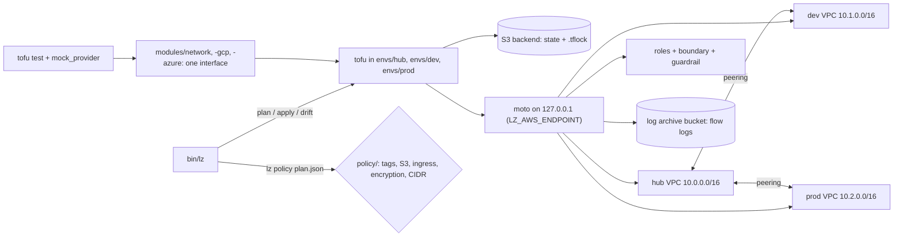

# A Landing Zone You Can Prove: Multi-Cloud IaC With Guardrails

*Ship a hub-and-spoke landing zone in OpenTofu with guardrails a grader can verify: real applies on moto, policy on plans, drift caught.*

## Metadata

| Field | Value |
|---|---|
| Type | Capstone |
| Languages | Python, YAML, HCL |
| Prerequisites | [Modules and Variables](https://cloudcaptain.io/learn/iac/modules-variables), [Remote State and Locking](https://cloudcaptain.io/learn/iac/remote-state-locking), [Drift Detection](https://cloudcaptain.io/learn/iac/drift-detection), [Policy as Code](https://cloudcaptain.io/learn/iac/policy-as-code), [IAM Policy Evaluator](https://cloudcaptain.io/learn/cloud/iam-policy-evaluator), [VPC Reachability](https://cloudcaptain.io/learn/cloud/vpc-reachability) |
| Time | 12 hours |
| Tools | tofu, moto, docker |
| Pass score | 11 of 15 points |

## The Brief

You are the first platform engineer at a company that has outgrown one AWS account with a default VPC. Product teams want their own environments, the security lead wants guarantees she can check rather than a wiki page, and the CFO wants every euro tagged to a cost center. Your lead hands you this:

> Build the landing zone: the network, identity and account baseline every team lands in. One hub network for shared services, two spokes (`dev` and `prod`) peered to it, private subnets in two zones, flow logs on, nothing open to the internet except HTTPS on load balancers. Two roles per environment, deploy and read-only, that can never leave our region or touch the account itself. A policy gate on every plan. Remote state with locking, and a drift report the on-call can read. We will add GCP and Azure next year, so the network module must have the same interface on all three clouds. And I want proof: a grader that runs it, not a slide.

The users are the product teams (who consume the spokes through the module outputs), the security lead (who reads the policy gate and the guardrails), and the on-call engineer (who runs `lz drift` at 3 a.m.).

**The interface the grader relies on.** Your repository has this layout, and the grader talks to it only through these paths and commands. It never imports your code, so the tooling may be any language as long as the contract holds.

```text
bin/lz                      executable; subcommands below
modules/network/            AWS network (VPC, subnets, security groups, flow logs)
modules/identity/           deploy and read-only roles, boundary, guardrail
modules/baseline/           account baseline (log archive bucket)
modules/network-gcp/        same inputs and outputs as modules/network, plus tests/*.tftest.hcl
modules/network-azure/      same, plus tests/*.tftest.hcl
envs/hub/ envs/dev/ envs/prod/   one root module each, S3 backend with locking
policy/                     the rules lz policy enforces
```

| Command | Contract |
|---|---|
| `bin/lz plan <env> --json` | init and plan `envs/<env>`, write `tofu show -json` of the plan to a file, print `{"env": ..., "plan_json": "<path>"}`; exit 0 |
| `bin/lz apply <env>` | init and apply `envs/<env>` without prompting; exit 0 |
| `bin/lz policy <plan.json> --json` | print `{"violations": [{"rule", "address", "message"}]}`; exit 1 on violations, 0 when clean, 2 on bad input |
| `bin/lz drift <env> --json` | refresh-only plan; print `{"env", "drifted", "resources": [{"address", "type", "id", "attributes"}]}`; exit 0 clean, 2 on drift |

Two more rules. When `LZ_AWS_ENDPOINT` is set (the grader sets `http://127.0.0.1:<port>`), every AWS provider and the S3 backend must use that endpoint with fake credentials, and `lz` must refuse an endpoint that is not on this machine. When `lz plan` or `lz apply` cannot get the state lock, it fails at once (`-lock-timeout=0s`, the default), exits 3 and, with `--json`, prints `{"error": "state-locked", "lock": {...}}`.

Fixed names the grader looks for: the region is `eu-central-1`; every taggable resource carries the tags `owner`, `env` (the folder name: `hub`, `dev` or `prod`) and `cost-center`; the VPC of an environment is the only VPC tagged with its `env`; the roles are `lz-<env>-deploy` and `lz-<env>-readonly`; the load-balancer security group is tagged `role = "load-balancer"`; the landing zone owns `10.0.0.0/8`.

**Out of scope.** Real AWS, GCP or Azure accounts (you may point the same code at one, see The Architecture), AWS Organizations and SCPs, Transit Gateway, NAT gateways, compute, DNS, and any CI system other than the workflow the grader ships.

**Install.** OpenTofu 1.10 or newer (`use_lockfile` and `mock_provider` both need it; the grader is tested with <ToolVersion name="opentofu" />), Docker (the grader runs moto from the `motoserver/moto:5.2.5` image), Python 3.9 or newer, and git. Copy `starter/` into a new repository and read its README.

## The Architecture



Every environment is a root module that calls three modules. `modules/baseline` creates the log archive bucket (encrypted, versioned, public access blocked). `modules/network` creates the VPC with private subnets `cidrsubnet(cidr_block, 4, i)` and public subnets `cidrsubnet(cidr_block, 4, 8 + i)` for zone `i`, an internet gateway that only the public route table uses, a load-balancer security group with HTTPS from anywhere, an app group that only accepts traffic from the load balancers, a default security group with no rules, and a flow log into the archive bucket. `modules/identity` creates the two roles, both with a permissions boundary and a guardrail policy of explicit denies.

The hub owns connectivity. It looks up the spoke VPCs by tag, creates a peering connection to each one that exists, and adds the routes on both sides. Spokes never reference the hub, so they plan and apply on their own, and the grader applies `dev` and `prod` before `hub`. Routes go into each spoke's main route table, which the spoke does not manage, so the hub's routes do not show up as drift in the spoke.

The AWS provider block that makes this testable lives in each env's `providers.tf` (the starter ships it):

```hcl
provider "aws" {
  region                      = var.region
  access_key                  = local.emulated ? "testing" : null
  secret_key                  = local.emulated ? "testing" : null
  skip_credentials_validation = local.emulated
  skip_requesting_account_id  = local.emulated
  skip_metadata_api_check     = local.emulated
  s3_use_path_style           = local.emulated

  endpoints {
    ec2 = var.aws_endpoint
    iam = var.aws_endpoint
    s3  = var.aws_endpoint
    sts = var.aws_endpoint
  }
}
```

`lz` sets `TF_VAR_aws_endpoint` from `LZ_AWS_ENDPOINT` and passes the backend the same endpoint with a `-backend-config` file (a backend block cannot read provider variables). With `LZ_AWS_ENDPOINT` unset, `aws_endpoint` is null, every endpoint falls back to AWS, the `skip_*` flags are false, and the same code plans against a real account with your normal credentials. Create the state bucket once by hand (versioned, encrypted) before the first `lz plan` against a real account; against moto, `lz` creates it.

**What moto does not prove.** moto stores what the API accepts and returns it; it is an emulator, not AWS. It does not evaluate IAM policies (unless you enable its optional auth mode), so the grader evaluates your policies itself with the logic from the IAM evaluator lesson. It has no Organizations SCPs that bite, no packets (a route to a peering connection is a row in a table, and flow logs never produce records), no eventual consistency, and no quotas. It accepts some requests real AWS refuses, such as a trust policy that names a principal which does not exist. Treat a green grade as "the design and the code are right", then run the same plan against a sandbox account before you trust it with production.

## Milestones

### Module structure

Write `modules/network`, `modules/identity` and `modules/baseline` as reusable modules: every variable has a `type` and a `description`, inputs that can be wrong have `validation` blocks (a CIDR outside `10.0.0.0/8`, fewer than two zones, missing tags), and every output has a description. Write `envs/hub`, `envs/dev` and `envs/prod` as thin root modules that call them. Reread [Modules and Variables](https://cloudcaptain.io/learn/iac/modules-variables).

The grader scans the `.tf` files of the three modules for `variable` and `output` blocks, then runs `tofu fmt -check -recursive` on `modules/` and `envs/`, and `tofu init -backend=false` plus `tofu validate -json` in every folder under them. It fails with the variable, file or diagnostic that is wrong.

Hint: `try()` keeps a validation condition from erroring on malformed input, so `try(cidrhost("${split("/", var.cidr_block)[0]}/8", 0) == "10.0.0.0", false)` is a safe "inside 10/8" test.

### Network baseline

Fill `modules/network` and the env roots: the three VPCs from variables (`10.0.0.0/16`, `10.1.0.0/16`, `10.2.0.0/16` work), private subnets in at least two zones, no security group ingress from `0.0.0.0/0` or `::/0` except TCP 443 on the group tagged `role = "load-balancer"`, flow logs on every VPC, and the hub peered with both spokes with routes on both sides. Reread [VPC Reachability](https://cloudcaptain.io/learn/cloud/vpc-reachability) for route tables, security groups and peering.

The grader starts moto, resets it, runs `bin/lz apply dev` and `bin/lz apply prod` in parallel, then `bin/lz apply hub`, and reads the real objects back over moto's EC2 API with SigV4-signed requests. It asserts: one VPC per `env` tag, ranges inside `10.0.0.0/8` that do not overlap; at least two private subnets in two zones per VPC (a subnet is private when its route table has no `0.0.0.0/0` route to an internet gateway and it does not map public IPs); no world-open ingress except the load-balancer case; a flow log per VPC; an active peering between the hub and each spoke, and routes to the other side's range through it.

Hint: give the hub a `data "aws_vpcs"` lookup per spoke and peer only with spokes it finds (`for_each` over the found IDs). Then a hub applied before its spokes is not an error, just a hub without peers until its next apply.

### Identity guardrails

Fill `modules/identity`: roles `lz-<env>-deploy` and `lz-<env>-readonly`, a least-privilege policy for each, a permissions boundary on every role, and a guardrail policy of explicit denies: everything outside the allowed regions (with global services such as IAM exempt) and account-level actions (`organizations:*`, `account:*`, creating users or access keys, removing a permissions boundary). Reread [IAM Policy Evaluator](https://cloudcaptain.io/learn/cloud/iam-policy-evaluator).

The grader applies `dev` on a fresh moto and reads every role tagged `env = dev` back through the IAM API (`GetRole`, `ListAttachedRolePolicies`, `GetPolicyVersion`, `ListRolePolicies`, `GetRolePolicy`). Each role must have a boundary, and no policy or boundary may Allow `Action: "*"` on `Resource: "*"` (or `NotAction` on everything). Then it evaluates eleven requests with the evaluator logic from the IAM lesson (explicit deny, identity allow, boundary): the deploy role may `ec2:CreateVpc` in `eu-central-1` but gets an explicit deny in `us-east-1`; neither role may `iam:CreateUser` or remove its boundary; `organizations:LeaveOrganization` and `account:PutAlternateContact` are explicitly denied even from the home region; the read-only role may describe VPCs and read IAM (from `us-east-1`, where IAM answers) and may not create or write anything.

Hint: write the guardrail once with `data "aws_iam_policy_document"` and reuse it in the boundary through `source_policy_documents`, so the boundary and the attached guardrail can never disagree.

### Policy as code on plans

Write the gate in `policy/` and wire it to `bin/lz policy`. It must enforce at least these rules, with exactly these rule IDs, and report the resource address the problem belongs to:

| Rule ID | Fails when | Address reported |
|---|---|---|
| `required-tags` | a created or updated resource with a `tags` attribute lacks a non-empty `owner`, `env` or `cost-center` in `tags_all` | the resource |
| `no-public-s3` | an `aws_s3_bucket` has no `aws_s3_bucket_public_access_block` with all four settings true, or has a public ACL | the bucket |
| `no-open-ingress` | an `aws_security_group` ingress allows `0.0.0.0/0` or `::/0`, except TCP 443 on a group tagged `role = "load-balancer"` | the security group |
| `encryption` | an `aws_s3_bucket` has no server-side encryption configuration (AES256 or aws:kms), or an `aws_ebs_volume` has `encrypted = false` | the bucket or volume |
| `cidr-allocation` | an `aws_vpc` or `aws_subnet` range is outside `10.0.0.0/8` | the VPC or subnet, with its index |

Reread [Policy as Code](https://cloudcaptain.io/learn/iac/policy-as-code). A bucket's companion resources reference it by `bucket = aws_s3_bucket.x.id`, and the bucket ID is unknown at plan time, so match them through `configuration` (each resource's `expressions.bucket.references`) within the same module instance, or by the bucket name in `after.bucket` when it is known.

The grader runs `bin/lz policy <fixture> --json` on thirteen plan JSON files in `grader/fixtures/plans/` (one compliant plan and twelve with one planted problem each, including a bucket inside `module.buckets["audit"]`), expecting exit 1 and the right rule on the right address for each bad plan, and exit 0 with no violations for the clean one. Then it runs `bin/lz plan <env> --json` for all three envs against an empty moto and requires each plan JSON to contain an `aws_vpc` and to pass your own policy.

Hint: build the gate as one function per rule that yields violations, and test each rule on a hand-written five-line plan before you point it at a real one.

### Same interface on GCP and Azure

Write `modules/network-gcp` (Google provider) and `modules/network-azure` (azurerm provider) with the same inputs (`name`, `env`, `region`, `cidr_block`, `zones`, `tags`, `flow_log_destination`) and the same outputs (`network_id`, `cidr_block`, `private_subnet_ids`, `private_subnet_cidrs`, `public_subnet_ids`, `public_subnet_cidrs`, `public_ingress_ports`) as `modules/network`. Each gets `tests/*.tftest.hcl` with `mock_provider` and at least three `run` blocks: subnet math, no public ingress except 443, and an input the validation rejects (`expect_failures`). Reread [Modules and Variables](https://cloudcaptain.io/learn/iac/modules-variables) on module contracts.

The grader scans the three modules for the shared inputs and outputs, counts your `run` blocks and `mock_provider` declarations, then copies the project, adds its own test file (`tests/cc_grader_interface.tftest.hcl` with `mock_provider` for the module's cloud) to each of the three modules and runs `tofu test`. Its test checks the outputs on a `10.42.0.0/16` network with two and three zones, `public_ingress_ports == [443]`, and that `192.168.0.0/16` fails validation. No cloud credentials are present; `tofu init` downloads the providers so `tofu test` has their schemas. The azurerm provider parses resource IDs at plan time and rejects the random strings a mock generates, so the grader's Azure mock sets realistic `id` defaults (`mock_resource` blocks) for `azurerm_resource_group`, `azurerm_virtual_network`, `azurerm_subnet`, `azurerm_network_security_group`, `azurerm_route_table`, `azurerm_public_ip` and `azurerm_nat_gateway`; reference the IDs of other types and your module fails the grader's test. Your own Azure tests need the same `mock_resource` defaults.

Hint: compare lists with `jsonencode(a) == jsonencode(b)` in assertions; `==` between a list and a tuple literal is false even when the elements match.

### Remote state and drift

Give every env an S3 backend on moto with locking. OpenTofu 1.10 and newer support `use_lockfile = true` (a `.tflock` object next to the state, written with a conditional `If-None-Match` PUT) as well as a DynamoDB table; either works here. Implement `lz drift` on a refresh-only plan. Reread [Remote State and Locking](https://cloudcaptain.io/learn/iac/remote-state-locking) and [Drift Detection](https://cloudcaptain.io/learn/iac/drift-detection).

The grader applies `dev` from one copy of your project and requires a `*.tfstate` object in an S3 bucket on moto. It starts `bin/lz plan dev --json` from that copy, waits until a lock exists (a `.tflock` object or a DynamoDB item with `Info`), pauses that process with `SIGSTOP`, and runs `bin/lz plan dev --json` from a second copy: that one must exit 3 with `"error": "state-locked"`. It resumes the first plan, which must succeed and release the lock. Then `bin/lz drift dev --json` must report no drift; the grader changes the `owner` tag of the dev VPC through moto's `CreateTags`, and `bin/lz drift dev --json` must exit 2 and list that VPC's ID with an attribute path containing `tags` and `owner`.

Hint: `resource_drift` in `tofu show -json` of a refresh-only plan holds `before` and `after` per drifted resource; a recursive diff of the two gives you `tags.owner` and `tags_all.owner`. Expect noise right after an apply: companion resources change computed attributes of the resource they attach to (`versioning` and `server_side_encryption_configuration` on `aws_s3_bucket`, `attachment_count` on `aws_iam_policy`, `managed_policy_arns` on `aws_iam_role`, `route` on `aws_route_table`) after OpenTofu recorded it. End `lz apply` with `tofu apply -refresh-only -auto-approve` so the state holds what the apply really produced.

## Grading

Grade your project from a clone of CloudCaptain at any time:

```bash
bash curriculum/phases/16-capstones/03-landing-zone/grader/grade.sh path/to/your-project
bash curriculum/phases/16-capstones/03-landing-zone/grader/grade.sh path/to/your-project --milestone policy-gate
bash curriculum/phases/16-capstones/03-landing-zone/grader/grade.sh path/to/your-project --json
```

The grader needs `tofu`, `docker` and `python3` on the PATH. It starts `motoserver/moto:5.2.5` itself as a container named `cc-grade-lz-moto-<pid>` on a random port of `127.0.0.1`, resets it before each milestone and removes it when it exits. If you already run moto locally (`pip install 'moto[server]==5.2.5'`, then `moto_server -p 5000`), set `LZ_AWS_ENDPOINT=http://127.0.0.1:5000` and the grader uses and resets yours instead. Providers are cached in `~/.cache/cloudcaptain-grader/tofu-plugins` (or `TF_PLUGIN_CACHE_DIR`), so only the first run downloads the AWS, Google and Azure providers. A full run takes a few minutes; `--milestone` runs one check.

To grade every push, copy `grader/workflow.yml` to `.github/workflows/cloudcaptain-grade.yml` in your project repository. It checks out your project and the grader, installs Python and OpenTofu, caches the providers on your lock files, and writes the score table to the run's summary page.

The grader's safety rules:

- It talks only to `127.0.0.1` or `localhost`. It refuses any other `LZ_AWS_ENDPOINT`, removes every `AWS_*` variable from the environment it gives your tools, and sets fake credentials, `AWS_ENDPOINT_URL` and empty AWS config files, so a missing endpoint override reaches moto, never AWS. It checks that the endpoint answers like moto before using it.
- It never touches your working tree: every milestone works on a fresh copy of the project in a temporary folder (without `.terraform/`, `.lz/` or state files) and deletes it afterwards.
- Containers it starts are named `cc-grade-lz-*`, labelled `cloudcaptain.grader=landing-zone` and removed on exit, including on Ctrl-C and SIGTERM.
- Every command runs with a timeout, and every wait polls with a deadline. A missing tool or a stub command fails its milestone within seconds with what to install or implement.

## Ship It

You keep a landing zone you can explain line by line, a policy gate you can run in any pipeline, and two artifacts in `outputs/`:

- `skill-landing-zone-review.md`: a runbook an agent follows to review a landing zone change: run the plan, the policy gate, the identity evaluation and the drift report, then decide with a table.
- `prompt-explain-guardrail-violation.md`: a prompt that turns one `lz policy` violation or one denied IAM request into a short explanation for the engineer who hit it, with the fix.

<ShipIt />

## Stretch Goals

- Add a Transit Gateway in the hub and move the spokes from peering to attachments; extend the network check in your own tests to assert the attachment routes.
- Run moto with `INITIAL_NO_AUTH_ACTION_COUNT` set so it evaluates IAM, then prove that the read-only role really cannot create a VPC by assuming it with the AWS CLI.
- Port the policy gate to Rego and run it with `conftest` on the same thirteen fixtures; diff the verdicts against your Python gate.
- Add OpenTofu state encryption (`encryption` block with a PBKDF2 key provider) and show that the `.tfstate` object in the bucket is unreadable without the passphrase.
- Turn `lz drift` into a nightly workflow that opens or updates one issue per drifted resource, keyed on address and attribute.
- Apply the AWS envs to a sandbox account with the same code and compare: which requests did moto accept that AWS refused?

<Quiz stage="post" />

## Further Reading

- [Terraform Advanced](https://cloudcaptain.io/docs/tools/terraform/advanced): modules, remote state and workspaces, the building blocks of every env root here.
- [AWS Compute and Networking](https://cloudcaptain.io/docs/cloud/aws/compute-networking): VPCs, subnets, route tables, security groups and peering in AWS terms.
- [AWS Security and IAM](https://cloudcaptain.io/docs/cloud/aws/security-iam): roles, policies, permissions boundaries and SCPs.
- [OpenTofu: tofu test](https://opentofu.org/docs/cli/commands/test/): `run` blocks, `expect_failures`, `mock_provider` and `override_resource`, with the exact syntax this capstone uses.
- [OpenTofu: s3 backend](https://opentofu.org/docs/language/settings/backends/s3/): `use_lockfile`, DynamoDB locking, endpoints and the `skip_*` options for emulators.
- [AWS Control Tower: the multi-account landing zone](https://docs.aws.amazon.com/controltower/latest/userguide/aws-multi-account-landing-zone.html): how AWS builds a landing zone with separate accounts, organizational units and SCPs, the production version of the one-account design here.
- [moto server mode](https://docs.getmoto.org/en/latest/docs/server_mode.html): how one moto process serves every service, how to reset it, and its IAM auth option.
- [IAM permissions boundaries](https://docs.aws.amazon.com/IAM/latest/UserGuide/access_policies_boundaries.html): how a boundary intersects with identity policies, the logic the identity check evaluates.
