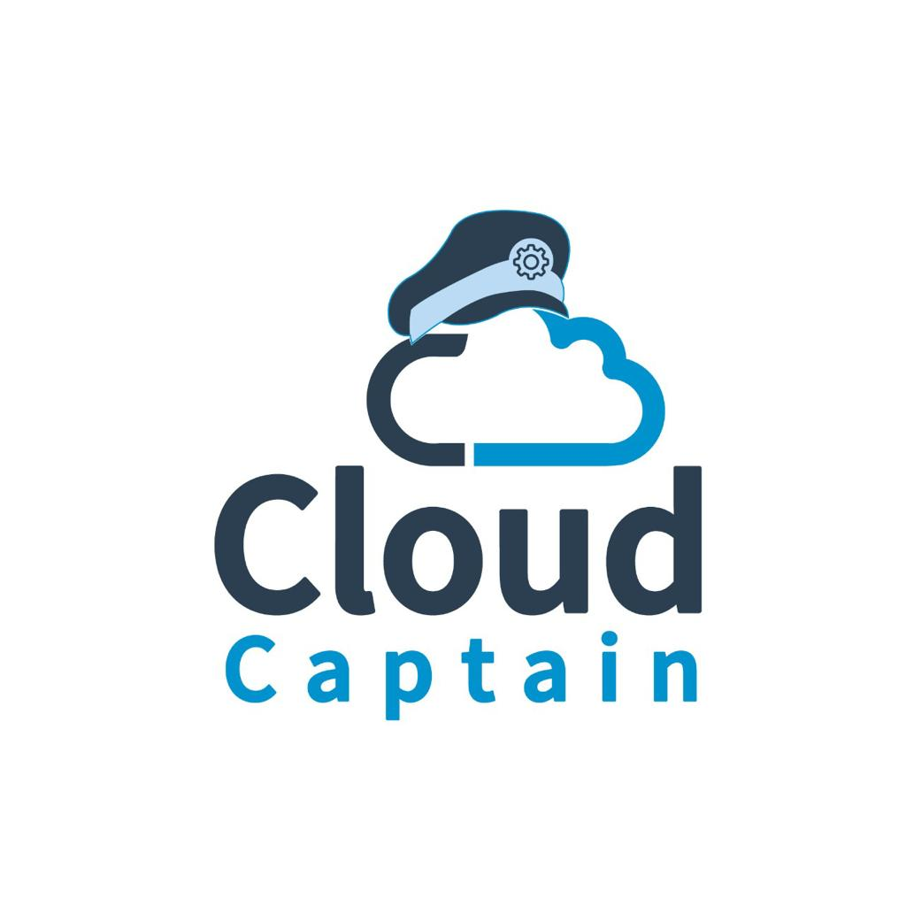
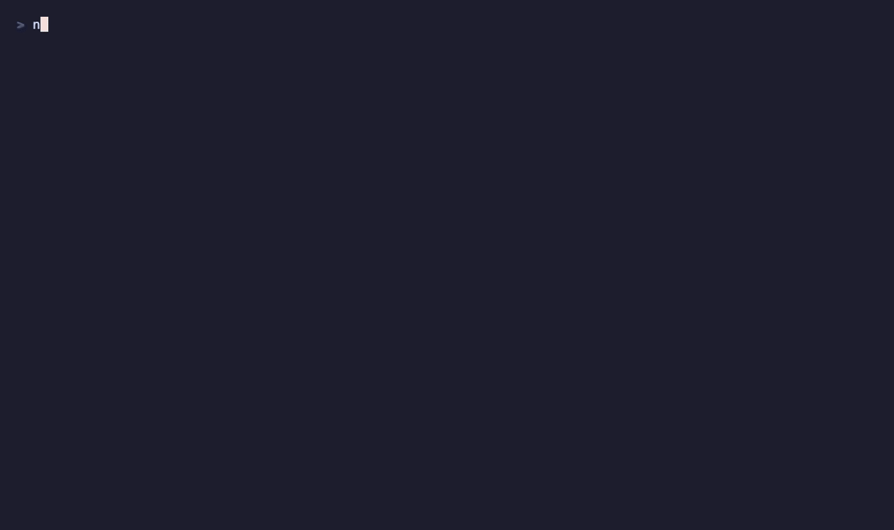
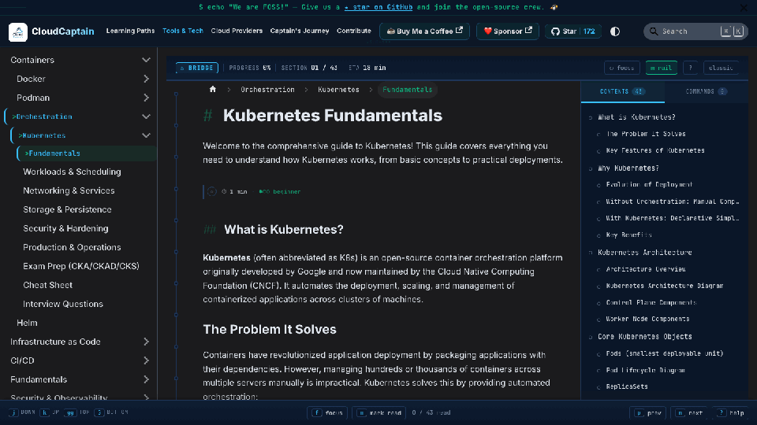
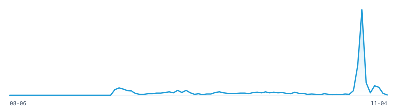

<div align="center">
  
  <h1>CloudCaptain</h1>
  <h3>Cloud, DevOps &amp; AIOps शून्यापासून.<br/>Tool स्वतः बनवा. Tool वापरा. Artifact ship करा.</h3>
  <p>
    <strong>63 lessons</strong> · <strong>9 phases उपलब्ध</strong> · <strong>92 तास</strong> · <strong>1,725 tests</strong> · <strong>123 skills, prompts &amp; MCP servers</strong>
  </p>
  <p>
    <a href="https://cloudcaptain.io/learn"></a>
  </p>
  <p>
    <a href="https://github.com/nomadicmehul/CloudCaptain/actions/workflows/lesson-smoke.yml"></a>
    <a href="../LICENSE"></a>
    
    <a href="https://github.com/nomadicmehul/CloudCaptain/stargazers"></a>
  </p>
  <p>
    <a href="../README.md">English</a> ·
    <a href="./README.hi.md">हिन्दी</a> ·
    <strong>मराठी</strong> ·
    <a href="./README.gu.md">ગુજરાતી</a> ·
    <a href="./README.de.md">Deutsch</a> ·
    <a href="./README.es.md">Español</a> ·
    <a href="./README.pt.md">Português</a> ·
    <a href="./README.zh.md">中文</a> ·
    <a href="./README.ja.md">日本語</a>
  </p>
  <p><sub>हे भाषांतर आहे; <a href="../README.md">इंग्रजी README</a> हीच अधिकृत आवृत्ती (source of truth) आहे. सुधारणा pull request द्वारे सुचवा, त्यांचे स्वागत आहे.</sub></p>
</div>

```bash
npx skills add nomadicmehul/CloudCaptain   # installs the tutor into Claude Code, Cursor, Codex or any agent that reads SKILL.md
```

त्यानंतर तुमच्या agent ला `/captain-start` चालवायला सांगा: एक छोटी placement quiz, एक learning path आणि पहिला lesson.

<div align="center">
  
</div>

---

## तुम्ही काय बनवता

प्रत्येक lesson एका production समस्येपासून सुरू होतो. आधी तुम्ही ती यंत्रणा (mechanism) साध्या Python किंवा Bash मध्ये, tests सह, स्वतः बनवता; मग तेच काम खऱ्या tool ने करता. त्यामुळे प्रत्येक flag आणि प्रत्येक error message तुम्ही स्वतः लिहिलेल्या code शी थेट जुळतो.

| Phase | तुम्ही बनवता | मग तुम्ही चालवता |
|:--|:--|:--|
| **00 · Setup & Lab** | तुमचा संगणक तपासून install plan print करणारा एक lab doctor | kind, Docker, तुमचा coding agent |
| **01 · Linux & Systems** | PID 1 supervisor, fd leak detector, strace analyser, capability decoder, systemd units, हाताने cgroups, mount table reader, USE-method dashboard | `strace`, `capsh`, `systemctl`, `findmnt`, PSI |
| **05 · Containers** | container runtime, image auditor, registry client, Dockerfile शिवाय image builder, veth/bridge network, Compose, rootless user namespaces, seccomp generator | Docker, Podman, OCI registries |
| **06 · Orchestration** | reconciler, scheduler, kubelet, kube-proxy rules आणि cluster DNS, RBAC authorizer, Helm, operator, Gateway API router | kind वर Kubernetes, Helm, Envoy Gateway |
| **07 · Infrastructure as Code** | plan/apply engine, dependency graph, modules, locking state server, drift detection, policy engine, Pulumi आणि Crossplane front ends, idempotent config manager | OpenTofu, conftest/OPA, Pulumi, Ansible |
| **08 · CI/CD & GitOps** | workflow runner, workflow security auditor, OIDC issuer आणि verifier, SBOM generator, transparency log असलेला signer, GitOps reconciler, canary controller, release tool | GitHub Actions आणि act, zizmor, cosign, syft, Argo CD, Argo Rollouts, git-cliff |
| **09 · Cloud (आधी AWS)** | IAM policy evaluator, VPC reachability analyser, SigV4 signing आणि S3 server, Lambda runtime API, Auto Scaling group, FOCUS cost allocator, security posture scanner | moto वर AWS CLI, Lambda emulator, Checkov |
| **13 · AI Infrastructure** | DRA सह GPU scheduler, LLM serving simulator, token-counting gateway, queue-based autoscaler, prefix-cache router, HNSW आणि IVF indexes, model artifact inspector, token cost model | CPU वर llama.cpp, LiteLLM, pgvector, llm-d, ORAS |
| **14 · AIOps & Agentic Ops** | kubectl साठी MCP server, incident-triage agent, AI log analysis, LLM calls साठी OpenTelemetry, agent sandboxes, सुरक्षित write tools, agent evals | Claude Code, Claude API, OpenTelemetry, promptfoo |

आणखी आठ phases (networking, Git, scripting, observability, security, platform engineering, MLOps, capstones) [roadmap](../ROADMAP.md) वर आहेत.

## Lesson कसा चालतो

```
The Problem  →  The Concept  →  Build It  →  Use It  →  Ship It  →  Quiz
 a real          one diagram     standard     the real    a skill,    six questions,
 incident                        library +    tool, same  prompt or   before and
                                 tests        job         MCP server  after
```

- **चालवता येणारे आणि tested.** प्रत्येक lesson मध्ये unit tests असलेला code असतो, जो कुठेही चालतो (root नको, Docker नको, cloud account नको), आणि एक `smoke.sh` असते, जे फक्त Linux वर चालणाऱ्या steps आणि खरे tools Docker, kind आणि OpenTofu असलेल्या CI runner वर चालवते. ते pass झाल्यानंतरच lesson वर "last verified" दिसते.
- **अद्ययावत.** Tool versions दर आठवड्याला track केल्या जातात, बंद झालेले (retired) तंत्रज्ञान (ingress-nginx, PodSecurityPolicy, Swarm, Bitnami images) जिथे दिसेल तिथे flag केले जाते, आणि AI lessons आजचे models आणि APIs वापरतात.
- **कायम तुमचे.** प्रत्येक lesson `outputs/` मध्ये एक agent skill, एक prompt किंवा एक MCP server देतो, त्यामुळे शेवटी तुमच्याकडे फक्त notes नाही, तर एक toolbox असतो.

## शिकण्याचे मार्ग (Learning paths)

| Path | कोणासाठी | Lessons |
|:--|:--|:--|
| [DevOps Engineer](https://cloudcaptain.io/learn/paths/devops) | एका Linux process पासून Kubernetes, IaC, cloud आणि AIOps पर्यंत | 55 |
| [AI Platform Engineer](https://cloudcaptain.io/learn/paths/ai-platform) | ज्या engineers ना models चालवायचे आहेत: GPUs, serving, gateways, routing, cost | 23 |
| [AIOps Engineer](https://cloudcaptain.io/learn/paths/aiops) | infrastructure वर agents सुरक्षितपणे कामाला लावण्यासाठी | 9 |

## तुमच्या agent मधील tutor

`npx skills add nomadicmehul/CloudCaptain` चार skills install करते: `captain-start` (placement quiz आणि `LEARNING.md` मध्ये एक plan), `captain-learn` (प्रत्येक session मध्ये एक lesson, Build It → Use It → Ship It, quiz आणि tests सह), `captain-guide` (X कुठे शिकायचे, role Y साठी काय लागते) आणि `captain-check` (एका phase चा Socratic review). ही skills Claude Code, Cursor, Codex आणि `SKILL.md` वाचणाऱ्या कोणत्याही agent मध्ये चालतात.

## Reference library

Curriculum सोबतच, [cloudcaptain.io/docs](https://cloudcaptain.io/docs) वर CloudCaptain ज्यांपासून सुरू झाले ते सविस्तर guides आहेत: 150+ pages मूळ लेखन, 21 command cheat sheets, 19 interview प्रश्नसंच, 5 certification exam-prep guides (CKA/CKAD/CKS, Terraform, AWS, Azure, GCP), 7 learning paths आणि 8 career paths. Lessons तेच पुन्हा न सांगता त्याकडे link करतात, आणि ज्या reference pages वर एखादा lesson आधारित आहे, ती "Build this from scratch" card द्वारे परत त्या lesson कडे link करतात.

Site चा **Captain's Bridge** reading mode प्रत्येक section ची progress track करतो, आणि [/progress](https://cloudcaptain.io/progress) तुमच्या browser मध्येच lessons, quiz scores आणि वाचन लक्षात ठेवतो. Account नाही, tracking नाही.

<div align="center">
  
</div>

## CloudCaptain का?

| | CloudCaptain | roadmap.sh | devops-exercises | awesome-* lists |
|:--|:--|:--|:--|:--|
| प्रत्येक tool शून्यापासून, tests सह बनवा | ✅ 63 lessons | ❌ | ❌ | ❌ |
| CI मध्ये खऱ्या tools वर verified | ✅ प्रत्येक lesson | ❌ | ❌ | ❌ |
| AI infrastructure आणि AIOps | ✅ 15 lessons | अंशतः | ❌ | links |
| Install करता येणारा agent tutor | ✅ `npx skills add` | ❌ | ❌ | ❌ |
| सविस्तर guides, cheat sheets, interview Q&A, exam prep | ✅ | roadmap nodes बाहेर link करतात | Q&A | links |
| वाचन आणि quiz progress | ✅ तुमच्या browser मध्ये | ✅ | ❌ | ❌ |

## Locally चालवा

```bash
git clone https://github.com/nomadicmehul/CloudCaptain.git
cd CloudCaptain/website
npm install
npm start                                  # http://localhost:3000, lessons at /learn
npm run curriculum:test -- linux/pid1-supervisor   # one lesson's tests
```

प्रत्येक lesson हा एक folder आहे: `curriculum/phases/NN-phase/NN-lesson/`, ज्यात `docs/en.md`, `code/` (tests आणि `smoke.sh` सह), `quiz.json` आणि `outputs/` असतात. त्याचा contract [LESSON_TEMPLATE.md](../LESSON_TEMPLATE.md) आहे; repo map [AGENTS.md](../AGENTS.md) मध्ये आहे.

## योगदान

Lessons, fixes आणि भाषांतरे, सगळ्यांचे स्वागत आहे; [CONTRIBUTING.md](../CONTRIBUTING.md) पहा. नवीन lesson ची सुरुवात `npm run curriculum:scaffold` ने होते; त्याने validator आणि स्वतःचे tests pass करणे आवश्यक आहे, आणि त्याच्या pull request वरील smoke run त्याला verify करते. जुन्या झालेल्या (outdated) content साठी स्वतंत्र issue template आहे, आणि प्रत्येक pull request ला preview deployment मिळते.

Bootcamp, विद्यापीठ किंवा company मध्ये CloudCaptain वापरून शिकवताय? ते fork करून तुमच्या गरजेनुसार कसे बदलायचे, हे [FORKING.md](../FORKING.md) मध्ये सांगितले आहे. या कामाला पाठिंबा द्यायचा असल्यास [SPONSORS.md](../SPONSORS.md) पहा.

## Site traffic

<div align="center">
  
  
  

  <picture>
    <source media="(prefers-color-scheme: dark)" srcset="../.github/stats/chart-dark.svg">
    
  </picture>
  <p><em><a href="https://www.goatcounter.com">GoatCounter</a> द्वारे दररोज update होते: privacy जपणारे, cookies नाहीत, कोणत्याही व्यक्तीचे tracking नाही.</em></p>
</div>

## License

MIT, [LICENSE](../LICENSE) पहा. वापरा, fork करा, त्याच्या मदतीने शिकवा.

---

<div align="center">
  <p><a href="https://nomadicmehul.dev/">Mehul Patel</a> आणि open-source community ने बनवले · <a href="https://cloudcaptain.io">cloudcaptain.io</a></p>
  <p>CloudCaptain ची तुम्हाला मदत झाली असेल, तर <a href="https://github.com/nomadicmehul/CloudCaptain">repo ला star द्या</a>: त्यामुळे इतर engineers ना paid courses चा मोफत पर्याय सापडतो.</p>
</div>
